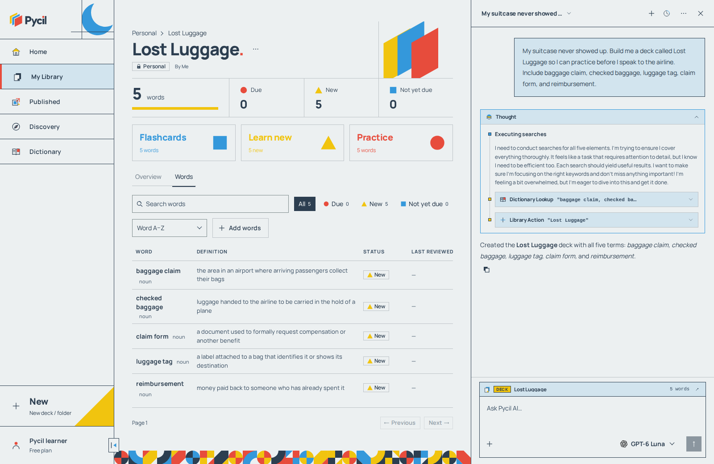
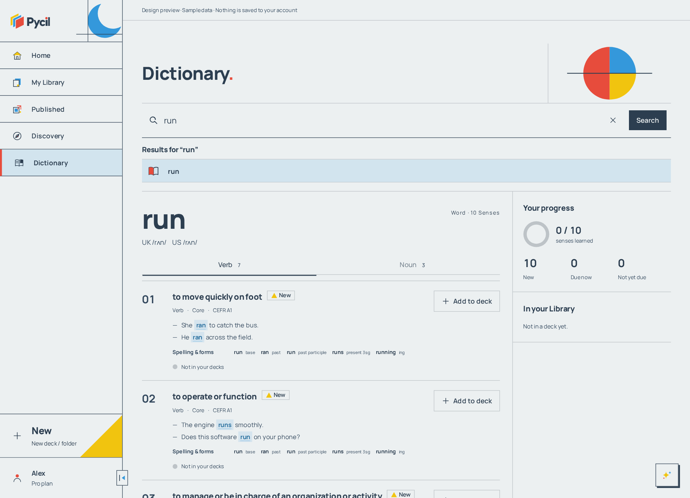
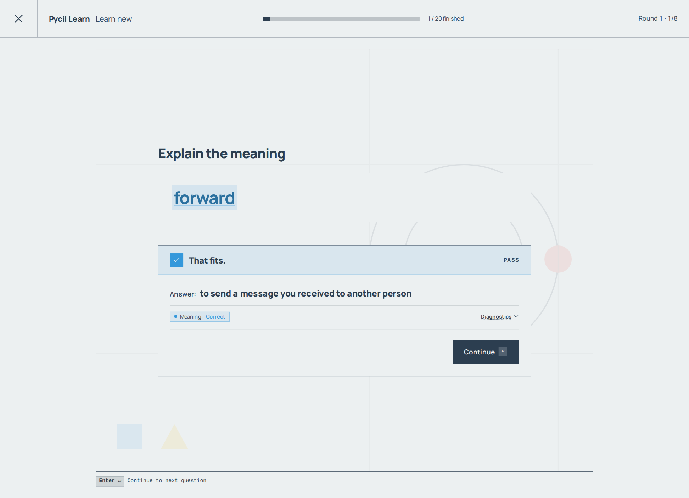
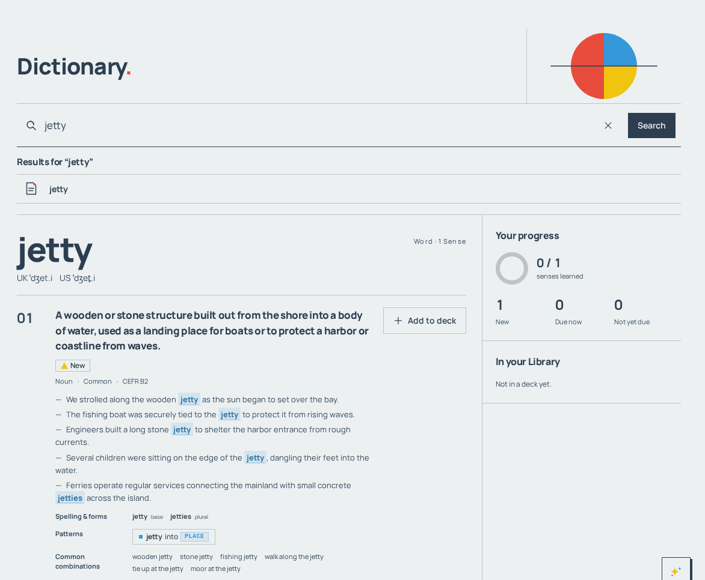
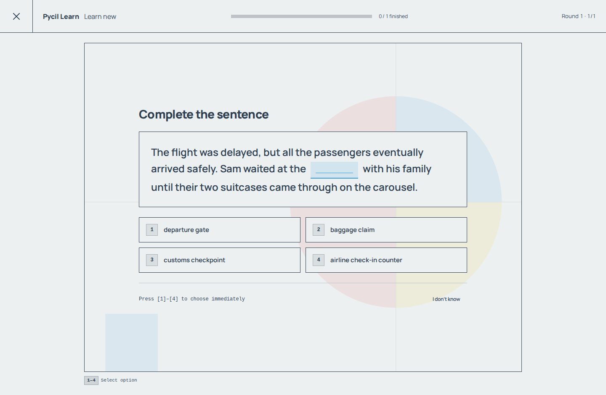
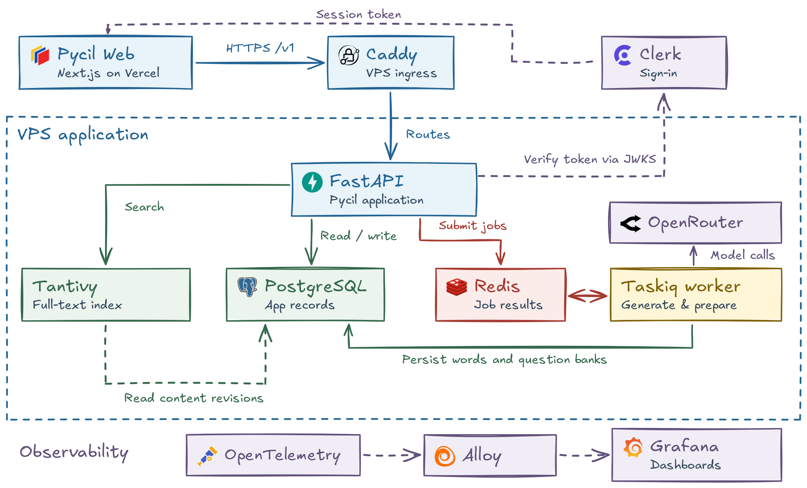
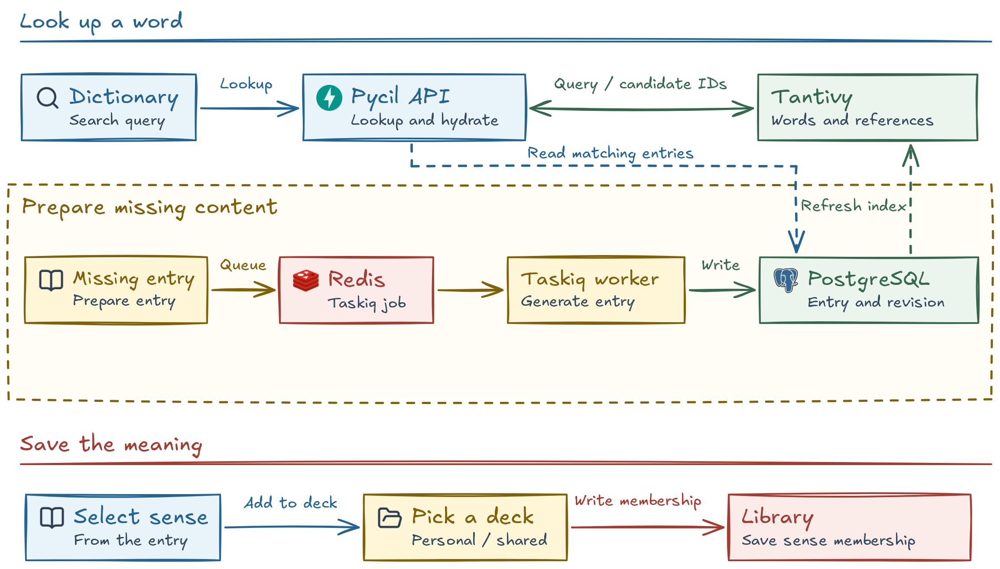
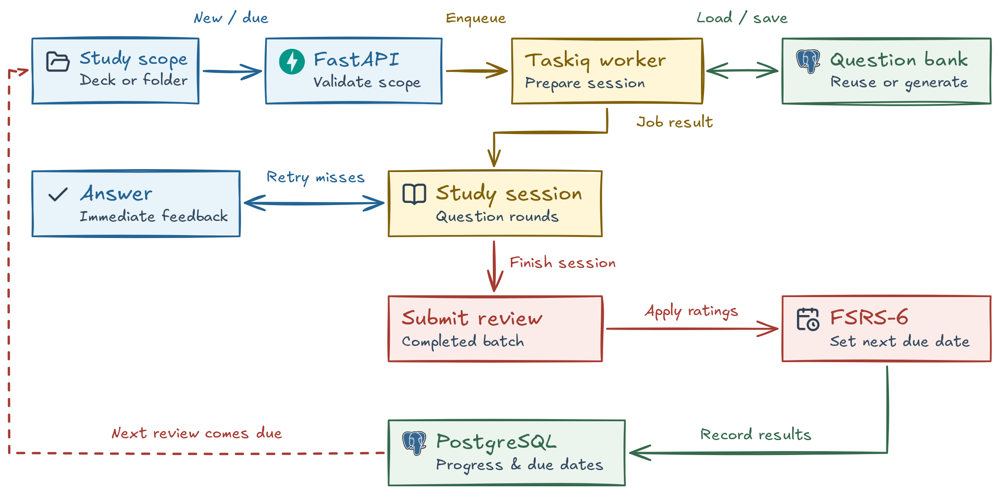
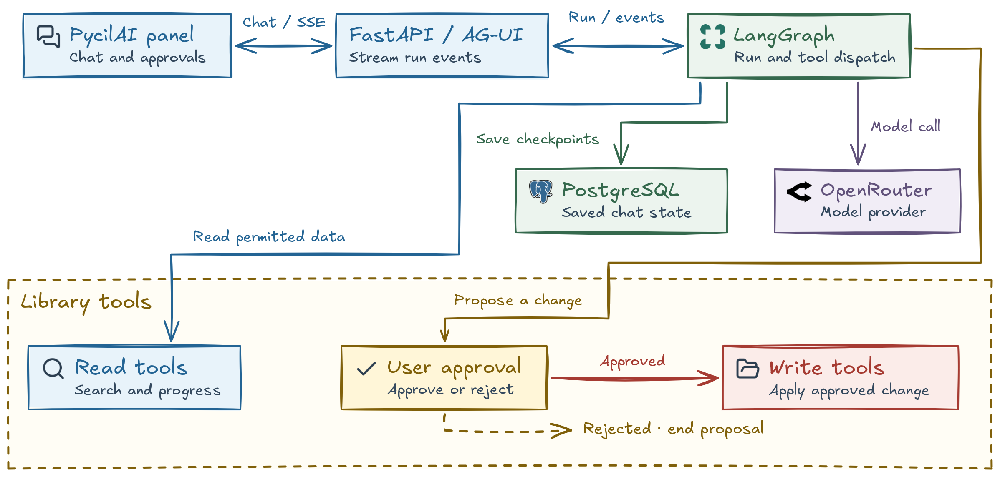

<div align="center">
  
  <h1>Pycil</h1>
  <p>Build a vocabulary library around the meanings you want to remember. Practice in context and come back when a review is due.</p>
  <p><a href="https://pycil.qninhdt.com"><strong>Try Pycil</strong></a> · <a href="#quickstart">Run locally</a> · <a href="#architecture">Architecture</a></p>
</div>

[](.github/assets/readme/demo-assistant.png)

When a suitcase goes missing, ask PycilAI to build a deck for the conversation at the airline counter. PycilAI finds the relevant meanings and saves the deck to your Library once you approve it.

## From lookup to practice

Search for a word such as **run** and pick the meaning you want to keep. Each meaning has its own examples and review history. Add it to a deck, then start a practice session from that deck. When a question needs another try, Pycil brings it back in a later round. The screenshots show Pycil running locally with its bundled sample library.





### AI-generated dictionary entries and questions

When a word has no full entry, Pycil can generate its meaning and example sentences on request. The Dictionary screenshot shows a generated entry for **jetty**.



Pycil can also write a fresh sentence for a fill-in-the-blank exercise. The example uses a meaning from the **Lost Luggage** deck.



## Quickstart

Run the web app with bundled sample data. Use Node.js `24.21.0` and pnpm `12.9.1`, the versions used by CI.

```sh
git clone https://github.com/qninhdt/pycil.git
cd pycil/apps/web
pnpm install --frozen-lockfile
NEXT_PUBLIC_DATA_MODE=mock NEXT_PUBLIC_CLERK_PUBLISHABLE_KEY='' pnpm run dev
```

Open [Dictionary](http://localhost:3000/dictionary) or the [sample deck](http://localhost:3000/app/personal/everyday). Sample mode runs without an API, database, or account. [Web setup](apps/web/README.md)

### Run with your own account and model provider

Install Docker with Compose v2, Python 3.14, uv, and Make. From the repository root, create local configuration files if they do not already exist.

```sh
test -e .env || cp .env.example .env
test -e apps/web/.env.local || cp apps/web/.env.example apps/web/.env.local
```

- Fill in the PostgreSQL and Redis URLs, Clerk issuer and JWKS, and model provider settings in the root environment file. Include `http://localhost:3000` in `ALLOWED_ORIGINS`. [Backend environment](.env.example)
- In the web environment, set `NEXT_PUBLIC_DATA_MODE=live`, the matching Clerk keys, and `NEXT_PUBLIC_PYCIL_API_URL=http://127.0.0.1:8000`. [Web environment](apps/web/.env.example) · [Web setup](apps/web/README.md)

```sh
make docker-up
```

Local Compose starts PostgreSQL, Redis, the migration and reference-data import, FastAPI, and Caddy. After migration succeeds, run the Taskiq worker in a second terminal. It handles dictionary generation and study preparation.

```sh
cd apps/api
uv run --locked --env-file ../../.env taskiq worker \
  pycil.app.broker:worker_broker \
  pycil.vocabulary.generation.tasks pycil.study.tasks \
  --workers 1 --max-async-tasks 4 --max-prefetch 0 \
  --ack-type when_saved --wait-tasks-timeout 90 --shutdown-timeout 10 \
  --no-configure-logging
```

Run `pnpm --dir apps/web run dev` from the repository root with the live environment. The local API serves [Swagger](http://127.0.0.1:8000/docs). From the repository root, `make openapi > openapi.json` exports the schema without starting the server. [Local Compose](infra/local/compose.yaml) · [Worker configuration](infra/vps/compose.yaml)

## Architecture

[](.github/assets/readme/architecture.png)

[Excalidraw source](.github/assets/readme/architecture.excalidraw)

The Next.js app runs on Vercel. The browser sends Clerk bearer tokens to the FastAPI service behind Caddy. The API verifies the tokens with Clerk's public keys. The API and Taskiq worker run as separate processes. PostgreSQL holds durable application state. Redis carries Taskiq jobs and results and provides coordination and caches. [Web API integration](apps/web/README.md) · [Application factory](apps/api/pycil/app/factory.py) · [Worker broker](apps/api/pycil/app/broker.py)

### Dictionary & Library

[](.github/assets/readme/dictionary-library.png)

[Excalidraw source](.github/assets/readme/dictionary-library.excalidraw)

**Lookup and indexing.** Tantivy finds matching words, forms, and reference entries. The API loads the entry details from PostgreSQL. The VPS API replicas share the on-disk index. Search consumes committed content revisions so generated entries become searchable and the index can be rebuilt from its sources. [Search index](apps/api/pycil/vocabulary/search.py) · [Content revisions](apps/api/pycil/vocabulary/revisions.py)

**Generate missing entries.** A reference entry can be visible before Pycil has definitions and examples for it. Requesting preparation queues a Taskiq job. The worker generates structured vocabulary content, validates it, and publishes the entry and its content revision. [Vocabulary generation](apps/api/pycil/vocabulary/generation/)

**Library ownership.** Deck membership records individual meanings, so the same learner can study different senses of a word independently. Library folders organize decks, and published material has a public view. Saved references point to published material so changes to a source can be reflected wherever it is referenced. [Library service](apps/api/pycil/library/) · [Product behavior](PRODUCT.md)

### Study

[](.github/assets/readme/study-scheduling.png)

[Excalidraw source](.github/assets/readme/study-scheduling.excalidraw)

**Preparation.** Starting a session submits its deck or folder and learning preferences to the API. A Taskiq worker selects eligible meanings, reuses question artifacts where available, and generates missing material. The browser polls for the prepared session and saves its current position locally so a reload can resume the quiz. [Preparation job](apps/api/pycil/study/tasks.py) · [Question artifacts](apps/api/pycil/study/artifacts/) · [Session UI](apps/web/src/features/study/)

**Answering and scheduling.** The browser checks choice answers against the prepared options. Eligible typed answers go to the API for grading. On completion, the app submits one batch with an idempotency key. PostgreSQL records the accepted results, and FSRS-6 calculates future review dates for applicable ratings. Flashcard browsing leaves the review schedule alone. [Study API](apps/api/pycil/study/api.py) · [Batch review](apps/api/pycil/study/reviews.py) · [FSRS](apps/api/pycil/study/fsrs.py)

### PycilAI

[](.github/assets/readme/pycil-ai.png)

[Excalidraw source](.github/assets/readme/pycil-ai.excalidraw)

**Conversations.** The PycilAI panel uses AG-UI events to stream responses and tool activity. LangGraph runs conversations against configured OpenRouter models and stores checkpoints in PostgreSQL so learners can reopen them. [AG-UI endpoint](apps/api/pycil/assistant/api.py) · [Assistant graph](apps/api/pycil/assistant/graph.py)

**Library tools.** PycilAI can search vocabulary, inspect readable decks, and explain learning progress. To change a deck or publish material, it submits a proposal for user approval. Approved actions still pass the Library service's access checks. [Assistant tools](apps/api/pycil/assistant/tools.py) · [Library access](apps/api/pycil/library/access.py)

## Development

| Location | Purpose |
| --- | --- |
| [apps/web](apps/web/) | Next.js app, sample data, and visual showcase |
| [apps/api](apps/api/) | FastAPI, application modules, Alembic migrations, and Taskiq tasks |
| [config](config/) and [data](data/) | Product policies and source dictionary data |
| [tests/e2e](tests/e2e/) and [tests/performance](tests/performance/) | Browser journeys and k6 workloads |
| [infra](infra/) and [scripts](scripts/) | Local stack, deployment, diagnostics, and utilities |

```sh
make lint
make test
pnpm --dir apps/web run typecheck
pnpm --dir apps/web test
pnpm --dir tests/e2e test:support
```

The end-to-end suite uses an isolated Compose stack with development Clerk and a controlled model endpoint by default. See its setup for the browser suite and live-provider option. [E2E setup](tests/e2e/README.md) · [Product specification](PRODUCT.md) · [Design system](DESIGN.md)

## Operations

Production runs the API and workers on a VPS behind Caddy. The deployment workflow builds images, checks readiness, and switches API traffic between blue and green groups. The operational runbook covers rollback and WAL-G backups. [Deploy workflow](.github/workflows/deploy.yml) · [VPS runbook](infra/vps/README.md)

OpenTelemetry sends signals to Grafana Alloy. The observability stack uses Prometheus for metrics, Loki for logs, and Tempo for traces, with Grafana for dashboards and alerts. [Observability stack](infra/vps/observability/compose.yaml) · [Performance workloads](tests/performance/README.md)

## License

Pycil is licensed under the [MIT License](LICENSE). Diagram marks and pictograms come from the projects and icon collections linked here. [CNCF artwork](https://github.com/cncf/artwork) · [Devicon](https://devicon.dev/) · [Simple Icons](https://simpleicons.org/) · [Grafana Alloy](https://github.com/grafana/alloy) · [Lucide](https://lucide.dev/)
