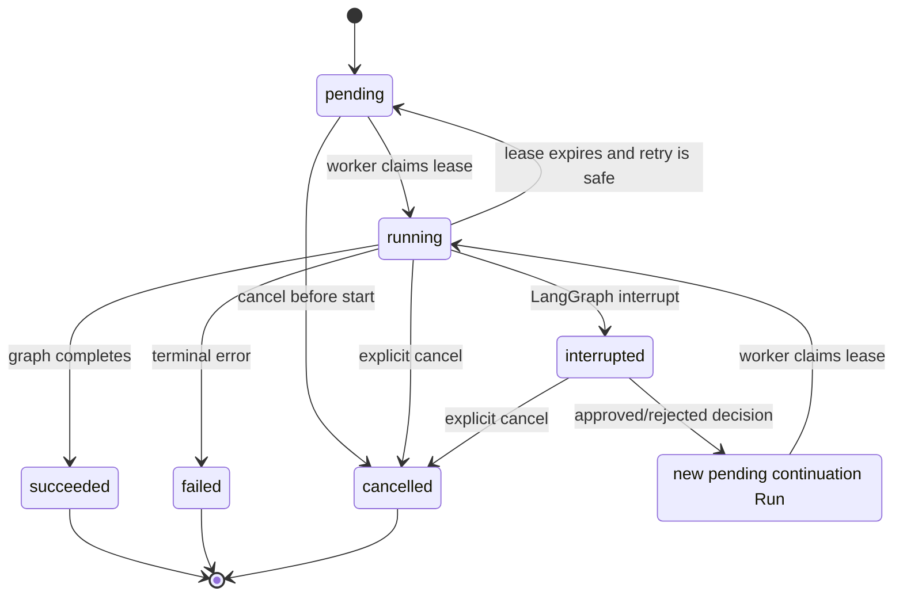
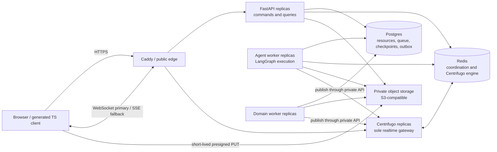
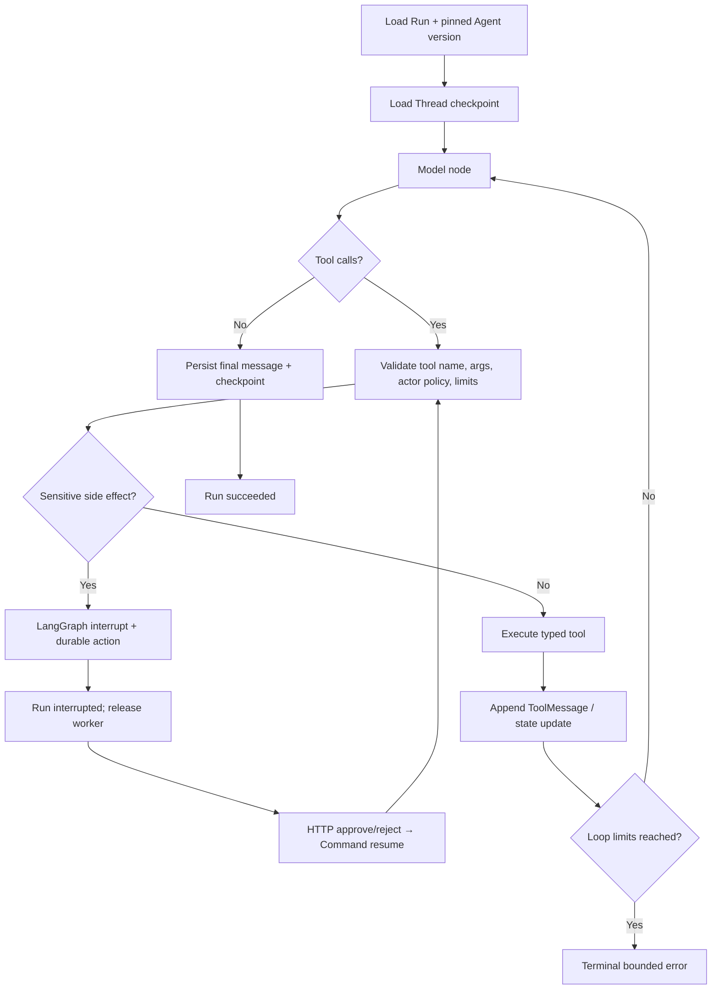
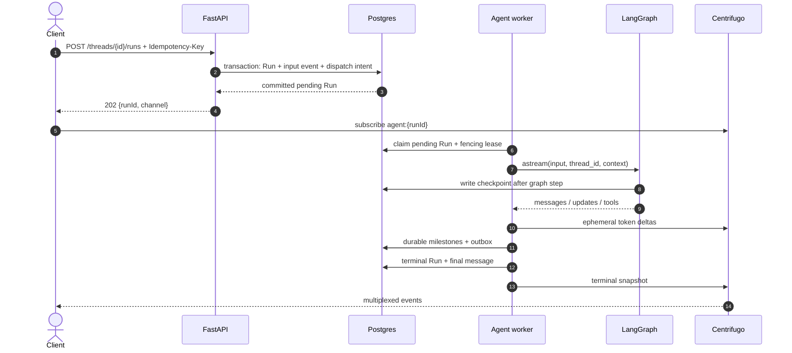
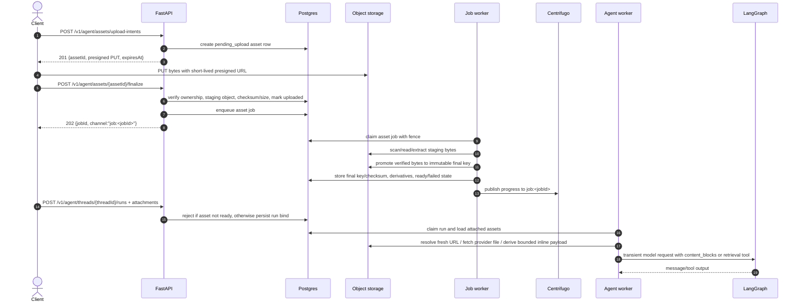

# Pycil Agent Runtime — LangChain/LangGraph Reference Design

> Status: target technical design
>
> Researched: 2026-08-26
>
> Scope: agent runtime only
>
> Normative words: **MUST**, **SHOULD**, **MAY**

## 1. Purpose

This document specifies Pycil's target AI-agent architecture. It follows the
resource model and execution semantics of LangGraph Agent Server and the public
LangChain/LangGraph APIs, while implementing only the subset Pycil needs with
open-source LangGraph.

The target is not a byte-for-byte clone of Agent Server. Differences are explicit:

- **LangChain/LangGraph standard**: behavior directly defined by the OSS libraries.
- **Agent Server reference**: production resource/API/runtime behavior documented by LangChain.
- **Pycil adaptation**: equivalent behavior required by Pycil's existing FastAPI,
  worker, Postgres, Redis, and Centrifugo stack.

The design has one public realtime gateway: **Centrifugo with WebSocket primary
and bidirectional SSE fallback**. FastAPI does not expose a second agent stream.

## 2. Conformance Summary

| Concern | LangChain / Agent Server reference | Pycil target |
| --- | --- | --- |
| Agent definition | Graph plus configured Assistant | Versioned internal agent definition |
| Conversation | Thread | `agent_threads` |
| Invocation | Run updates a Thread | `agent_runs` queued and executed by workers |
| Short-term memory | Checkpoints per graph step | `AsyncPostgresSaver`; tables owned by LangGraph migrations |
| Long-term memory | Store shared across Threads | `AsyncPostgresStore` only when a product use case exists |
| Attachments | Multimodal `ContentBlock` inputs | Private object storage plus durable asset metadata |
| Execution | Queue worker, not API handler | Dedicated agent worker pool |
| Run serialization | At most one executing Run per Thread | Durable queue plus one active lease per Thread |
| Tool loop | Model → tools → model until terminal | `create_agent`, typed tools, bounded middleware |
| Human approval | `interrupt()` / HITL middleware, resume with `Command` | Same LangGraph primitive plus durable Pycil authorization/audit row |
| Streaming semantics | Structured modes and resumable SSE | Same event taxonomy inside Centrifugo publications |
| Public stream | Agent Server SSE | Not exposed; Centrifugo is the sole gateway |
| Recovery | Checkpoint/state and resumable event stream | HTTP state/events plus best-effort Centrifugo history |
| Disconnect | Run continues unless explicitly cancelled | Same |
| Horizontal scale | Stateless API and worker pools, shared persistence | Same; Centrifugo uses Redis engine |

Licensing note:

- The target contract is implementable with the open-source LangGraph stack.
- Agent Server is the reference runtime/API shape, not a required proprietary dependency for Pycil.
- Pycil should copy the behavior contract, not reintroduce a bespoke transport that drifts from that contract.

## 3. Core Resource Model

### 3.1 Graph

A Graph is the executable blueprint. Pycil MUST build it with LangChain
`create_agent` or the LangGraph Graph API and compile it once per worker process.
Per-run factories MAY be used only when graph topology truly changes by run.

The graph MUST receive:

- a Postgres checkpointer;
- optional long-term Store;
- typed runtime context containing authenticated actor data;
- a closed list of registered tools;
- middleware for limits, errors, observability, and HITL.

The graph MAY receive resolved attachment content blocks at invocation time.
Attachment storage and extraction are application concerns, not graph concerns.

### 3.2 Agent definition

Agent Server defines an Assistant as a configured instance of a Graph. Pycil calls
that resource an Agent definition and keeps it internal rather than exposing public
CRUD initially.

Each Run MUST pin:

- `agent_id`;
- `agent_version`;
- `graph_id`;
- model/config revision or digest.

This prevents old Threads from silently changing behavior after a prompt, model,
tool, or middleware rollout.

### 3.3 Thread

A Thread is the accumulated state of related Runs. It is the stable conversation
identity and the LangGraph `thread_id` checkpoint namespace.

A Thread MUST belong to one user. Ownership is checked in FastAPI before every
read, mutation, subscription grant, cancel, or resume operation.

### 3.4 Run

A Run is one graph invocation against one Thread. Creating a Run is a durable
command, not an HTTP streaming operation.

Run states:



For one invocation, `pending` and `running` are active; `interrupted`, `succeeded`,
`failed`, and `cancelled` are terminal. Resume creates a new continuation Run on
the same Thread/checkpoint and keeps the interrupted Run as history. A network
disconnect MUST NOT change state.

Agent Server's documented wire vocabulary is `pending`, `running`, `success`,
`error`, `timeout`, and `interrupted`. Pycil may retain its current internal
`succeeded`, `failed`, and `cancelled` values, but the API adapter MUST map them
explicitly. `cancelled` maps to `interrupted` plus `terminationReason=cancelled`;
it must not be confused with a resumable HITL interrupt.

### 3.5 Checkpoint and Store

Checkpoint is LangGraph's short-term execution state. It enables:

- conversation memory;
- inspection of current graph state;
- recovery after worker failure;
- native pause/resume for HITL;
- replay/time-travel where explicitly supported.

Store is cross-thread long-term memory. It MUST NOT be used as a duplicate user
profile or domain database. Add it only for an explicit memory feature with
retention, deletion, and authorization rules.

Application tables MUST NOT duplicate raw checkpoint state. They may keep a
checkpoint ID/version reference for audit and stale-approval protection.

### 3.6 Attachments and Assets

LangChain's standard message boundary is a message `content` or
`content_blocks` list. Multimodal inputs MAY include `image`, `audio`, `video`,
and `file` blocks with `url`, `base64`, or provider-managed `file_id`
representations. That is the upstream boundary Pycil MUST honor.

Pycil does not treat file upload, object storage, or PDF processing as a native
LangGraph resource. Those concerns are an application-layer adaptation around
the message boundary:

- the browser uploads bytes to private object storage via a short-lived
  presigned URL;
- the API stores canonical asset metadata in Postgres;
- the worker resolves a ready asset into a LangChain content block in a transient
  model-request view immediately before model invocation;
- the checkpoint stores only stable asset references, never binary blobs or
  signed URLs.

Canonical asset rules:

- `asset_id` is the only stable browser-visible reference.
- Storage keys are internal locators, not browser authority or asset identity.
- Presigned URLs and provider `file_id` values are ephemeral implementation details.
- Binary payloads MUST NOT be stored in Postgres or checkpoint state.
- Resolved `url`, `base64`, and provider `file_id` blocks MUST NOT be written back
  into graph state. A `wrap_model_call` middleware or custom model node MUST
  materialize them only in the outbound model request and discard them afterward.
- Large PDFs SHOULD be treated as retrieval inputs, not as prompt stuffing.
- Small one-shot PDFs or images MAY be inlined as content blocks when the
  provider and token budget support it.

## 4. Target Runtime Architecture



Rules:

1. API replicas MUST remain stateless with respect to live Runs.
2. API handlers MUST NOT call `graph.astream()` or hold a request open for model work.
3. Agent workers MUST be a separate concurrency pool from normal domain jobs.
4. API and worker pools MUST scale independently.
5. Postgres is canonical. Redis contains coordination/signaling data only.
6. Centrifugo failure MUST degrade latency, not corrupt canonical state.
7. No sticky session is required for FastAPI or Centrifugo when shared stores are configured.
8. Object storage is private by default and is accessed only through short-lived
   presigned operations or worker-side credentials.

## 5. Database Design

The SQL below is logical DDL. Final migrations use the project's SQLModel/Alembic
conventions. UUIDs and timestamps are server-generated.

### 5.1 Agent definitions and versions

```sql
CREATE TABLE agent_definitions (
  id uuid PRIMARY KEY,
  agent_key varchar(80) NOT NULL UNIQUE,
  graph_id varchar(120) NOT NULL,
  active_version integer NOT NULL,
  name varchar(200) NOT NULL,
  description text,
  created_at timestamptz NOT NULL,
  updated_at timestamptz NOT NULL
);

CREATE TABLE agent_versions (
  agent_id uuid NOT NULL REFERENCES agent_definitions(id),
  version integer NOT NULL,
  config jsonb NOT NULL,
  context jsonb NOT NULL DEFAULT '{}',
  artifact_digest varchar(128) NOT NULL,
  created_at timestamptz NOT NULL,
  PRIMARY KEY (agent_id, version)
);
```

`config` contains allow-listed graph configuration only. Secrets never enter this
table. `artifact_digest` identifies the prompt/tool/model deployment revision.

### 5.2 Threads

```sql
CREATE TABLE agent_threads (
  id uuid PRIMARY KEY,
  owner_id uuid NOT NULL REFERENCES users(id),
  agent_id uuid NOT NULL REFERENCES agent_definitions(id),
  status varchar(20) NOT NULL CHECK (status IN ('active', 'deleted')),
  title varchar(200) NOT NULL,
  metadata jsonb NOT NULL DEFAULT '{}',
  retention_deadline timestamptz NOT NULL,
  created_at timestamptz NOT NULL,
  updated_at timestamptz NOT NULL,
  deleted_at timestamptz
);

CREATE INDEX ix_agent_threads_owner_updated
  ON agent_threads(owner_id, updated_at DESC)
  WHERE deleted_at IS NULL;
```

The LangGraph configurable `thread_id` MUST be derived deterministically from the
owner and Thread UUID, preventing cross-user checkpoint collisions.

### 5.3 Runs and durable dispatch

```sql
CREATE TABLE agent_runs (
  id uuid PRIMARY KEY,
  thread_id uuid NOT NULL REFERENCES agent_threads(id) ON DELETE CASCADE,
  owner_id uuid NOT NULL REFERENCES users(id),
  agent_id uuid NOT NULL REFERENCES agent_definitions(id),
  agent_version integer NOT NULL,
  parent_run_id uuid REFERENCES agent_runs(id),
  client_request_id uuid NOT NULL,
  status varchar(24) NOT NULL,
  input jsonb NOT NULL,
  output jsonb,
  metadata jsonb NOT NULL DEFAULT '{}',
  event_cursor bigint NOT NULL DEFAULT 0,
  attempt integer NOT NULL DEFAULT 0,
  max_attempts integer NOT NULL DEFAULT 3,
  lease_owner varchar(160),
  lease_expires_at timestamptz,
  fence_token bigint NOT NULL DEFAULT 0,
  checkpoint_id varchar(255),
  cancel_requested_at timestamptz,
  available_at timestamptz NOT NULL,
  started_at timestamptz,
  finished_at timestamptz,
  error_code varchar(80),
  error_detail jsonb,
  termination_reason varchar(40),
  created_at timestamptz NOT NULL,
  updated_at timestamptz NOT NULL,
  UNIQUE(owner_id, client_request_id),
  FOREIGN KEY (agent_id, agent_version)
    REFERENCES agent_versions(agent_id, version)
);

CREATE INDEX ix_agent_runs_claim
  ON agent_runs(status, available_at, created_at)
  WHERE status = 'pending';

CREATE UNIQUE INDEX uq_agent_runs_one_running_per_thread
  ON agent_runs(thread_id)
  WHERE status = 'running';
```

The Run row is the durable queue record. Workers claim pending rows with
`SELECT ... FOR UPDATE SKIP LOCKED`, increment `fence_token`, and set a bounded
lease. Every worker write MUST match `(run_id, fence_token)` so a stale worker
cannot commit after its lease is lost.

This is at-least-once execution with idempotent/fenced effects. Pycil MUST NOT
claim exactly-once external side effects.

### 5.4 Durable events and realtime outbox

```sql
CREATE TABLE agent_run_events (
  id uuid PRIMARY KEY,
  run_id uuid NOT NULL REFERENCES agent_runs(id) ON DELETE CASCADE,
  sequence bigint NOT NULL,
  event_type varchar(80) NOT NULL,
  payload jsonb NOT NULL,
  durable boolean NOT NULL DEFAULT true,
  created_at timestamptz NOT NULL,
  expires_at timestamptz,
  UNIQUE(run_id, sequence)
);

CREATE TABLE agent_run_outbox (
  id uuid PRIMARY KEY,
  run_id uuid NOT NULL REFERENCES agent_runs(id) ON DELETE CASCADE,
  sequence bigint NOT NULL,
  channel varchar(255) NOT NULL,
  event_type varchar(80) NOT NULL,
  payload jsonb NOT NULL,
  attempts integer NOT NULL DEFAULT 0,
  available_at timestamptz NOT NULL,
  published_at timestamptz,
  last_error varchar(500),
  created_at timestamptz NOT NULL,
  UNIQUE(run_id, sequence)
);

CREATE INDEX ix_agent_outbox_dispatch
  ON agent_run_outbox(available_at, created_at)
  WHERE published_at IS NULL;
```

Persist durable milestones, not every token. Durable examples:

- accepted user message;
- Run lifecycle transition;
- complete agent message;
- tool call/result metadata after sanitization;
- interrupt/approval request and decision;
- terminal error summary.

Token deltas are ephemeral Centrifugo publications. On loss, the client recovers
the final message from HTTP/Thread state instead of reconstructing it from token rows.

### 5.5 HITL authorization and audit

```sql
CREATE TABLE agent_actions (
  id uuid PRIMARY KEY,
  run_id uuid NOT NULL REFERENCES agent_runs(id) ON DELETE CASCADE,
  owner_id uuid NOT NULL REFERENCES users(id),
  tool_call_id varchar(160) NOT NULL,
  tool_name varchar(80) NOT NULL,
  canonical_args jsonb NOT NULL,
  args_digest varchar(64) NOT NULL,
  checkpoint_id varchar(255) NOT NULL,
  resource_generations jsonb NOT NULL DEFAULT '{}',
  status varchar(24) NOT NULL,
  expires_at timestamptz NOT NULL,
  decided_at timestamptz,
  executed_at timestamptz,
  result jsonb,
  created_at timestamptz NOT NULL,
  updated_at timestamptz NOT NULL,
  UNIQUE(run_id, tool_call_id)
);

CREATE TABLE agent_action_audit (
  id uuid PRIMARY KEY,
  action_id uuid REFERENCES agent_actions(id) ON DELETE SET NULL,
  actor_id uuid NOT NULL REFERENCES users(id),
  decision varchar(24) NOT NULL,
  sanitized_digest varchar(64) NOT NULL,
  correlation_id uuid NOT NULL,
  occurred_at timestamptz NOT NULL
);
```

LangGraph checkpoint tables remain migration-owned copies of the official
checkpointer schema. Do not remodel or query their internals from product code.

### 5.6 Assets, bindings, and processing jobs

```sql
CREATE TABLE agent_assets (
  id uuid PRIMARY KEY,
  owner_id uuid NOT NULL REFERENCES users(id),
  original_filename varchar(255) NOT NULL,
  storage_provider varchar(40) NOT NULL,
  staging_object_key varchar(512) NOT NULL UNIQUE,
  object_key varchar(512) UNIQUE,
  declared_mime_type varchar(120) NOT NULL,
  detected_mime_type varchar(120),
  size_bytes bigint,
  sha256 varchar(64),
  version bigint NOT NULL DEFAULT 1,
  status varchar(24) NOT NULL,
  purpose varchar(40) NOT NULL,
  page_count integer,
  upload_expires_at timestamptz NOT NULL,
  retention_deadline timestamptz,
  uploaded_at timestamptz,
  scanned_at timestamptz,
  processed_at timestamptz,
  failed_at timestamptz,
  deleted_at timestamptz,
  metadata jsonb NOT NULL DEFAULT '{}',
  created_at timestamptz NOT NULL,
  updated_at timestamptz NOT NULL,
  CHECK (status IN ('pending_upload', 'uploaded', 'scanning', 'processing', 'ready', 'failed', 'deleted', 'quarantined')),
  CHECK (purpose IN ('agent_input', 'agent_reference', 'document_retrieval', 'other')),
  CHECK (status <> 'ready' OR (object_key IS NOT NULL AND detected_mime_type IS NOT NULL AND size_bytes IS NOT NULL AND sha256 IS NOT NULL))
);

CREATE TABLE agent_run_assets (
  run_id uuid NOT NULL REFERENCES agent_runs(id) ON DELETE CASCADE,
  asset_id uuid NOT NULL REFERENCES agent_assets(id) ON DELETE RESTRICT,
  ordinal integer NOT NULL,
  attachment_mode varchar(24) NOT NULL,
  attachment_kind varchar(24) NOT NULL,
  canonical_snapshot jsonb NOT NULL DEFAULT '{}',
  created_at timestamptz NOT NULL,
  PRIMARY KEY (run_id, ordinal),
  UNIQUE (run_id, asset_id),
  CHECK (attachment_mode IN ('auto', 'inline', 'retrieval')),
  CHECK (attachment_kind IN ('image', 'file', 'document'))
);

CREATE TABLE agent_asset_jobs (
  id uuid PRIMARY KEY,
  asset_id uuid NOT NULL REFERENCES agent_assets(id) ON DELETE CASCADE,
  job_type varchar(40) NOT NULL,
  status varchar(24) NOT NULL,
  attempts integer NOT NULL DEFAULT 0,
  max_attempts integer NOT NULL DEFAULT 3,
  lease_owner varchar(160),
  lease_expires_at timestamptz,
  fence_token bigint NOT NULL DEFAULT 0,
  available_at timestamptz NOT NULL,
  started_at timestamptz,
  finished_at timestamptz,
  error_code varchar(80),
  error_detail jsonb,
  created_at timestamptz NOT NULL,
  updated_at timestamptz NOT NULL,
  UNIQUE (asset_id, job_type),
  CHECK (job_type IN ('scan', 'extract', 'index', 'ocr', 'normalize')),
  CHECK (status IN ('pending', 'running', 'succeeded', 'failed', 'cancelled'))
);

CREATE TABLE agent_asset_derivatives (
  id uuid PRIMARY KEY,
  asset_id uuid NOT NULL REFERENCES agent_assets(id) ON DELETE CASCADE,
  derivative_type varchar(40) NOT NULL,
  storage_key varchar(512),
  content_hash varchar(64),
  metadata jsonb NOT NULL DEFAULT '{}',
  created_at timestamptz NOT NULL,
  CHECK (derivative_type IN ('page_text', 'chunk_index', 'thumbnail', 'ocr_text', 'embedding_index'))
);

CREATE INDEX ix_agent_assets_owner_status
  ON agent_assets(owner_id, status, created_at DESC);

CREATE INDEX ix_agent_asset_jobs_dispatch
  ON agent_asset_jobs(available_at, created_at)
  WHERE status = 'pending';
```

`agent_assets` is the canonical asset registry. The file bytes live in
private object storage, never in Postgres. `agent_run_assets` binds a Run to
the exact asset snapshot it used. `agent_asset_jobs` models background
scan/extract/index work. `agent_asset_derivatives` is optional and may point
to derived text, thumbnails, or retrieval indexes.

Direct uploads land at a per-intent staging key. After validation and scanning,
the job worker MUST copy/promote the verified bytes to an immutable final key,
record its checksum and final `object_key`, then delete the staging object. A Run
MUST never resolve a staging key. This prevents an unexpired presigned PUT from
changing bytes after validation. Bucket versioning or an equivalent conditional
copy policy SHOULD provide defense in depth.

Asset jobs use the same lease, fencing, retry, and reconciliation principles as
Runs. Every state/derivative write MUST match `(job_id, fence_token)`. The unique
job constraint is the initial subset; if a future pipeline legitimately repeats
a stage, add an explicit asset generation/stage generation to that key rather
than silently enqueueing duplicates.

The logical model MUST support:

- ownership checks by `owner_id` at read, upload, finalize, bind, and delete time;
- stable references for audit and replay;
- allow-listed `canonical_snapshot` fields only: asset ID/version, checksum,
  detected MIME type, size, and display filename; never storage credentials or URLs;
- soft delete and retention-driven purge;
- horizontal worker processing with idempotent job claims;
- future workspace scoping without changing the browser contract.

## 6. DTO Contract

Public JSON uses camelCase. Server models remain typed Pydantic DTOs generated
into the web TypeScript client from FastAPI OpenAPI.

### 6.1 Create Thread

```json
POST /v1/agent/threads
{
  "agentId": "3db5f44b-4b41-47ce-8c0e-5e54b6f465d3",
  "title": "Vocabulary planning",
  "metadata": {}
}
```

```json
201 Created
{
  "threadId": "8b4d713b-c87b-4e35-a91c-902f53bfd401",
  "agentId": "3db5f44b-4b41-47ce-8c0e-5e54b6f465d3",
  "status": "active",
  "title": "Vocabulary planning",
  "createdAt": "2026-08-26T08:00:00Z",
  "updatedAt": "2026-08-26T08:00:00Z"
}
```

### 6.2 Create Run

The payload mirrors Agent Server concepts: Assistant (Pycil's Agent definition),
`input` or `command`, context/config, metadata, multitask strategy, durability, and
resumability. Pycil exposes a bounded subset.

```json
POST /v1/agent/threads/{threadId}/runs
Idempotency-Key: <uuid>
{
  "agentId": "3db5f44b-4b41-47ce-8c0e-5e54b6f465d3",
  "input": {
    "messages": [
      {"role": "user", "content": "Help me organize this deck"}
    ]
  },
  "attachments": [
    {"assetId": "f3e5b9ff-2f54-4c3d-a7f8-2e4c4af2f1a0", "mode": "auto"}
  ],
  "context": {},
  "metadata": {},
  "multitaskStrategy": "enqueue",
  "durability": "async"
}
```

```json
202 Accepted
{
  "runId": "664446fa-d85f-4e69-a17a-075c67ada680",
  "threadId": "8b4d713b-c87b-4e35-a91c-902f53bfd401",
  "agentId": "3db5f44b-4b41-47ce-8c0e-5e54b6f465d3",
  "agentVersion": 7,
  "status": "pending",
  "version": 1,
  "channel": "agent:664446fa-d85f-4e69-a17a-075c67ada680",
  "createdAt": "2026-08-26T08:01:00Z"
}
```

Rules:

- `Idempotency-Key` maps to `client_request_id` and is mandatory.
- Default `multitaskStrategy` is `enqueue`; only one Run executes per Thread.
- Initial support is `durability=async`, matching checkpoint-after-step behavior.
- User identity and authorization are server-injected, never accepted from input/context.
- Arbitrary `configurable` keys from a browser are rejected.
- A normal Run has `input`; a continuation has a LangGraph `command`; the two are
  mutually exclusive, matching Agent Server Run creation semantics.
- All referenced `assetId` values MUST already be owned by the caller and in
  `ready` state before the Run is accepted.

### 6.3 Run Read

```json
{
  "runId": "664446fa-d85f-4e69-a17a-075c67ada680",
  "threadId": "8b4d713b-c87b-4e35-a91c-902f53bfd401",
  "agentId": "3db5f44b-4b41-47ce-8c0e-5e54b6f465d3",
  "agentVersion": 7,
  "status": "interrupted",
  "eventCursor": 18,
  "checkpointId": "1f0...",
  "error": null,
  "createdAt": "2026-08-26T08:01:00Z",
  "startedAt": "2026-08-26T08:01:01Z",
  "finishedAt": null
}
```

### 6.4 Cancel and Resume

```json
POST /v1/agent/threads/{threadId}/runs/{runId}/cancel
{}
```

```json
202 Accepted
{"runId":"...","status":"cancellation_requested"}
```

```json
POST /v1/agent/threads/{threadId}/runs/{runId}/resume
Idempotency-Key: <uuid>
{
  "actionId": "aa27590a-aa07-461b-bfd5-a4fb6db09981",
  "decisions": [
    {"type": "approve"}
  ]
}
```

```json
202 Accepted
{
  "interruptedRunId": "...",
  "continuationRunId": "...",
  "status": "pending",
  "channel": "agent:<continuationRunId>"
}
```

`/resume` is a Pycil authorization convenience endpoint. Atomically, it records
the action decision and creates a new Run whose command is equivalent to:

```python
Command(resume={"decisions": [{"type": "approve"}]})
```

The interrupted Run is immutable history. The continuation uses the same
LangGraph Thread/checkpoint. This preserves Agent Server's model in which each
graph invocation is a Run rather than mutating a completed invocation back to pending.

Allowed LangChain HITL decision types are `approve`, `edit`, and `reject`.
Pycil initially allows `approve` and `reject`; `edit` remains disabled until its
authorization semantics are designed.

### 6.5 Attachments and assets

```json
POST /v1/agent/assets/upload-intents
{
  "filename": "worksheet.pdf",
  "mimeType": "application/pdf",
  "sizeBytes": 1827341,
  "sha256": "7f04f3a7f3f38f8e6b2cf4b4b3a8c9d8ce4f3f6c7f1e8d7c6c5b4a3928171615",
  "purpose": "agent_input"
}
```

```json
201 Created
{
  "assetId": "f3e5b9ff-2f54-4c3d-a7f8-2e4c4af2f1a0",
  "status": "pending_upload",
  "upload": {
    "method": "PUT",
    "url": "https://storage.example.com/presigned/...",
    "headers": {
      "Content-Type": "application/pdf",
      "x-amz-checksum-sha256": "7f04f3a7f3f38f8e6b2cf4b4b3a8c9d8ce4f3f6c7f1e8d7c6c5b4a3928171615"
    },
    "expiresAt": "2026-08-26T08:05:00Z",
    "maxBytes": 52428800
  }
}
```

```json
POST /v1/agent/assets/{assetId}/finalize
{
  "etag": "\"b1946ac92492d2347c6235b4d2611184\"",
  "sizeBytes": 1827341
}
```

```json
202 Accepted
{
  "assetId": "f3e5b9ff-2f54-4c3d-a7f8-2e4c4af2f1a0",
  "status": "uploaded",
  "jobId": "9b7d3f0a-6137-4f64-8c53-1c03f72ad71a",
  "channel": "job:9b7d3f0a-6137-4f64-8c53-1c03f72ad71a"
}
```

```json
GET /v1/agent/assets/{assetId}
```

```json
200 OK
{
  "assetId": "f3e5b9ff-2f54-4c3d-a7f8-2e4c4af2f1a0",
  "filename": "worksheet.pdf",
  "mimeType": "application/pdf",
  "detectedMimeType": "application/pdf",
  "status": "ready",
  "purpose": "agent_input",
  "sizeBytes": 1827341,
  "sha256": "7f04f3a7f3f38f8e6b2cf4b4b3a8c9d8ce4f3f6c7f1e8d7c6c5b4a3928171615",
  "pageCount": 12,
  "createdAt": "2026-08-26T08:00:00Z",
  "updatedAt": "2026-08-26T08:02:10Z"
}
```

```json
DELETE /v1/agent/assets/{assetId}
```

```json
202 Accepted
{
  "assetId": "f3e5b9ff-2f54-4c3d-a7f8-2e4c4af2f1a0",
  "status": "deleted"
}
```

Rules:

- `upload-intents` MUST reject unsupported extensions, MIME types, or sizes before any presigned URL is issued.
- The presigned PUT targets a unique staging key and is bound to the expected
  content type/checksum where the storage provider supports those constraints.
- `finalize` MUST verify the staging object exists, matches the declared checksum
  and size policy, has not expired, and remains owned by the caller.
- Validation workers MUST promote verified bytes to an immutable final key before
  setting the asset to `ready`; a late write to the staging key cannot alter a ready asset.
- `DELETE` MUST tombstone the asset first, then enqueue asynchronous object/derivative purge.
- `POST /runs` MUST return `409 asset_not_ready` when a referenced asset is not `ready`.
- Initial browser requests SHOULD expose only `mode=auto`. Any future `inline` or
  `retrieval` value is a hint; server policy makes and records the final choice.
- `mode=auto` SHOULD choose inline content blocks for small image/PDF inputs and
  retrieval for larger or reused documents.

## 7. HTTP API

### 7.1 Public surface

| Method | Endpoint | Purpose |
| --- | --- | --- |
| `GET` | `/v1/agent/definitions` | List agent definitions available to caller |
| `GET` | `/v1/agent/definitions/{agentId}` | Read active config/version metadata |
| `POST` | `/v1/agent/threads` | Create Thread |
| `GET` | `/v1/agent/threads` | Cursor-paginated owner Threads |
| `GET` | `/v1/agent/threads/{threadId}` | Read Thread metadata |
| `PATCH` | `/v1/agent/threads/{threadId}` | Rename/archive Thread |
| `DELETE` | `/v1/agent/threads/{threadId}` | Owner-scoped deletion |
| `GET` | `/v1/agent/threads/{threadId}/state` | Current materialized graph state projection |
| `GET` | `/v1/agent/threads/{threadId}/history` | Bounded checkpoint/message history projection |
| `POST` | `/v1/agent/threads/{threadId}/runs` | Create background Run; returns `202` |
| `GET` | `/v1/agent/threads/{threadId}/runs` | List Runs |
| `GET` | `/v1/agent/threads/{threadId}/runs/{runId}` | Run status/output |
| `GET` | `/v1/agent/threads/{threadId}/runs/{runId}/events?after={seq}` | Durable recovery events |
| `POST` | `/v1/agent/threads/{threadId}/runs/{runId}/cancel` | Durable explicit cancellation |
| `POST` | `/v1/agent/threads/{threadId}/runs/{runId}/resume` | Authorize decision and create continuation Run |
| `POST` | `/v1/agent/assets/upload-intents` | Create a short-lived direct-upload intent |
| `POST` | `/v1/agent/assets/{assetId}/finalize` | Finalize upload and enqueue scan/process job |
| `GET` | `/v1/agent/assets/{assetId}` | Read asset metadata and status |
| `DELETE` | `/v1/agent/assets/{assetId}` | Tombstone and purge an asset |
| `POST` | `/v1/realtime/token` | Short-lived Centrifugo connection credential |

No agent route returns `StreamingResponse`. OpenAPI is the source for the
generated TypeScript client and DTOs.

### 7.2 FastAPI transaction boundary

`POST .../runs` performs one transaction:

1. authenticate cookie/Bearer and enforce CSRF where applicable;
2. authorize Thread and Agent definition;
3. deduplicate the idempotency key;
4. lock Thread ordering state;
5. create Run with pinned Agent version;
6. persist the input milestone;
7. persist dispatch notification/outbox intent;
8. commit;
9. return `202` with channel name.

No model/provider or Centrifugo network call occurs inside that transaction.

### 7.3 Error contract

Errors use the existing Pycil envelope and stable machine codes. Required cases:

- `agent_not_configured` → `503`;
- `agent_thread_not_found` → `404` without ownership leakage;
- `agent_run_conflict` → `409`;
- `agent_action_stale` → `409`;
- `agent_capacity_exhausted` → `429` or `503` by cause;
- `agent_message_too_long` → `413`;
- `agent_run_not_resumable` → `409`;
- `agent_run_terminal` → `409` for invalid mutation.
- `agent_asset_not_ready` → `409`;
- `agent_asset_forbidden` → `404` or `403` by policy;
- `agent_asset_invalid_type` → `400`;
- `agent_asset_scan_failed` → `422` or `409` by pipeline policy;
- `agent_asset_too_large` → `413`.

## 8. Realtime Contract

### 8.1 One physical connection

The browser opens one Centrifugo bidirectional-protocol connection with transport
fallback ordered as:

1. WebSocket at `/connection/websocket`;
2. bidirectional SSE at `/connection/sse` plus `/emulation`.

Do not use `uni_sse`; dynamic agent/job and future workspace/chat subscriptions
are required. `centrifuge-js` owns reconnect, connection-token refresh, protocol
commands, and subscription state across both transports. Business commands never
use `/emulation`; they use FastAPI HTTPS endpoints. Client publish and RPC are
disabled by default.

One connection multiplexes:

| Channel | Lifetime | Data |
| --- | --- | --- |
| `personal:#<userId>` | connection | automatic server-side notification/control stream |
| `job:<jobId>` | job | word generation, question generation, grading, asset processing and future jobs |
| `agent:<runId>` | Run | interactive/background agent tokens, tools, lifecycle and interrupt |
| `workspace:<workspaceId>` | future workspace session | shared workspace events |
| `chat:<conversationId>` | future conversation session | chat/collaboration events |

The personal channel MUST use Centrifugo automatic personal subscription; its
user ID comes from the authenticated connection `sub`, never a client-selected
channel. Dynamic subscriptions are granted by backend subscribe proxy after
owner/interest/membership checks. Shared jobs MAY have multiple authorized
subscribers. Grading and current agent Runs are owner-scoped.

### 8.2 Authentication and subscription authorization

Connection authentication:

1. browser calls `POST /v1/realtime/token` with FastAPI cookie auth;
2. FastAPI revalidates user/token version and signs a short-lived Centrifugo-only
   JWT with `sub`, fixed algorithm, `iss`, `aud`, `exp`, and server metadata;
3. Centrifugo validates the JWT and exact allowed origin before accepting either transport;
4. `centrifuge-js` refreshes the connection token through FastAPI.

Dynamic channel authorization is default-deny. Namespace configuration for
`agent`, `job`, and future `workspace`/`chat` MUST enable subscribe proxy and
MUST NOT enable:

- `allow_subscribe_for_client`;
- `allow_subscribe_for_anonymous`;
- `allow_publish_for_client`;
- `allow_publish_for_subscriber`.

Centrifugo sends authenticated `user`, exact `channel`, and connection metadata
to an internal FastAPI proxy. The proxy authenticates Centrifugo itself, parses a
strict channel format, revalidates user/token version, and authorizes:

- `agent:<runId>` against Run owner or future workspace authority;
- `job:<jobId>` against a live owner/job-interest record;
- future `workspace:<workspaceId>` against active membership;
- future `chat:<conversationId>` against active conversation membership.

Knowing a UUID or channel name grants no authority. The proxy fails closed and
MAY return a canonical initial snapshot. Immediate revocation uses Centrifugo's
server unsubscribe/disconnect API; expiring subscriptions plus `sub_refresh` MAY
periodically revalidate access.

Do not accept subscription JWTs for these proxy-authorized namespaces initially:
a valid subscription token is itself an authorization decision and bypasses the
subscribe proxy. If proxy load later requires tokens, FastAPI MUST issue a
short-lived token bound to one exact channel through the same authorization service.

Durable future chat messages SHOULD remain FastAPI commands that persist message
plus transactional outbox before publishing once to `chat:<conversationId>`. If a
product requirement later mandates WebSocket commands, add an idempotent Centrifugo
RPC-proxy adapter to the same application service; raw client publish MUST NOT
become the canonical database write. Ephemeral typing/presence MAY use a separately
authorized namespace.

Asset processing jobs use the same `job:<jobId>` channel. The job row is the
canonical state; Centrifugo carries progress and terminal notifications only.

### 8.3 Event envelope

Agent Server Protocol v2 separates `values`, `updates`, `messages`, `tools`,
`lifecycle`, `input`, `tasks`, and `custom` channels and uses sequence-based
resumption. Pycil preserves that semantic taxonomy inside a Centrifugo payload:

```json
{
  "schemaVersion": 1,
  "runId": "664446fa-d85f-4e69-a17a-075c67ada680",
  "threadId": "8b4d713b-c87b-4e35-a91c-902f53bfd401",
  "sequence": 18,
  "stream": "messages",
  "event": "messages.delta",
  "durable": false,
  "data": {
    "messageId": "msg_01",
    "content": "partial text"
  },
  "emittedAt": "2026-08-26T08:01:04.100Z"
}
```

Event families:

| Stream | Events | Durable |
| --- | --- | --- |
| `lifecycle` | `run.pending`, `run.running`, `run.interrupted`, `run.succeeded`, `run.failed`, `run.cancelled` | yes |
| `messages` | `messages.delta` | no |
| `messages` | `messages.complete` | yes |
| `tools` | `tools.call`, `tools.result`, `tools.error` | sanitized milestone yes |
| `updates` | bounded node/state progress | only if product-visible |
| `tasks` | subgraph/task lifecycle | only if product-visible |
| `custom` | application-specific progress | declared per event |

Rules:

- A durable event gets its `sequence` in the same DB transaction as Run state.
- Outbox publication preserves that sequence.
- Ephemeral deltas MAY use worker-local monotonic subsequences but are not recovery truth.
- Payloads MUST be provider-independent and sanitized.
- Raw prompts, credentials, hidden chain-of-thought, and unbounded tool results MUST NOT be published.

### 8.4 Recovery

Recovery algorithm:

1. reconnect the single Centrifugo connection;
2. resubscribe to active Run channels;
3. attempt bounded Centrifugo recovery when available;
4. call `GET .../events?after=<lastDurableSequence>`;
5. call Run or Thread state if a token gap occurred;
6. render the persisted complete message, not a concatenation of assumed deltas.

Centrifugo history is a short latency optimization. HTTP plus Postgres is the
long recovery path. `Last-Event-ID` belongs to Agent Server's native SSE design;
Pycil uses explicit sequence cursors because Centrifugo is the only gateway.

## 9. Agent Pipeline and Loop



The loop terminates when:

- the model returns no tool call;
- an interrupt pauses execution;
- explicit cancellation is observed;
- recursion/tool/token/time/cost limit is reached;
- a non-retryable error occurs.

Retry policy applies at model/tool node boundaries only. Side-effecting tools
MUST be idempotent before any automatic retry.

## 10. Tool Calling Standard

### 10.1 Definitions

Tools MUST use LangChain's typed tool contract (`@tool`, Pydantic schema, or an
equivalent `BaseTool`). Each tool has:

- stable verb-first name;
- precise description of when to use it;
- strict typed argument schema;
- bounded, structured result;
- explicit read/write classification;
- timeout, error mapping, and observability tags.

Example shape:

```python
from dataclasses import dataclass
from uuid import UUID

from langchain.tools import ToolRuntime, tool


@dataclass(frozen=True)
class AgentContext:
    user_id: UUID
    token_version: int
    run_id: UUID
    action_id: UUID | None = None


@tool
async def list_deck_words(
    deck_id: UUID,
    limit: int,
    runtime: ToolRuntime[AgentContext],
) -> dict:
    """List a bounded page of words from one owned deck."""
    # Ownership is enforced by deterministic application code using runtime.context.
    ...
```

User identity is injected through runtime context. It MUST NOT be an LLM-supplied
argument. Tools call application services/facades, not routers or raw database
tables, and recheck object authorization at execution time.

### 10.2 Side effects and HITL

Sensitive tools use `HumanInTheLoopMiddleware(interrupt_on=...)` or explicit
`interrupt()`. The interrupt payload is a proposal, never authority.

Approval flow MUST bind the decision to:

- owner and actor token version;
- Run and exact tool call ID;
- tool name and canonical argument digest;
- checkpoint ID;
- target resource generation/version;
- expiry and one-time action ID.

Resume uses LangGraph `Command(resume={"decisions": [...]})`. Before resume,
Pycil revalidates ownership, action state, checkpoint freshness, resource
generation, and current authorization. The tool uses `action_id` as its durable
idempotency key.

Rejecting an action resumes the graph with a rejection ToolMessage; it does not
execute the tool. Editing a call is disabled until per-field policy exists.

### 10.3 Limits

Every Run MUST bound:

- graph recursion steps;
- total tool calls and calls per named tool;
- input characters/tokens;
- output tokens;
- wall-clock deadline;
- per-user and global concurrency;
- tool result bytes;
- monthly/provider budget where configured.

Limits are server policy, not prompt instructions.

## 11. Run Execution Pipeline



Workers renew leases during provider/tool awaits. If a worker dies:

1. lease expires;
2. reconciler moves a retryable Run to `pending`;
3. another worker claims it with a higher fence;
4. LangGraph reloads the latest checkpoint;
5. stale-worker writes fail their fence condition.

### 11.1 Attachment ingestion and resolution



Attachment resolution rules:

- The canonical stored reference is `asset_id`.
- Signed URLs MUST be minted just in time and MUST expire quickly.
- Checkpoints and audit rows MUST NOT store signed URLs as canonical truth.
- Canonical graph state stores text messages plus typed attachment references.
  A `wrap_model_call` middleware or custom model node resolves those references
  into a transient copy of the model request without mutating checkpointed messages.
- Inline bytes MUST be bounded, held only for the provider call, and discarded afterward.
- The resolver SHOULD prefer `content_blocks` for images and small PDFs when the provider can accept them.
- The resolver SHOULD prefer retrieval tools for large, repeated, or shared PDFs.
- Retrieval tools MUST authorize against the Run's bound asset set; the model
  cannot choose an arbitrary user or storage object identifier.
- Provider-managed `file_id` MAY be used only when the target model/provider
  benefits from it and the adapter can create it safely. It is a replaceable
  cache entry, not checkpoint or asset identity.

## 12. HITL Sequence

```mermaid
sequenceDiagram
    autonumber
    participant Worker
    participant LG as LangGraph
    participant DB as Postgres
    participant CF as Centrifugo
    actor Client
    participant API as FastAPI

    LG-->>Worker: __interrupt__ with action request
    Worker->>DB: action + interrupted Run + checkpoint reference
    Worker->>CF: lifecycle interrupt publication
    CF-->>Client: confirmation required
    Client->>API: POST /runs/{runId}/resume decision
    API->>DB: lock action; revalidate actor, args, checkpoint, resource
    API->>DB: decision + new pending continuation Run
    API-->>Client: 202 {continuationRunId, channel}
    Worker->>DB: claim continuation Run
    Worker->>LG: Command(resume={decisions:[...]})
    LG->>LG: execute or reject tool call
    Worker->>DB: action outcome + Run progress
    Worker->>CF: result/lifecycle publication
```

An interrupted Run consumes no worker slot while waiting for the user.

## 13. Concurrency, Cancellation, and Ordering

- Default strategy is `enqueue` when another active Run exists on the Thread.
- Workers execute at most one Run per Thread at a time.
- Different Threads from the same user MAY execute concurrently within quota.
- Cancellation is an explicit durable HTTP command.
- Redis MAY wake a worker for cancellation, but Postgres `cancel_requested_at`
  is the source of truth.
- Workers check cancellation between graph steps and around long-running tools.
- If a provider cannot be interrupted immediately, late output is discarded by
  fence/status checks.
- Client disconnect, tab close, API restart, or Centrifugo reconnect MUST NOT cancel a Run.

## 14. FastAPI and Worker Responsibilities

### FastAPI owns

- authentication, CSRF, ownership, authorization;
- DTO validation and OpenAPI;
- Agent definition/Thread/Run commands and queries;
- asset upload intent/finalize/read/delete commands and queries;
- idempotency and transaction boundaries;
- realtime connection/subscription grants;
- durable cancel/resume decisions;
- recovery reads.

### Agent worker owns

- graph construction and execution;
- model calls and typed tool loop;
- attachment resolution into LangChain message content blocks;
- checkpoint writes;
- leases, retries, cancellation checks;
- durable milestone and final message writes;
- Centrifugo publications through private credentials.

### Domain job worker owns

- asset scan, MIME/signature verification, normalization, OCR, extraction, and indexing;
- staging-to-immutable object promotion and derivative generation;
- asset-job leases, fencing, retry, reconciliation, and terminal status;
- `job:<jobId>` progress publication through private credentials.

### Centrifugo owns

- long-lived browser connections;
- authorized channel subscriptions;
- low-latency fan-out and bounded history/recovery.

It does not own Runs, messages, notifications, task state, or business commands.

## 15. Security Requirements

- Browser authentication follows Pycil's cookie/JWT decision in `notes.md`.
- Unsafe cookie-auth HTTP methods require CSRF protection.
- Every resource query includes owner scope; `404` hides foreign object existence.
- Centrifugo connection tokens are short-lived, audience-bound, issuer-bound,
  origin-restricted, and tied to current token version.
- `personal:#<userId>` is derived automatically from authenticated connection `sub`.
- Dynamic `agent`, `job`, and future `workspace`/`chat` namespaces are default-deny
  and require an explicit backend subscribe-proxy decision.
- `allow_subscribe_for_client`, anonymous subscription, client publish, and client
  RPC remain disabled by default.
- Subscribe proxy endpoints are internal-only and authenticate Centrifugo itself.
- Active authorization revocation triggers unsubscribe/disconnect and does not wait
  indefinitely for browser reconnect.
- Tool arguments are schema-validated and canonicalized before authorization.
- Asset uploads are private, checksum-verified, size-bounded, MIME-sniffed, and
  extension-allowlisted before processing.
- File bytes stay in private object storage; database rows store metadata and
  derivatives only.
- Upload credentials target one random staging key, use the shortest practical
  lifetime, and are treated as bearer credentials. Ready assets resolve only an
  immutable verified final object, never the staging key.
- Uploaded PDFs and images are treated as untrusted input until scan and parser
  validation complete.
- Parsers and extractors MUST run in an isolated sandbox with bounded CPU,
  memory, output, page/pixel count, and wall-clock limits.
- PDF, DOCX, and similar formats SHOULD pass through CDR or an equivalent
  sanitization path when available.
- SSRF is forbidden for arbitrary remote file ingestion; only explicit,
  allowlisted fetch flows MAY be added later.
- Provider upload/file APIs require an explicit data-classification and retention
  policy. Provider-side deletion MUST be scheduled when its cached reference or
  owning Pycil asset expires.
- Object storage MUST use encryption at rest and private network/bucket policy;
  downloads require owner/workspace authorization and short-lived credentials.
- Raw provider payloads and chain-of-thought are never stored or streamed.
- Tool results are size-bounded and sanitized before model or client use.
- Provider credentials exist only in worker runtime secrets.
- Side effects use idempotency keys and DB constraints.
- Action audit survives Thread/Run retention according to policy.
- Account deletion cascades product data and deletes LangGraph checkpoint/store namespaces.

## 16. Observability

Metrics MUST cover:

- queue depth and oldest pending age;
- Run latency by state and agent version;
- active/expired leases and retries;
- checkpoint latency/failures;
- tokens, model latency, tool latency/errors;
- interrupts pending/expired and approval outcomes;
- outbox lag/publication failures;
- Centrifugo connections, reconnects, publications, broker errors;
- recovery API usage and detected sequence gaps;
- cancellation latency;
- asset upload/finalize failures, scan latency, quarantine rate, parser failures,
  staging-object age, asset-job lease expiry, and derivative/index latency;
- per-user/global concurrency rejection.

Logs carry `request_id`, `thread_id`, `run_id`, `agent_id/version`,
`tool_call_id`, and `action_id`. Logs MUST exclude message content and tool
arguments by default. LangSmith tracing is optional observability, not a runtime
dependency or source of truth.

## 17. Retention and Deletion

Current default policy remains until separately changed:

- inactive Threads/checkpoints: 30 days;
- minimized action audit: 90 days;
- ephemeral token events: not stored;
- durable Run events: bounded to the Thread retention window unless audit policy requires longer;
- abandoned staging uploads: purge shortly after upload-intent expiry;
- ready assets and derivatives: expire by their explicit asset retention deadline,
  subject to active bindings and legal/audit holds;
- cached provider files: never outlive the owning asset policy.

Deletion order:

1. mark Thread deleted and reject new Runs/subscriptions;
2. request cancellation for non-terminal Runs;
3. remove product events/actions after preserving required audit rows;
4. remove bindings owned only by the deleted Thread;
5. purge an asset's final object, staging object, derivatives, provider copies,
   and job rows only after it is tombstoned/expired and no live binding or hold remains;
6. delete LangGraph checkpoint namespace;
7. delete optional Store namespace;
8. revoke any remaining channel interests.

## 18. Acceptance Criteria

The target is complete when:

- no FastAPI request executes `graph.astream()`;
- no agent `StreamingResponse` endpoint remains;
- a Run survives browser, API, worker, and Centrifugo reconnects;
- a worker crash resumes from the latest safe checkpoint;
- one Run executes per Thread while API/worker replicas scale horizontally;
- final messages recover through HTTP without token-event persistence;
- WebSocket is primary and bidirectional SSE is a working fallback on the same protocol;
- all agent realtime traffic uses `agent:<runId>` on the shared connection;
- all domain-job realtime traffic uses `job:<jobId>`;
- file upload uses direct-to-storage presigned PUT with private object storage;
- assets finalize through background scan/process jobs before any Run consumes them;
- an unexpired upload credential cannot mutate bytes consumed by a ready asset;
- image and PDF inputs resolve through LangChain `ContentBlock` boundaries or retrieval tools;
- resolved URLs/base64/provider IDs never enter checkpointed graph state;
- personal subscription is automatic and every dynamic subscription is backend-authorized;
- HITL uses native LangGraph interrupt/resume and durable Pycil authorization/audit;
- sensitive tools are idempotent and stale approvals fail closed;
- generated TypeScript types match FastAPI OpenAPI;
- client publish/RPC is disabled by default and business commands use HTTPS;
- old per-request SSE and per-token DB writes are removed.

## 19. Explicit Non-Goals

- Deploying licensed LangGraph Agent Server.
- Cloning every Agent Server endpoint, cron, webhook, A2A, MCP, or Store feature.
- Introducing a second realtime gateway or native agent SSE endpoint.
- Using `uni_sse` for the dynamic subscription model.
- Using raw client publish as a canonical business write path.
- Kafka, gRPC, STS, TypeSpec, or a new agent microservice without a concrete need.
- Persisting every model token.
- Allowing the LLM to determine identity, authority, or approval policy.
- Treating object storage URLs or provider file IDs as stable canonical state.

## 20. Research Method

- Recency target: current official documentation on 2026-08-26.
- Sources: LangChain documentation, Agent Server OpenAPI pages, and the official
  LangGraph repository/license; no community architecture was treated as normative.
- Cross-check: Agent Server resources/runtime were compared with LangGraph OSS
  persistence, interrupts, streaming, agents, and tools documentation.
- Pycil migration facts were traced from current source with CodeGraph before file reads.
- Boundary: proprietary Agent Server internals not documented publicly are not
  reverse-engineered or claimed here.

## 21. Official References

Accessed 2026-08-26:

- [Agent Server architecture and execution lifecycle](https://docs.langchain.com/langsmith/agent-server)
- [Agent Server API index](https://docs.langchain.com/langsmith/agent-server-api)
- [Agent Server API reference](https://docs.langchain.com/langsmith/server-api-ref)
- [Create Assistant](https://docs.langchain.com/langsmith/agent-server-api/assistants/create-assistant)
- [Create Thread](https://docs.langchain.com/langsmith/agent-server-api/threads/create-thread)
- [Create background Run](https://docs.langchain.com/langsmith/agent-server-api/thread-runs/create-background-run)
- [Create Run and stream output](https://docs.langchain.com/langsmith/agent-server-api/thread-runs/create-run-stream-output)
- [Join resumable Run stream](https://docs.langchain.com/langsmith/agent-server-api/thread-runs/join-run-stream)
- [Cancel Run](https://docs.langchain.com/langsmith/agent-server-api/thread-runs/cancel-run)
- [Protocol v2 event stream](https://docs.langchain.com/langsmith/agent-server-api/streaming/protocol-v2-event-stream-sse)
- [LangChain messages and multimodal content blocks](https://docs.langchain.com/oss/python/langchain/messages)
- [LangChain retrieval](https://docs.langchain.com/oss/python/langchain/retrieval)
- [LangGraph persistence and Store](https://docs.langchain.com/oss/python/langgraph/persistence)
- [LangGraph interrupts](https://docs.langchain.com/oss/python/langgraph/interrupts)
- [LangGraph streaming](https://docs.langchain.com/oss/python/langgraph/streaming)
- [LangChain agents](https://docs.langchain.com/oss/python/langchain/agents)
- [LangChain tools](https://docs.langchain.com/oss/python/langchain/tools)
- [Standalone Agent Server requirements and license key](https://docs.langchain.com/langsmith/deploy-standalone-server)
- [LangGraph OSS MIT license](https://github.com/langchain-ai/langgraph/blob/main/LICENSE)
- [Amazon S3 presigned URLs](https://docs.aws.amazon.com/AmazonS3/latest/userguide/using-presigned-url.html)
- [Cloudflare R2 presigned URLs](https://developers.cloudflare.com/r2/api/s3/presigned-urls/)
- [OWASP File Upload Cheat Sheet](https://cheatsheetseries.owasp.org/cheatsheets/File_Upload_Cheat_Sheet.html)
- [Centrifugo transport overview](https://centrifugal.dev/docs/transports/overview)
- [Centrifugo WebSocket with SSE fallback](https://centrifugal.dev/docs/transports/sse)
- [Centrifugo channel permission model](https://centrifugal.dev/docs/server/channel_permissions)
- [Centrifugo server-side subscriptions](https://centrifugal.dev/docs/server/server_subs)
- [Centrifugo subscribe proxy](https://centrifugal.dev/docs/server/proxy#subscribe-proxy)

## 22. Unresolved Questions

- None blocking this target design. Model/provider choice, optional long-term
  Store, `edit` HITL support, and the exact S3-compatible backend remain later
  product decisions.
