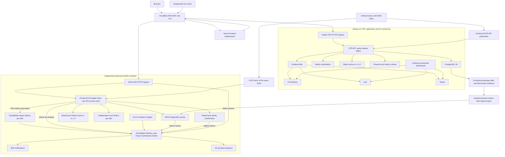

# Pycil DevSecOps architecture: overview and standards

**Status:** accepted architecture, proposed implementation configuration, not deployed. **Audit:** 14 October 2026, Asia/Ho_Chi_Minh; VPS observations began at 13 October 2026 20:36:58 UTC. **Source:** working tree at commit `41359cd`. All architecture documents are in English. Remote inspection was read-only.

## 1. Outcome and acceptance contract

Run the same immutable API image on two independent application environments: an always-on VPS and an on-demand AWS environment. Each has its own PostgreSQL, Redis coordination, search storage and monitoring. Vercel serves environment-specific frontends; Cloudflare owns DNS and edge security. VPS telemetry stays on the VPS; AWS telemetry stays on AWS. AWS teardown must preserve benchmark evidence in S3 and leave no workload resources billed by the hour.

### Accepted AWS stack and independence boundary

**Final stack decision: 15 October 2026.** This supersedes the EC2/Compose application and separate AWS LGTM monitoring-host design. Application, observability and the [search/content-revision design](../../search_and_content_revisions.md) are accepted. Implementation and operational acceptance remain separate gates.

| Concern | VPS — self-hosted | AWS — managed |
| --- | --- | --- |
| Deployment | Docker Compose | ECS service on **Fargate**, ECR immutable image |
| Ingress / TLS | Cloudflare → Caddy | Cloudflare → ALB + ACM; ALB directly targets API |
| Application | Pycil API monolith | Same monolith; **one API process per task** |
| PostgreSQL | PostgreSQL container | Private RDS PostgreSQL |
| Redis | Redis container; required coordination distinct from optional cache | Private ElastiCache Redis; same coordination/cache boundary |
| Dictionary search | Local Tantivy directory on VPS | Independent task-local ephemeral Tantivy; inside the API process |
| Backup / initialization | WAL-G base backups + WAL → S3 | RDS managed backups; optional initial logical import from completed S3 recovery set |
| Collection | One Grafana Alloy, including Unix/cAdvisor/PostgreSQL/Redis exporter components | CloudWatch Agent sidecar for app OTel; awslogs for stdout; Container Insights and native AWS service metrics |
| Metrics / logs / traces | Prometheus / Loki / Tempo | CloudWatch Metrics / Logs / traces and X-Ray integration |
| View / alert | Grafana + Grafana Alerting | CloudWatch Dashboards + Alarms → SNS |

The application uses shared OpenTelemetry instrumentation and structured JSON logs with trace IDs. Backend-specific mapping, queries, dashboards and alerts require separate validation. No EFS, dedicated dictionary process/service, application EC2 node or monitoring EC2 host is selected. The existing finite EC2 physical-restore utility remains only for the optional WAL-G-to-RDS initialization procedure; it is terminated after recovery.

Every new Fargate task rebuilds its derived index from RDS and catches up before readiness. One lifetime writer per index consumes transactional `content_revisions`; VPS workers share one index owner, while each AWS task owns its independent index. Each API worker has one background task, active as index owner or waiting for ownership. Until sync passes its acceptance tests, multi-task operation (including overlapping rolling replacements) uses a fixed dictionary dataset with vocabulary writes and generation jobs quiesced. See [local search storage](03-hybrid-infrastructure-vps-and-aws-iac.md#local-search-storage).

AWS routes, collection, dashboards, alerts, secrets and cleanup do not call the VPS. Initialization reads completed backups and recovery keys from AWS-held storage without a live VPS connection. There is no ongoing database synchronization or reverse replication. Blocking the VPS must leave AWS requests, queries, alerts and teardown functional. Cloudflare, Vercel, Clerk and model providers remain external dependencies.

Task/sidecar sizing, digests, regional availability, prices and soak tests are implementation gates; this decision does not certify capacity or authorize cloud apply. The course retains its always-on VPS / on-demand AWS lifecycle; Fargate can also serve continuously without changing this stack.

The requested delivery is this design set. Configuration blocks are implementation specifications or explicitly identified fragments; they are not evidence of a deployed or validated system. No VPS package, firewall rule, service, file or database was changed. No AWS, GitHub, Cloudflare or Vercel resource was created or modified.

| Document | Owning topic |
| --- | --- |
| [01 — Current state and capacity](01-current-state-audit-and-capacity.md) | Evidence, sizing, resource and disk budgets, Little's Law |
| [02 — Application and Redis](02-app-12factor-and-redis-design.md) | Exact source changes, health, lifecycle, telemetry, cache behavior |
| [03 — Independent infrastructure](03-hybrid-infrastructure-vps-and-aws-iac.md) | Compose, ingress, hardening, Terraform, AWS lifecycle and cost |
| [04 — Observability](04-observability-lgtm-and-public-dashboard.md) | Collectors, dashboards, correlation, sharing, retention and alerts |
| [05 — Delivery and recovery](05-devsecops-cicd-and-walg-backup.md) | CI/CD, OIDC, WAL-G, PITR, RDS restore, Makefile and runbooks |
| [06 — Performance and roadmap](06-k6-performance-testing-and-roadmap.md) | Shared k6 workloads, release comparisons and implementation gates |
| [07 — Search design navigation](07-tantivy-replica-sync-proposal.md) | Link to the root search/content-revision authority and implementation gates |

Design delivery requires linked owning documents, code/VPS evidence, concrete budgets, architecture diagrams, conventional solutions, and validation/rollback criteria. The root [search/content-revision document](../../search_and_content_revisions.md) owns that application contract. Actual production capacity, zero-interruption deployment, recoverability and AWS bills require the later implementation exercises.

## 2. Overall topology

Telemetry failure must not stop business requests. VPS monitoring shares its host failure domain; AWS uses managed observability independently of the VPS. Neither environment is a standby replica or automatic failover target for the other. AWS demo writes do not synchronize back into VPS production.

## 3. Evidence-driven adjustments to the reference architecture

| Reference assumption | Verified constraint | Design decision |
| --- | --- | --- |
| Redis is not integrated | Redis already handles actor cache, task status, conversation leases and admission; startup/readiness require it | Preserve required coordination. Make the baseline's measured data reads bypass existing optional caches through release code, not a runtime feature flag. Isolate new evictable cache storage in `v1.1.0`. |
| Any Redis outage should fail open | A lease outage can permit conflicting paid operations if bypassed | Cache failure falls back to PostgreSQL; coordination failure rejects affected operations safely. Coordination readiness remains required. |
| A local directory is shared by all API replicas | Tantivy locks and OnCommit readers coordinate one directory, not independent task disks | One lifetime writer/poller per directory; VPS shares an index, Fargate tasks independently consume the same revision history. Rebuild/catch up on replacement; gate mutable use on verified sync. |
| Restore WAL-G directly into RDS | WAL-G produces a physical cluster backup; RDS exposes no writable cluster directory | Restore into isolated PostgreSQL 18, then `pg_dump`/`pg_restore` into private RDS. |
| Foundation always costs below $1/month | Backup volume, WAL frequency, requests and image storage are variable | Define a measurable storage envelope and cost alerts; do not promise an unconditional ceiling. |
| Metrics/traces remain forever while raw retention is finite | VPS metrics/logs/traces expire; AWS managed telemetry has its own retention | Archive bounded benchmark summaries/series plus populated VPS Grafana snapshots or AWS CloudWatch chart data before raw expiry/teardown. |
| Wildcard DNS implies nested edge TLS | Observed edge certificate covers only `qninhdt.com` and `*.qninhdt.com` | Nested `*.pycil.qninhdt.com` requires additional edge certificate coverage. Keep requested names; block activation until coverage is valid. |
| Resource limits guarantee no OOM | A hard container limit can trigger a container OOM under overload | Reserve host headroom, bound work/queues, monitor cgroups, and abort tests before exhaustion. Absolute OOM/full-disk guarantees are not technically defensible. |

These documents own the accepted VPS Compose/LGTM and AWS ECS/Fargate/CloudWatch design. An existing untracked architecture assessment is not adopted as live evidence or modified by this change.

## 4. Technology and version policy

Use exact released versions during implementation and immutable OCI digests during deployment. A version tag is the human-readable release identity; the digest is the deploy identity. Resolve and record real digests in a reviewed release manifest. Never invent a digest, use floating image/action/module references, or treat an upstream release lookup as a vulnerability scan.

| Component | Candidate pin / evidence | Purpose |
| --- | --- | --- |
| Python / uv | Repository: `3.14.8-slim-trixie` / `0.12.22` | Locked API build; verify Python 3.14 dependency compatibility in CI |
| PostgreSQL | Repository and regional RDS inventory: `18.6` | Same major/minor where supported; custom VPS image includes WAL-G |
| Redis VPS | Repository: `8.10.2-alpine3.23` | Coordination and separate cache containers |
| Redis AWS | Redis OSS `7.1`, subject to regional engine/instance validation | Managed compatible protocol; equal contracts do not require identical managed/vendor packaging |
| Caddy | Repository: `2.11.6-alpine` | Existing ingress and SSE routing |
| Grafana / Alloy | Upstream releases: `13.2.4` / `1.20.1` | Dashboards and unified collection |
| Prometheus / Loki / Tempo | Upstream: `3.15.0` / `3.7.8` / `3.1.0` | Local metrics, logs, traces; single-process deployments |
| VPS exporters | Unix, cAdvisor, PostgreSQL and Redis components bundled in the pinned Alloy; optional blackbox `0.29.0` | No four standalone exporter containers or independent exporter image pins |
| AWS observability | CloudWatch Agent image: resolve supported release and digest at implementation | App OTel sidecar, native awslogs, Container Insights and AWS service metrics |
| WAL-G / AWS signing helper | `3.0.9` / `1.8.5` | Physical backups and temporary VPS AWS credentials |
| k6 / Trivy | Upstream: `2.3.0` / `0.75.0` | Load testing and image/config/security scans |
| Terraform / providers | CLI `1.16.5`; AWS `6.68.0`; Cloudflare `5.28.0` | Two independent roots; provider lock files; no external modules initially |
| OTel Python | SDK/exporter `1.45.1`; instrumentation `0.66b1` | Explicit SDK lifecycle and official instrumentations |

Upstream release metadata was read with GitHub API; OTel package metadata with PyPI. These are candidate compatibility sets, not a tested bill of materials. Official OTel Python instrumentations use beta version numbering; that does not justify enabling unrelated experimental collector components. AWS uses CloudWatch directly; no YACE or self-hosted managed-store exporters are required by the baseline.

Tempo 3 uses different configuration from Tempo 2. Monolithic mode needs no Kafka; do not copy obsolete `ingester`/`compactor` sections into the selected release. No Kubernetes, Mimir, Kafka, self-hosted SonarQube or custom feature-flag framework is required. Prometheus fills the metrics role in this small LGTM deployment. [Tempo 3 migration](https://grafana.com/docs/tempo/latest/set-up-for-tracing/setup-tempo/migrate-to-3/).

## 5. Security, availability and learning claims

Secrets are supplied at runtime, not baked into images or committed to Git. Private databases, cache, collectors and storage endpoints have no Internet host bindings. Only controlled HTTPS ingress and restricted SSH are public. GitHub uses short-lived AWS OIDC credentials; the VPS backup producer uses IAM Roles Anywhere. Application authorization remains Clerk plus PostgreSQL ownership checks.

Provisional goals: ordinary DB-backed API p95 below 300 ms at the initial 50 RPS test target; error rate below 1%; 60-second WAL switching with measured archive lag; PITR RPO target at most five minutes; small-dataset RTO target at most 60 minutes. These are acceptance targets, not achieved SLOs. Paid model requests and assistant streams have separate SLIs. A one-host MVP and Single-AZ demo RDS do not provide enterprise HA.

### Why is this industry standard?

The architecture uses immutable artifacts, 12-Factor configuration, distinct liveness/readiness, standard OTLP, RED/USE methods, bounded resources, least-privilege federation, pre-deploy migrations, physical PITR and reproducible IaC. These practices apply independently of company size. AWS design decisions are mapped to the [Well-Architected pillars](https://docs.aws.amazon.com/wellarchitected/latest/framework/the-pillars-of-the-framework.html), with reduced demo availability explicitly documented.

### Trade-offs

VPS LGTM costs local memory/disk and shares host availability. AWS CloudWatch avoids a monitoring host but bills for actual ingestion, storage, queries and enabled features. S3 archives retain curated benchmark evidence after workload teardown. NAT and managed databases preserve private networking. Independent Fargate indexes require rebuilds and an explicit update mechanism; the proposed mechanism adds eventual-consistency lag and database polling work.

### Interview questions this design answers

- How do you keep a small system production disciplined without introducing Kubernetes?
- How do immutable releases, migrations and rollback fit together?
- Why are a cache and a distributed lock different failure boundaries?
- How do you make an ephemeral cloud environment observable after it is destroyed?
- Which requirements cannot honestly be guaranteed before measurement?
