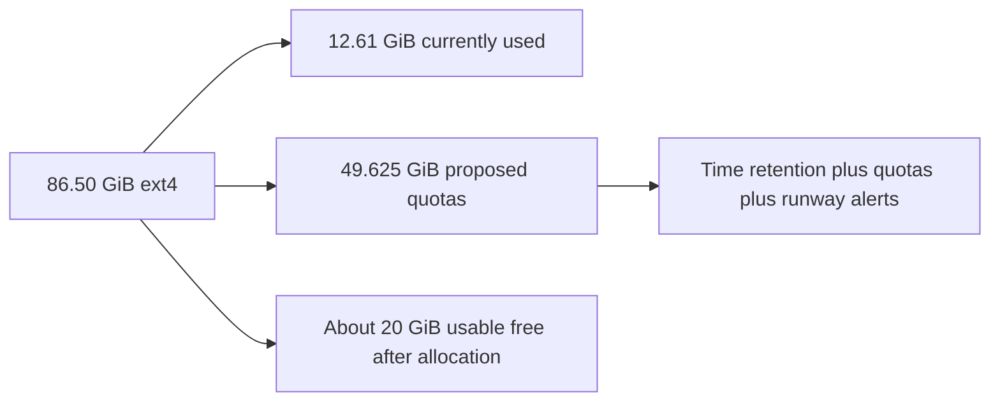

# Current-state audit and capacity model

**Evidence date:** 14 October 2026 local time. **Scope:** current source and read-only VPS/cloud observations. Follow the [overview](00-architecture-overview-and-standards.md) for design status and release/version policy.

> Application update, 16 October 2026: generation/preparation now use native Taskiq
> workers; see [jobs](../backend/modules/jobs.md). The dated capacity inventory below
> predates this extra process and does not establish its production resource budget.
> Application OTel/logging has also been implemented since this audit; see the
> [lesson-10 scope and verification](04-observability-lgtm-and-public-dashboard.md#application-implementation-status).
> The historical inventory below is not a current feature checklist.

## Accepted starting topology — 18 October 2026

Use **N=2 API containers**, one Uvicorn process each; **M=1 native Taskiq worker
execution process**; **K=4 concurrent jobs per worker**. The VPS APIs share one
Tantivy directory. With blue/green delivery, two replicas per slot means two APIs
in steady state and up to four during overlap. One job can fan out into multiple
LLM calls; K is not a provider-request limit. AWS sizing is unchanged.

The user accepted this modest starting configuration; tune N/M/K in lessons
20–21 using representative k6 workloads and separate bounded job measurements.
No further sizing benchmark is required for lesson 19. Basic full-stack startup,
health, host headroom and no-OOM checks remain required before activation.
The [VPS measurement](../../devops-course/lab/lesson19/capacity-evidence.json)
proved 1/2/4/5 APIs at 50 read requests/second; it excluded monitoring and busy
LLM jobs and does not establish maximum capacity.

The [current controller](../../infra/vps/README.md) still assumes one API per
slot; implementing the accepted two-replica topology remains part of the
[delivery plan](../../plans/261018-safe-vps-delivery/plan.md).
Its existing 1,024 MiB worker and lesson-11 768 MiB Grafana ceilings produce
6,528 MiB steady / 7,296 MiB overlap **for the older one-API topology**, excluding
optional Redis cache. These are ceiling sums, not measured usage or an accepted
budget for N=2. The historical table below predates these changes; do not use it
to infer remaining RAM or an optimal replica count.

## 1. Inspection method and evidence boundaries

CodeGraph was used before text search because `.codegraph/` exists. The audit followed application construction, resource ownership, database pools, Redis callers, HTTP/error logging, Tantivy search, migrations, container/ingress configuration, CI and frontend configuration. Relevant existing documentation is indexed by [backend README](../backend/README.md); there is no root `README.md` in this working tree.

SSH used existing host-key verification, batch authentication and a connection timeout. Commands included `lscpu`, `free`, `swapon --show`, `df`, `lsblk`, `ss`, `ps`, `docker ps/stats/info/system df`, `ufw status`, `sshd -T`, `systemctl is-active`, network counters and `iostat -dx 1 2`. No throughput benchmark, package installation, restart, write, cleanup or firewall change was performed. Package/process names and configuration findings are reported without credentials, user records or cloud account identifiers.

## 2. Codebase inventory

| Area | Verified source | Current behavior / consequence |
| --- | --- | --- |
| API | [pyproject.toml](../../apps/api/pyproject.toml), [factory.py](../../apps/api/pycil/app/factory.py) | Python 3.14+, FastAPI/Uvicorn, async SQLAlchemy/asyncpg, Alembic, Pydantic, structlog |
| PostgreSQL | [database.py](../../apps/api/pycil/infrastructure/database.py) | `pool_pre_ping`, hidden parameters; pool size/overflow/checkout timeout use SQLAlchemy defaults |
| Checkpoint store | [checkpoints.py](../../apps/api/pycil/assistant/checkpoints.py) | Separate psycopg pool, minimum 1 / maximum 5 connections per process |
| Runtime | [resources.py](../../apps/api/pycil/app/resources.py) | AsyncExitStack closes jobs, search, pools, HTTP and Redis; Redis connect/read timeouts currently 5 seconds |
| Probes | [factory.py](../../apps/api/pycil/app/factory.py) | `/livez` is live; `/readyz` checks PostgreSQL, Redis and initialized search within 2 seconds; Redis PING is bounded to 250 ms total |
| Redis | [cache.py](../../apps/api/pycil/infrastructure/cache.py), [auth.py](../../apps/api/pycil/account/auth.py), [conversations.py](../../apps/api/pycil/assistant/conversations.py) | Actor caching already fails open; conversation leases are mandatory and fail closed |
| Generation | Domain pipeline only | Custom job runner and status endpoints removed; native Taskiq replacement pending |
| Other caches | [infrastructure/cache.py](../../apps/api/pycil/infrastructure/cache.py) | Two process-local content/artifact caches, each 32 MiB payload limit, TTL 30 seconds |
| Search | [search.py](../../apps/api/pycil/vocabulary/search.py) | Tantivy shared path, file locks, one writer, OnCommit readers, startup fingerprint/rebuild |
| Queries | [words.py](../../apps/api/pycil/vocabulary/words.py), [library scopes](../../apps/api/pycil/library/scope.py) | Nested JSON projections, recursive scope work and ownership filters; different costs from health checks |
| Logging/errors | [observability (current location)](../../apps/api/pycil/observability/__init__.py), [http.py](../../apps/api/pycil/app/http.py) | Structured JSON off TTY, request IDs and sanitized errors; no OTel SDK/exporter in dependencies |
| Policy/secrets | [configuration](../backend/configuration.md), [settings.py](../../apps/api/pycil/app/settings.py) | YAML product policy separate from validated environment addresses/secrets |
| Migrations | [migrate.py](../../apps/api/pycil/app/migrate.py) | Explicit Alembic, native checkpoint setup, optional reference import; no startup migration |
| Containers | [Dockerfile](../../apps/api/Dockerfile), [Compose](../../infra/local/compose.yaml) | Non-root API; single-stage image retains build tools; no complete production resource/retention budget |
| Deployment | [deploy.sh](../../infra/vps/deploy.sh), [Caddyfile](../../infra/local/Caddyfile) | Backup checksum/digest gate; stops API before migration, so current deployment has downtime |
| CI / registry | [test.yml](../../.github/workflows/test.yml), [deploy.yml](../../.github/workflows/deploy.yml) | Tests gate publication of the tested API SHA to `ghcr.io/qninhdt/pycil-api`; no Sonar/Trivy/AWS OIDC or automated runtime deployment |
| Frontend | [Next config](../../apps/web/next.config.ts), [package.json](../../apps/web/package.json) | Next.js 16 / React 19 / Clerk; API URL and data mode are build-time public values |

The reference artifact is **63,787,488 bytes**, **103,426 words** and **202,607 senses**, from [its manifest](../../data/reference.manifest.json). It is about 60.8 MiB before import; database/index sizes cannot be inferred directly from JSONL bytes. No deployed production dataset was available. Existing Git changes were `e2e.md` deleted and an untracked architecture assessment; they were preserved.

## 3. VPS hardware and current utilization

| Item | Observation | Interpretation |
| --- | --- | --- |
| Host | `103.173.227.135`, Ubuntu 24.04 LTS, kernel `6.8.0-31-generic`, x86-64 KVM | Patch/reboot planning belongs to implementation, with recovery console access |
| CPU | 8 visible vCPUs, Intel Xeon Gold 6148 @ 2.40 GHz | Virtual CPU allotment; physical dedicated cores and sustained entitlement are unverified |
| RAM | 8,325,689,344 bytes = **7.754 GiB** | Approximately 7,940 MiB, not 8 GiB of application budget |
| RAM at second sample | 720,592,896 used; 7,605,096,448 available | Approximately 687 MiB used and 7.083 GiB available on an almost idle host |
| Swap | 8,589,930,496 bytes, 12,288 bytes used | Emergency host buffer; not additional application capacity |
| Root filesystem | ext4 on `/dev/vda1`; **86.500 GiB** total, **12.611 GiB** used, **69.474 GiB** available | Difference includes filesystem reserved space; swapfile is part of used disk |
| Block device | `vda`, 88 GiB, virtual rotational flag `ROTA=1`, no model | This does not prove physical HDD; media type and guaranteed IOPS are unknown |
| I/O | Since-boot sample: read await 0.29 ms, write await 0.60 ms, flush await 0.63 ms, utilization 0.17%; second sample idle | Historical/idle statistics, not loaded disk capability |
| Network | `eth0`; virtual link speed returns `-1`; Tailscale present | Guaranteed bandwidth, traffic allowance and loaded throughput are unknown |
| Docker | Client/server `29.5.3`, cgroup v2, driver `overlayfs`, `json-file` logs | No running containers/images; three local volumes reported 0 B; volumes were not removed |
| Processes | journald about 164 MiB RSS; dockerd 101 MiB; containerd 59 MiB; tailscaled 38 MiB | Existing host consumption must be reserved independently of container limits |
| Load/uptime | Load average 0.00; uptime about 42 days | One idle snapshot, not proof of stability under load |

Only SSH TCP 22 and Tailscale UDP 41641 were observed listening. UFW is active but allows several unrelated Internet ports, including 80, 443, 3000, 5000, 8080 and game ports. It has conflicting-looking 8317 deny/allow entries; actual ordering must be inspected before changes. SSH effective config allows root and password login, with six authentication attempts. Nginx/Caddy/Fail2ban were inactive. Do not remove unrelated rules or disable Tailscale without confirming ownership during implementation.

Scoped cloud checks: profile `pycil` selects Singapore (`ap-southeast-1`); EC2 and RDS inventories returned empty there; authenticated principal was root, which must be replaced by an operator role before delivery automation. This is not an account-wide billing/IAM audit. RDS engine inventory includes PostgreSQL `18.6`. Cloudflare's certificate query returned active apex/one-level coverage; scoped Pycil DNS queries returned no records. Previous assessment claims are not reused as live evidence. Vercel project settings and Cloudflare plan entitlements were not audited.

A final scoped GitHub read found the [latest recorded Deploy run](https://github.com/qninhdt/pycil/actions/runs/32523443811) completed with conclusion `skipped`, created 21 August 2026. The package-version API returned HTTP 403 because the CLI token lacks `read:packages`. The repository configures GHCR publication; this audit does not verify an extant package version or a successful current publish.

## 4. Enforceable starting resource budget

One Uvicorn process per API container at the starting configuration. VPS processes sharing one directory still multiply memory/admission/DB-pool demand. AWS Fargate tasks each own an independent index; their provisional task envelope is in document 03. All values below are design limits, not measured working sets. Each container must have limits in its effective configuration, including utility/exporter containers. CPU quotas are maximum shares of one core and may be fractional.

| Container | `mem_limit` MiB | `mem_reservation` MiB | `cpus` | Notes |
| --- | ---: | ---: | ---: | --- |
| Caddy | 128 | 64 | 0.25 | Only HTTPS ingress |
| Active API | 768 | 384 | 1.50 | Limit ordinary requests and expensive jobs |
| PostgreSQL including WAL archiver | 1,792 | 1,024 | 2.00 | Starting shared buffers 384 MiB |
| Redis coordination | 256 | 128 | 0.20 | `maxmemory 96mb`, `noeviction`, AOF every second |
| Redis cache, v1.1.0 only | 256 | 128 | 0.20 | `maxmemory 128mb`, LRU, no persistence |
| Grafana | 256 | 128 | 0.20 | Limit query concurrency |
| Prometheus | 512 | 256 | 0.40 | Series and query limits |
| Loki | 384 | 192 | 0.35 | Single binary, ingestion/query caps |
| Tempo | 384 | 192 | 0.35 | Monolithic, sampled traces, bounded queries |
| Alloy including Unix/cAdvisor/PostgreSQL/Redis components | 448 | 224 | 0.50 | Consolidated budget; verify host mounts/cgroup access and query overhead |
| blackbox_exporter | 32 | 16 | 0.05 | Probe worker, not independent outage detection |
| Docker API allowlist proxy | 32 | 16 | 0.05 | GET-only discovery/log routes; no container mutations |
| **Steady v1.1.0 total** | **5,248** | **2,752** | **6.05** | v1.0.0 excludes cache container: 4,992 MiB; Alloy envelope remains conservative |
| Candidate API, temporary | +768 | +384 | +1.50 | Peak deploy: **6,016 MiB / 7.55 CPU** |
| Migration/import task, temporary | +768 | +384 | +0.50 | Finish before candidate starts; no deploy load test |
| WAL-G full-backup utility, temporary | +384 | +192 | +0.40 | Peak backup: **5,632 MiB / 6.45 CPU** |

At deployment peak, 7,940 − 6,016 ≈ **1,924 MiB** remains for the OS, Docker, kernel/socket/slab overhead and emergency headroom. Reservations are soft preferences, not guaranteed allocated RAM. Set container swap allowance equal to its memory limit where supported; do not allow load to spill into 8 GiB swap. Disable neither the OOM killer nor PostgreSQL durability. Schedule full backups, reference imports, index rebuilds and deploys outside stress tests.

A 384 MiB Tempo or Loki budget may prove insufficient on this workload. Acceptance requires a soak without OOM/restarts and adequate query performance; if it fails, reduce telemetry cardinality/volume first, then increase host memory or move storage. Do not silently omit a required signal. Capacity is admission-controlled, not promised by a spreadsheet.

## 5. Disk allocation and growth model

| Allocation | Initial maximum GiB | Policy |
| --- | ---: | --- |
| PostgreSQL data and WAL | 16 | Include 6 GiB emergency WAL growth within this allocation; never manually delete WAL |
| Tantivy | 4 | Derived from DB; monitor rebuild peak and restore correctness |
| Prometheus | 8 | TSDB retention size 6 GiB, time 15 days; leave WAL/head room |
| Loki | 6 | Seven days; target at most 0.5 GiB/day compressed |
| Tempo | 4 | Seven days; target at most 0.3 GiB/day compressed |
| Alloy spool | 1 | Reject/drop telemetry at documented bounds, never block business requests |
| Grafana database | 0.5 | Provisioning metadata and bounded benchmark snapshots |
| Redis coordination / cache scratch | 0.5 / 0.125 | AOF rewrite headroom; cache has no durable dataset |
| Container logs | 1.5 | 10 MiB × 3 files per container; account for transient jobs |
| Retained application/support images | 4 | CI build off-host; keep current/previous releases, measured image sizes |
| Recovery/export staging | 4 | Do large drills on independent compute if this budget is insufficient |
| **Total new allocations** | **49.625** | Leaves 69.474 − 49.625 = **19.849 GiB** of currently available space |

Use ext4 project quotas on dedicated bind-mount directories if the kernel/filesystem supports them; enabling filesystem quota features may require a maintenance window. Confirm with filesystem metadata and a write-limit test after approval. If unavailable, add a quota-capable volume before deployment. An ordinary Docker named volume on ext4 has no automatic byte limit. Avoid relying on `storage_opt` options intended for other storage drivers. Root journald also needs a bounded system journal and image/log maintenance. [Docker storage drivers](https://docs.docker.com/engine/storage/drivers/).

At 100 requests/s for two hours, sampled traces at 10%, ten spans/request and 500 bytes/span produce about 360 MB before block compression/overhead. One 700-byte request log/request produces about 504 MB before compression. At that rate all day, logs alone become 6.05 GB/day; retention cannot make continuous maximum traffic fit the disk budget. Measure bytes/request and ingest bytes/s, then reject excess telemetry or expand storage. Prometheus example: 20,000 series / 15 seconds × 86,400 × 2 bytes/sample ≈ 230 MB/day for samples, excluding WAL/index/head overhead; actual bytes/sample and series counts require measurement.

## 6. Capacity: Little's Law and independent bottlenecks

Use `L = λ × W`, with **mean** time in a stable system: in-flight requests `L`, completed requests/s `λ`, and mean response time `W` seconds. p95 is an SLO statistic, not the mean for this equation. Logged-in users/CCU are not the same as in-flight requests; with think time `Z`, a closed interactive workload has `N ≈ λ × (W + Z)`.

Current SQLAlchemy defaults are normally pool size 5 + overflow 10 per process; confirm installed version behavior. Adding the separate maximum-5 checkpoint pool gives up to 20 per process: three one-process tasks can reach 60, and a 100%/200% ECS rollout with six tasks can reach 120, before migrations/monitoring. This is a real scale-out risk, even with few users. [SQLAlchemy pooling](https://docs.sqlalchemy.org/en/20/core/pooling.html).

Proposed SQLAlchemy size 5, overflow 0, checkout timeout 2 seconds; checkpoint minimum 1 / maximum 3. At most **8 connections/process**, 24 for three one-process tasks and **48 during a six-task ECS rolling overlap**. Reserve ten for admin/exporters/migration/restore; no concurrent migration/restore/load/deploy and keep `max_connections=80` as the initial VPS/RDS-compatible target. RDS actual permitted memory-derived maximum must be checked before changing its parameter group.

| Model | Assumed demand, explicitly unmeasured | Illustrative limit |
| --- | --- | ---: |
| One API DB pool | 5 connections; 20 ms aggregate connection occupancy/request | 5 / 0.020 = **250 RPS** at full occupancy; 70% planning utilization gives **175 RPS** |
| More complex DB requests | 5 connections; 50 ms occupancy/request | Full 100 RPS; 70% planning utilization **70 RPS** |
| API CPU | 1.5 cores × 70% / 5 ms CPU/request | **210 RPS** |
| Database CPU | 2 cores × 70% / 10 ms DB CPU/request | **140 RPS** |
| In-flight requests | 100 RPS × 0.150 s mean response | **15 concurrent requests** |
| Interactive CCU | 100 RPS × (0.150 + 5 s think time) | About **515 active users**, only under that workload model |

For the first assumptions, `min(175, 210, 140)` gives an illustrative **140 RPS** CPU/pool envelope before I/O, locks, provider limits and monitoring interference. With 50 ms pool occupancy the pool can dominate at about 70 RPS. None is measured maximum RPS or an advertised capacity. Start at 10 RPS, use **50 RPS** as the first load acceptance target, and step upward only with resource/latency evidence.

Nested joins/projections, scope traversals, advisory locks, write transactions and search initialization can increase occupancy. LLM waiting consumes stream/task memory but should not hold idle DB transactions. The 128 process-local generation slots multiply across workers and need bounded admission before stress testing. The first bottleneck cannot be scientifically selected from CPU/RAM alone: capture pool wait, DB active time/locks, CPU throttling/steal, I/O await and heap growth together in [the k6 plan](06-k6-performance-testing-and-roadmap.md).

### Why is this industry standard?

Capacity planning combines hard resource budgets, queueing relationships and empirical calibration. Connection budgets cover **all** pools and deployment overlap. Time retention, byte budgets and disk runway address different failure modes.

### Trade-offs

Small pools provide backpressure but can reject bursts. Shared monitoring steals some application CPU; independent k6 execution and an unchanged telemetry configuration make comparisons defensible. A virtual disk's idle latency cannot establish sustained IOPS.

### Interview questions this design answers

- How do you distinguish CCU, concurrent requests and RPS?
- Why can adding API replicas overload PostgreSQL?
- Why does `mem_limit` prevent host-wide exhaustion but still permit a container OOM?
- What evidence distinguishes CPU saturation, pool saturation and lock contention?
