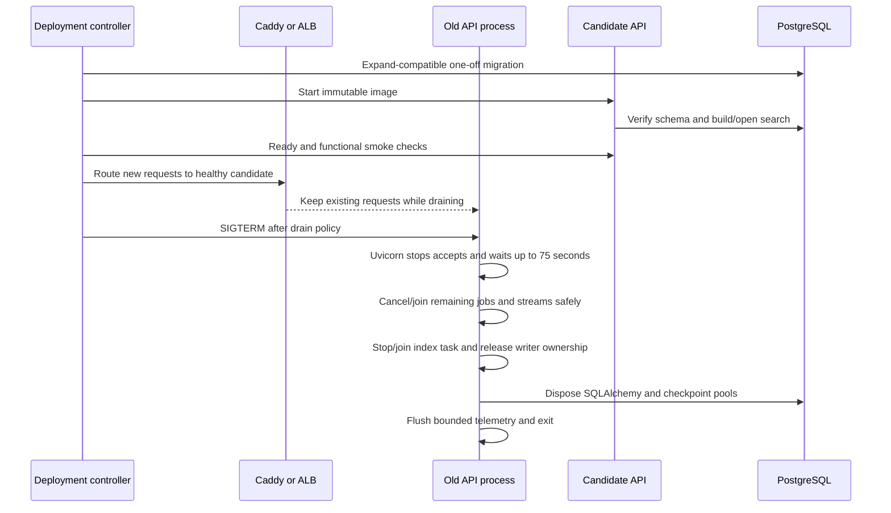
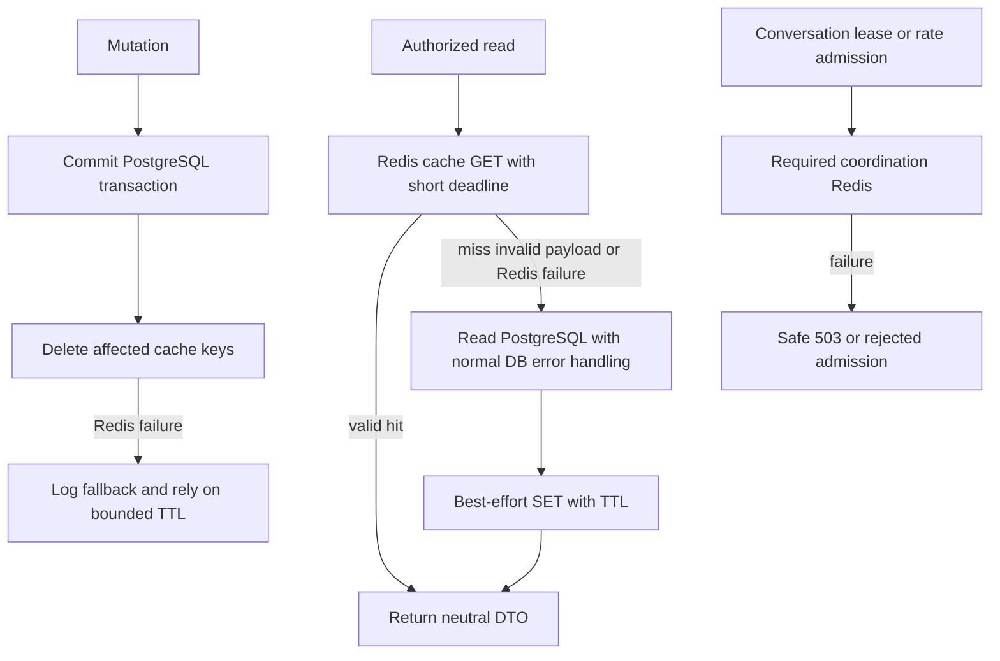

# Application readiness, 12-Factor contracts and Redis design

**Status:** implementation design, partially applied. The [audit](01-current-state-audit-and-capacity.md) is dated baseline evidence. Lesson 10 now implements the application OTel/logging boundary; see [current contracts](../backend/configuration.md#opentelemetry-export) and [verified scope](04-observability-lgtm-and-public-dashboard.md#application-implementation-status). Production telemetry deployment remains pending.

## 1. Change map and contract reach

Extend existing owners rather than introducing a parallel configuration or lifecycle framework. Test paths in the table are relative to `apps/api/`; operational scripts/configuration are relative to the repository root.

| Owner to change | Required change | Callers/configuration/tests to update |
| --- | --- | --- |
| [factory.py](../../apps/api/pycil/app/factory.py) | Use `/livez` and `/readyz` without legacy aliases; initialize official ASGI HTTP instrumentation inside FastAPI | Caddy routes, Compose/ALB/ECS probes, `tests/integration/app/test_lifespan.py`, route tests, OpenAPI exclusions |
| [settings.py](../../apps/api/pycil/app/settings.py) | Validate deployment environment/version, OTLP endpoint and explicit pool/cache addresses | `.env.example`, Compose wrapper/runtime map, SSM injection, `tests/unit/app/test_configuration.py` |
| [resources.py](../../apps/api/pycil/app/resources.py) | Own OTel providers/exporters and separate optional cache client; preserve cleanup order | AppState/RuntimeState typing, factory, integration lifecycle/failure tests |
| [database.py](../../apps/api/pycil/infrastructure/database.py) | Explicit SQLAlchemy pool budget and connection/statement deadlines | Migration client, request dependencies, DB tests, RDS connection TLS |
| [checkpoints.py](../../apps/api/pycil/assistant/checkpoints.py) | Explicit maximum-3 pool budget and finite pool wait | Assistant/checkpoint integration tests and runtime resource owner |
| [observability](../../apps/api/pycil/observability/__init__.py) | Add current OTel trace/span IDs and stable resource metadata to structlog/stdlib output | Request middleware, Uvicorn logs, unit HTTP/log tests; no payload logging |
| [http.py](../../apps/api/pycil/app/http.py) | Bounded route-level metrics and in-flight accounting; sanitize raw paths | Middleware ordering, error/CORS/body-limit tests; SSE final outcome |
| [account/auth.py](../../apps/api/pycil/account/auth.py) and [lifecycle.py](../../apps/api/pycil/account/lifecycle.py) | Release-based actor read-cache behavior and correct invalidation | Account update/deletion callers, identity integration tests |
| [words.py](../../apps/api/pycil/vocabulary/words.py), [artifact storage](../../apps/api/pycil/study/artifacts/storage.py) | Bypass measured local cache paths in baseline; add selected neutral content cache in v1.1.0 | Vocabulary/study callers, ownership/content/artifact/invalidation tests |
| [infrastructure/cache.py](../../apps/api/pycil/infrastructure/cache.py) | Reuse typed JSON Cache-Aside helper with short timeout; never swallow DB failures | Real Redis failure/invalid-payload tests; cache metrics |
| Background jobs | Native Taskiq Redis Streams and result backend; separate CLI worker; no custom receiver | [Jobs contract](../backend/modules/jobs.md), domain submission/worker tests; deployment remains deferred |
| [Dockerfile](../../apps/api/Dockerfile), [Compose](../../docker-compose.yml), [Caddyfile](../../Caddyfile), [compose.py](../../scripts/compose.py) | Multi-stage build, non-root runtime, limits/probes/networks and canonical env mapping | Image smoke, quiet Compose validation, production config validation |
| [deploy.sh](../../scripts/deploy.sh), [Makefile](../../Makefile), [CI](../../.github/workflows/test.yml) | Pre-deploy migration, two-slot switch, telemetry metadata and immutable manifests | Narrow operational script self-checks; pipeline and deploy drills |

AWS ALB directly targets API: preserve the current Caddy route/body-size, trusted-header and SSE contract in the application/ALB configuration. This is an implementation requirement, not a claim that the existing API already enforces the Caddy body cap. The accepted [search/content-revision design](../../search_and_content_revisions.md) owns transactional history, one lifetime writer/poller per index and request publication waiting. Reuse existing projection/document code; request-side direct writes become publication receipts. Include word publication/reuse/themed content, artifact merges and theme/cascade transactions, plus migration, resource lifecycle, readiness and their tests.

Only after implementation update owning backend configuration/deployment/migration pages. These LLDs describe proposed endpoints and settings; do not rewrite current docs to claim they already exist.

## 2. Environment and 12-Factor behavior

Retain `DB_URL`, `REDIS_URL`, Clerk/model variables, `ALLOWED_ORIGINS`, `CONFIG_PATH` and `SEARCH_INDEX_PATH`. `REDIS_URL` continues to mean **required coordination**. New `CACHE_REDIS_URL` exists only in the cache release's deployment contract, not as a benchmark switch. Resource metadata comes from `OTEL_SERVICE_NAME=pycil-api`, `SERVICE_VERSION=<release-tag>`, `GIT_SHA`, `DEPLOYMENT_ENVIRONMENT=vps|aws` (`local` in labs), and `OTEL_RESOURCE_ATTRIBUTES`.

Use OTel resource key `deployment.environment.name` as the canonical semantic attribute; emit `deployment.environment` as a log compatibility field and normalize to Prometheus/Loki `env`. Version values must represent immutable code: no changing an env string to pretend a cache build is a raw-DB release.

Every server process receives configuration at startup; no credential reads from product YAML. Production uses `LOG_FORMAT=json`, `LOG_LEVEL=INFO`, unbuffered stdout, one process/container and no reload watcher. Vercel public configuration includes only API URL, public Clerk key and data mode `live`; private credentials never receive a `NEXT_PUBLIC_` prefix. Use distinct frontend deployments for VPS and AWS; rebuilding is required when their API URL changes.

Manage configuration in three groups. Non-secret product policy remains in the versioned `config/config.yaml` packaged with the image. Shared non-secret runtime defaults belong once in the final Dockerfile stage's `ENV`, including the existing `CONFIG_PATH` and proposed common logging/service-name defaults. VPS Compose `environment` and ECS task-definition `environment` supply only environment-specific values and deliberate overrides, such as deployment environment, CORS origins and OTLP destination. Runtime overrides take precedence over image defaults and require container/task replacement, not an environment-specific image rebuild; changing packaged defaults/policy creates a new release. Do not bake deployment endpoints, credentials or per-environment policy into separate images.

Sensitive deployment values, including complete DB/Redis URLs containing credentials, stay outside Git and image layers. VPS API slots receive service-scoped root-owned mode-0600 files through Compose `env_file`, using `/etc/pycil/runtime-blue.env` and `runtime-green.env`; non-secret overrides remain in the versioned Compose configuration. AWS uses SSM Parameter Store SecureString by default for static credentials, with Secrets Manager selected when managed rotation is required; ECS injects exact references through `secrets` at startup. Terraform owns references/IAM, not plaintext secret values in state. Rotation requires recreating affected VPS containers or deploying new ECS tasks; a process/container restart with the old injected environment is insufficient. Secret readers and access controls are owned by [delivery design section 3](05-devsecops-cicd-and-walg-backup.md#3-aws-oidc-runtime-secrets-and-vps-delivery-credentials).

Disposability includes process-owned jobs and derived Tantivy state: rebuilding is allowed, silently losing committed business data is not. PostgreSQL remains business authority. One background ownership task runs per API worker: only the index owner polls revisions; standby workers wait for writer ownership. Four VPS workers may share files, but multiply reader/application memory, pools and admission; the starting deployment still uses one process/container. Runtime policy changes require a new reviewed release/restart. These contracts follow [12-Factor App](https://12factor.net/).

## 3. Health probes and dependency failure semantics

| Probe | Work and deadline | Response | Consumer |
| --- | --- | --- | --- |
| `GET /livez` | Process/event loop only; no network calls | 200 while serving | Container liveness, external process diagnosis |
| `GET /readyz` | Borrow SQLAlchemy connection, required coordination Redis PING, initialized compatible search and revision progress; total deadline 2 seconds | 200 ready; sanitized 503 otherwise | Caddy/ALB routing and deployment validation |

Readiness cannot depend on optional cache, LGTM, paid provider availability or external notification services. With coordination Redis down, the current whole application is not fully ready: do not return healthy merely because ordinary reads could still work. With only optional cache down, readiness stays 200 and DB reads continue. This resolves the apparent contradiction between readiness dependencies and cache fail-open.

After search synchronization is installed, reuse the bounded DB readiness read to compare committed revision head with the local index cursor. Do not mark an idle, caught-up index unhealthy merely because its last commit is old. The root design owns bootstrap and sustained pending-change failure thresholds; standby workers need no extra background DB poller.

Proposed readiness dependency deadlines: DB checkout/connect/query each bounded by the enclosing two-second probe; coordination PING (including connection acquisition, connect, read and retries) bounded to 250 ms total. Cache operations use a separate client budget of 50 ms connect / 100 ms read with no automatic retry. Catch expected connectivity exceptions, log component/category, and return no hostname/exception/credentials. Preserve cancellation; do not broadly swallow `BaseException`.

ALB: HTTP `/readyz`, success code 200, interval 15 seconds, timeout 5, healthy/unhealthy thresholds 2. ECS service health-check grace starts at 300 seconds but must be calibrated against importing/rebuilding 103k reference words. Container checks use `/livez` after startup; deployment readiness uses the canonical ready path. Docker health status does not itself remove a container from Caddy or automatically restart it. If every ALB target is unhealthy, ALB can fail open to unhealthy targets; application handlers must continue returning safe 503s. [ALB health checks](https://docs.aws.amazon.com/elasticloadbalancing/latest/application/target-group-health-checks.html).

## 4. Graceful shutdown and zero-interruption boundaries



Use Uvicorn's native SIGTERM handling; do not register a competing signal handler in FastAPI. Exec-form command keeps Uvicorn as the process receiving the signal. Starting specification:

```text
uvicorn pycil.main:app --host 0.0.0.0 --port 8000 --workers 1
  --timeout-graceful-shutdown 75 --timeout-keep-alive 5
  --limit-concurrency 64 --no-access-log
```

Ordinary overload returns bounded 503 instead of unbounded queues. Account for probe traffic and establish a meaningful ordinary-request admission limit under the server cap. Do not interpret 64 as safe concurrency for model generation: generation/preparation execute in native Taskiq workers; worker async concurrency and provider fan-out need their own measured budget. HTTP readiness does not establish worker progress. Reuse existing coordination controls rather than a home-grown feature-toggle system.

Preserve existing AsyncExitStack LIFO order: stop/join index work before closing search/HTTP/Redis/pools. Lifespan is reached after Uvicorn's HTTP drain. The exit stack has a cooperative 40-second cleanup budget, leaving five seconds of nominal margin after the 75-second drain within the 120-second container stop interval. Async cancellation does not preempt blocked native code or cancellation-suppressing cleanup; the container stop deadline remains the hard bound. Keep future telemetry flush within the cleanup budget. VPS Compose `stop_grace_period=120s` and AWS ECS API container `stopTimeout=120` (the Fargate maximum); ALB deregistration delay 90 seconds. Caddy reload uses `stream_close_delay=120s` so configuration replacement does not immediately terminate streams. [Uvicorn settings](https://www.uvicorn.org/settings/), [Caddy reverse proxy](https://caddyserver.com/docs/caddyfile/directives/reverse_proxy).

Assistant LLM timeout 180 seconds and provider timeout 120 seconds. They exceed a 75-second server drain. Long-running streams/jobs can be interrupted and must publish the existing interrupted outcome/checkpoint semantics; do not claim all requests finish uninterrupted. Zero-interruption acceptance applies to bounded ordinary API calls under compatible schema and healthy replacement capacity. A single VPS cannot deliver zero downtime during host failure or incompatible DDL. Test active SSE cancellation, generation interruption, pool disposal and no duplicate review settlement explicitly.

## 5. OpenTelemetry and structured logging

Initialize one SDK TracerProvider and MeterProvider per process in the resource lifecycle. Attach resource service name/version/environment and unique instance identity. Use BatchSpanProcessor and OTLP HTTP exporter: VPS Compose to Alloy at `http://alloy:4318`; AWS to the task-local CloudWatch Agent sidecar receiver, provisionally `http://127.0.0.1:4318` after its configuration is verified. Reuse instrumentation; validate backend metric/dimension and correlation mapping separately. The current SDK owner appends `/v1/traces` and `/v1/metrics` to one validated base endpoint; per-signal URL overrides are not current configuration inputs.

Starting trace export limits: queue 2,048 spans, batch 256, schedule 5 seconds, export timeout 2 seconds, parent-based trace-ID ratio 10% sampling. Controlled short diagnostic runs may use 100%, with identical settings for paired comparisons. Do not claim head sampling keeps every error trace; that requires a different sampling design. Metrics export every 15 seconds with bounded timeout, sampled-trace exemplars and explicit histogram buckets for 5 ms through 5 seconds. Reserve SDK memory within the API limit.

Use official ASGI middleware for HTTP inside FastAPI. The HTTP adapter supplies a sanitized telemetry scope before span/metric collection, while the original scope reaches the application; this avoids the FastAPI wrapper collecting raw URLs before hooks run. Never enable both HTTP wrappers. Application query spans reuse the existing cursor events on `engine.sync_engine` and the standard OTel SDK: pinned contrib `0.66b0` excludes SQLAlchemy `2.1`, so its dependency check must not be bypassed. Record only bounded operation names, timing and error classes; do not simultaneously enable SQLAlchemy/asyncpg auto-instrumentation and duplicate each query. The separate psycopg checkpoint pool uses its public `cursor_factory` for safe execute/executemany spans; native persistence, pool waiting, cancellation and privacy have integration checks. Pipeline spans measure driver calls that may only enqueue work, not completed database execution; later synchronization errors belong to the enclosing operation. See the [instrumentation contract](../backend/configuration.md#opentelemetry-export). Shared HTTPX and assistant OpenRouter async clients use the existing SDK through a safe public `AsyncClient.send` boundary, with no URL/header/body/exception-text capture or additional retries. Child spans, cancellation, response hooks, streaming behavior and client cleanup have focused checks. Send spans do not measure the full streamed generation; later body errors belong to its enclosing outcome. Do not add overlapping HTTPX auto-instrumentation. PyJWT JWKS fetching uses a separate transport and is outside this HTTPX boundary. Runtime/process metric collection remains a collector/deployment requirement; lesson 10 does not enable a separate system-metrics instrumentor. Add only missing application measurements: pool checkout wait/use, requests in flight, route latency/count, generation/stream outcomes, cache hit/miss/fallback and search publish/rebuild duration.

Disable SQL bind values and redact statement text where private literals/schema details can leak. Never capture authorization/cookie headers, provider prompts/responses, assistant messages, image bodies or raw JWTs. Structured completion logs include `request_id`, current valid `trace_id` (32 hex), `span_id` (16 hex), service/version/environment, templated route, method, status and duration. Outside a span omit trace IDs instead of inventing them. Add metadata through a structlog processor reading current OTel context, after contextvars merge; middleware clears request context, so constant resource fields cannot depend solely on a startup contextvar. Disable native Uvicorn access logging in shared logging setup as well as the server command: its raw URL/query messages must not propagate to root alongside sanitized completion logs.

Metric dimensions are bounded: env, version, method, route template and status class. Trace IDs, user IDs, raw URLs, task IDs and query strings are never metric/Loki index labels. Keep useful correlation fields as JSON/structured metadata. For SSE, record first-event delay and terminal outcome separately from the HTTP 200 response. HTTP success does not prove stream completion. [OTel Python instrumentation](https://opentelemetry.io/docs/languages/python/instrumentation/).

Unmatched 404 routes use one fixed `unmatched` metric value rather than the user-supplied path. RDS asyncpg connections use an explicit SSL context with the current RDS CA bundle and hostname verification; do not pass psycopg-only connection arguments into SQLAlchemy's asyncpg URL. Managed Redis uses `rediss://` with CA/hostname verification. These settings belong to validated deployment configuration and real TLS integration tests, not a permissive development fallback.

## 6. Independent migrations and production image

Keep the existing one-off command `python -m pycil.app.migrate`; startup only verifies. CI/CD serialization provides one migration owner per environment. The command now acquires a session advisory lock on a dedicated connection across Alembic, native checkpoint setup, optional import and verification, so native autocommit does not release ownership. Lock wait, connection, SQL and async setup budgets are specified in [migration operations](../backend/operations/migrations.md#serialization-and-deadlines); deployment runners must also bound the whole task. Do not put migration in the app entrypoint or run one per replica.

Use expand/contract migrations: add backward-compatible columns/indexes first, deploy readers/writers, backfill outside latency paths, then remove old schema in a later release. Current `initial.py` is a fresh baseline, not an upgrade chain; a populated legacy DB requires a separately verified transfer. Reference import runs on first initialization or an intentional artifact upgrade, not on every deploy. Native checkpoint setup uses separate autocommit boundaries, so a later import failure does not roll back all earlier setup. Image rollback never reverses DDL.

Illustrative Dockerfile skeleton, using existing exact base pins; production adds reviewed digests:

```dockerfile
FROM python:3.14.8-slim-trixie AS builder
COPY --from=ghcr.io/astral-sh/uv:0.12.22 /uv /bin/uv
ENV UV_LINK_MODE=copy UV_COMPILE_BYTECODE=1
WORKDIR /app/apps/api
RUN apt-get update && apt-get install -y --no-install-recommends build-essential git && rm -rf /var/lib/apt/lists/*
COPY apps/api/pyproject.toml apps/api/uv.lock ./
RUN --mount=type=cache,target=/root/.cache/uv uv sync --locked --no-dev --no-install-project
COPY apps/api/ ./
RUN --mount=type=cache,target=/root/.cache/uv uv sync --locked --no-dev

FROM python:3.14.8-slim-trixie AS runtime
ENV PYTHONUNBUFFERED=1 PYTHONDONTWRITEBYTECODE=1 \
    PATH=/app/apps/api/.venv/bin:$PATH CONFIG_PATH=/app/config/config.yaml
RUN useradd --uid 10001 --create-home appuser \
    && install -d -o appuser -g appuser /var/lib/pycil/search
WORKDIR /app/apps/api
COPY --from=builder /app/apps/api/.venv ./.venv
COPY apps/api/pycil ./pycil
COPY apps/api/migrations ./migrations
COPY apps/api/alembic.ini ./alembic.ini
COPY config/config.yaml /app/config/config.yaml
USER 10001:10001
CMD ["uvicorn", "pycil.main:app", "--host", "0.0.0.0", "--port", "8000", "--workers", "1", "--timeout-graceful-shutdown", "75", "--limit-concurrency", "64", "--no-access-log"]
```

The venv uses the same absolute path in both stages. CI must smoke-test installed package metadata/native extensions and migration path resolution in this exact runtime; include any necessary distribution metadata/package assets if the locked build requires them. Exclude dotenv, credentials, `.git`, node_modules, tests/reports and personal data using `.dockerignore`; explicitly include only needed source/policy. Import `reference.jsonl` through a verified read-only artifact mount on VPS; provide it through a checksummed S3 artifact to the AWS initialization container. Do not bake mutable production data into the image.

## 7. Release-based Cache-Aside, with real boundaries

`v1.0.0` means **raw PostgreSQL reads for the declared benchmark endpoints**, not an assertion that the current repository lacks Redis. In that baseline commit, remove optional actor-cache attachment for measured requests and pass the existing `cache=None` data-read path where supported. Remove measured content-cache lookups/writes from the release's selected owners where no uncached path exists. Keep task-status/lease/admission Redis behavior unchanged. No environment toggle, fake cache backend or per-request benchmark flag is introduced. Search uses Tantivy and is measured separately from the DB-only cohort.

`v1.1.0` restores/adds selected cache behavior using the existing typed helper, backed by the **separate** cache Redis. Redis coordination keeps noeviction so cache pressure cannot evict locks/task status. AWS uses separate ElastiCache replication groups with the same semantic boundary; v1.0.0 creates only coordination storage.



Starting cache candidates: account DTO TTL 60 seconds, neutral immutable word DTO TTL 300 seconds with ±10% TTL jitter, maximum value 256 KiB. Cache complete neutral content, not owner-specific access decisions, entitlements, review progress, balances or paid-operation settlement. Account/plan authorization freshness must retain current DB checks for sensitive writes. Re-evaluate actor caching before it can conceal account deletion or downgrade beyond the existing accepted TTL.

Keys use an explicit deployment/database identity plus schema namespace, e.g. `pycil:v1.1:aws-fargate:content-v1:word:<id>`. The current namespace hashes DB URL and Clerk issuer; credential rotation changes that namespace, so do not make cross-node correctness depend on caches surviving credential rotation. Do not cache whole authenticated HTTP responses. Deletion/invalidation happens after transaction commit. Concurrent miss + mutation can repopulate stale data after invalidation: TTL bounds that race; apply cache only to data where this consistency window is acceptable. Strictly consistent state stays in PostgreSQL.

On cache timeout/RedisError/invalid JSON, log a bounded warning and record fallback; execute the real PostgreSQL read. Cache SET/DELETE failure must not change a committed business result. PostgreSQL errors are propagated through existing safe handlers. Cache outage still increases DB load, so load-test the fallback path within the raw-DB capacity envelope. Cache miss storms use existing per-process singleflight where available; distributed locking is unnecessary for inexpensive reads. Introduce it only if measured origin overload warrants it.

### Why is this industry standard?

Native ASGI lifecycle, independent migrations, immutable multi-stage builds and standard OTel avoid bespoke process machinery. Cache-Aside treats cached values as disposable acceleration while keeping authoritative data and coordination semantics explicit. [Microsoft Cache-Aside pattern](https://learn.microsoft.com/en-us/azure/architecture/patterns/cache-aside).

### Trade-offs

Cache-Aside permits a bounded stale-read window and cannot make an overloaded database disappear. Keeping mandatory coordination means a total coordination outage cannot honestly satisfy blanket Redis fail-open. Long-lived streams require bounded interruption/recovery semantics rather than an unconditional zero-downtime claim.

### Interview questions this design answers

- What belongs in liveness versus readiness?
- Who handles SIGTERM in an ASGI container?
- Why should migrations not run in every application entrypoint?
- How do you instrument SQLAlchemy without duplicate driver spans?
- How do cache invalidation races and Redis outage change database capacity?
