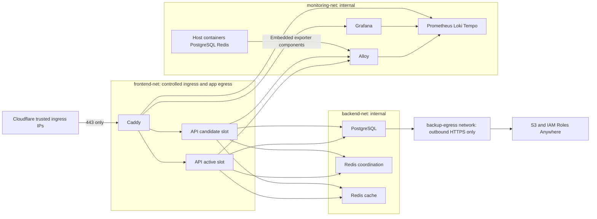
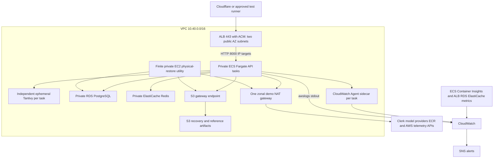

# Independent infrastructure: VPS production and ephemeral AWS

**Status:** proposed infrastructure configuration. Do not execute mutation examples until this design is approved. Resource limits are owned by [01](01-current-state-audit-and-capacity.md), application contracts by [02](02-app-12factor-and-redis-design.md), and orchestration/recovery by [05](05-devsecops-cicd-and-walg-backup.md).

## 1. VPS network and deployment topology

Retain Caddy because the repository already has correct assistant streaming/body-limit behavior. Caddy supports native active health checks, reloadable upstream configuration and explicit TLS without Docker discovery privileges. Traefik adds discovery machinery that two known API slots do not need; Nginx is also conventional but requires replacing a working ingress contract without a demonstrated benefit.



`backend-net` and `monitoring-net` use `internal: true`. No ports are published by PostgreSQL, either Redis, API, Alloy, exporters, Prometheus, Loki, Tempo or Grafana. Container listeners on `0.0.0.0` within their private namespaces are acceptable; publishing those services on host `0.0.0.0` is prohibited. Caddy publishes TCP 443 only. Its admin endpoint stays on loopback inside the container and is reached through a controlled deploy command, never a public route.

API-to-PostgreSQL and API-to-Redis connections may omit TLS on this single trusted VPS with unpublished store ports and controlled Compose network membership. This is an accepted same-host trust boundary, not a claim that Docker private networking encrypts traffic. Revisit TLS with server certificate/hostname verification if stores move off-host or untrusted workloads join the boundary; public ingress TLS remains required.

The API joins frontend/backend/monitoring networks and needs outbound HTTPS for Clerk/model providers. PostgreSQL's archive process needs S3/temporary-credential HTTPS: an internal-only backend would block that. Add `backup-egress` for PostgreSQL/backup utility, and a controlled egress network for alerting/probes as needed. Apply host FORWARD egress policy; attaching an extra Docker network alone does not constrain egress. Alloy joins only the networks needed for store access and collection; the four embedded exporters need no separate containers. Multi-network containers must not forward traffic between networks.

### Production Compose specification

Implement production configuration under `infra/vps/compose.production.yaml`, keeping local development behavior separate. Extend `scripts/compose.py` to accept the production file selection while preserving canonical URL parsing and its ban on printing resolved secrets. Production must remove inherited `ports`, rather than assuming an empty YAML merge deletes them. Validate the final effective configuration quietly.

Fragment showing the complete required contract for an API slot; image values come from a release manifest and must resolve to real `@sha256` digests:

```yaml
x-logging: &bounded-logging
  driver: json-file
  options: {max-size: "10m", max-file: "3"}
x-api: &api
  image: ${API_IMAGE:?immutable release digest required}
  user: "10001:10001"
  init: true
  restart: unless-stopped
  read_only: true
  cap_drop: [ALL]
  security_opt: [no-new-privileges:true]
  mem_limit: 768m
  mem_reservation: 384m
  memswap_limit: 768m
  cpus: 1.5
  pids_limit: 256
  stop_signal: SIGTERM
  stop_grace_period: 120s
  logging: *bounded-logging
  tmpfs: ["/tmp:size=64m,mode=1777"]
  networks: [frontend-net, backend-net, monitoring-net]
  volumes: ["/srv/pycil/search:/var/lib/pycil/search"]
  healthcheck:
    test: [CMD, python, -c, "import urllib.request; urllib.request.urlopen('http://127.0.0.1:8000/livez', timeout=2).read()"]
    interval: 15s
    timeout: 3s
    retries: 3
    start_period: 180s
services:
  api-blue:
    <<: *api
    env_file: /etc/pycil/runtime-blue.env
  api-green:
    <<: *api
    profiles: [deploy]
    env_file: /etc/pycil/runtime-green.env
networks:
  frontend-net: {}
  backend-net: {internal: true}
  monitoring-net: {internal: true}
  backup-egress: {}
```

The active slot alternates; the deployment controller supplies separate blue/green digest values so starting a candidate cannot recreate the active container. The fragment's single variable illustrates one slot's contract; the final file uses `BLUE_API_IMAGE` and `GREEN_API_IMAGE` independently. No production build occurs on the VPS. One-shot migration/backup containers receive their own limits, no restart policy and temporary credentials. PostgreSQL/Grafana/Redis need writable data directories and vendor startup permissions; verify entrypoint ownership before enabling `read_only`/dropping capabilities. Do not blanket-force API UID 10001 onto vendor images.

All services use [the budget table](01-current-state-audit-and-capacity.md#4-enforceable-starting-resource-budget), including a pinned `tecnativa/docker-socket-proxy:0.5.0` if Docker discovery is used. The proxy is internal, GET-only and disables POST/EXEC/images/secrets; its allowed Docker inspection can still expose sensitive metadata, so it is an elevated trust component. Prefer direct read-only log-directory access when it meets discovery needs. A socket mounted `:ro` does not make Docker API commands read-only. cAdvisor's host mounts/permissions need separate review and must not expose container environment variables as metric labels.

Starting PostgreSQL settings within its 1,792 MiB budget: `shared_buffers=384MB`, `effective_cache_size=1536MB` (planner estimate, not an allocation), `work_mem=4MB`, `maintenance_work_mem=64MB`, `autovacuum_work_mem=32MB`, `autovacuum_max_workers=2`, `max_connections=80`, `max_parallel_workers=2`, `max_parallel_workers_per_gather=1`, `max_wal_size=1GB`, `checkpoint_timeout=15min`, `checkpoint_completion_target=0.9`. Keep `fsync`, `full_page_writes` and `synchronous_commit` enabled. `work_mem` is per plan operation/worker, not per connection: measure multi-sort/hash queries and overlapping deploys before accepting this envelope. Ordinary API sessions start with a five-second statement timeout, one-second lock timeout and 30-second idle-in-transaction timeout; migration/import/recovery roles have separately bounded longer deadlines. These settings require workload calibration and are not blindly copied into a smaller RDS instance.

### Caddy/TLS and blue-green routing

Use Cloudflare **Full (Strict)** with a valid origin certificate matching requested hostnames. A private-mounted Cloudflare Origin CA certificate is suitable for proxied-only VPS traffic; browsers connecting directly do not trust it. Mount key/certificate read-only, mode 0600, and alert on expiry. Closing port 80 means the current automatic HTTP-01 certificate path cannot simply be assumed to work. Use the mounted origin certificate; avoid adding a DNS plugin solely for issuance.

```caddyfile
api.pycil.qninhdt.com {
    tls /run/secrets/origin.crt /run/secrets/origin.key
    request_body { max_size 15000000 }
    reverse_proxy api-blue:8000 {
        health_uri /readyz
        health_interval 10s
        health_timeout 3s
        stream_close_delay 120s
        transport http {
            compression off
            response_header_timeout 3m
        }
    }
}
```

Extend the existing route allowlist for canonical probes; retain its SSE no-cache/unbuffered behavior and avoid compressing assistant streams. Restrict documentation/admin surfaces appropriately. Candidate readiness and authenticated smoke checks precede a validated Caddy reload switching the static upstream. Keep the old slot for drain/rollback. Two slots share the local Tantivy directory and required stores. No retry of non-idempotent POSTs occurs just because an upstream connection fails.

## 2. VPS security hardening specification

1. Establish a named sudo operator, SSH public-key login and tested provider rescue console. Test a second session before disabling root/password authentication. Proposed effective SSH values: `PermitRootLogin no`, `PasswordAuthentication no`, `PubkeyAuthentication yes`, `MaxAuthTries 3`.
2. UFW default deny inbound; SSH permitted only from the operator's fixed IP/VPN route. Preserve authorized Tailscale networking and unrelated services until their ownership is resolved. Only TCP 443 from current Cloudflare IPv4 **and IPv6** ranges is public for proxied traffic; no UDP 443 is required for this design.
3. Docker published ports bypass ordinary UFW INPUT rules. The observed iptables-nft configuration needs matching DOCKER-USER/FORWARD restrictions for external Docker traffic; first accept established traffic, then allow Cloudflare-to-Caddy and deny other external ingress. Do not disable Docker-managed firewalling. Verify the active Docker firewall backend before applying any backend-specific rules. [Docker firewall behavior](https://docs.docker.com/engine/network/packet-filtering-firewalls/).
4. A controlled scheduled job reads [Cloudflare's published ranges](https://www.cloudflare.com/ips/), validates non-empty IPv4/IPv6 sets and replaces firewall sets atomically. Failure keeps the previous rules and alerts; it must not open 443 to the world.
5. Fail2ban `sshd` jail uses the systemd backend, `maxretry=3`, `findtime=10m`, `bantime=1h`; ignore the verified management subnet. Rate limiting complements keys; it does not replace them.
6. Patch OS/Docker through an approved maintenance window; monitor reboot requirements and provider/hypervisor security constraints. Bound journald (starting `SystemMaxUse=256M`, `SystemKeepFree=1G`). Changes to daemon log defaults require a separately planned Docker restart and container recreation.

Before public activation verify from outside that 5432/6379/9090/3100/3200/4317/4318/3000 and exporter ports are unreachable, direct-origin HTTPS cannot bypass the Cloudflare policy, and both address families behave correctly. A firewall listing alone is not an external exposure test. Restrict forwarding/egress for store/collector containers while preserving DNS, S3 and required HTTPS destinations.

## 3. Cloudflare DNS, TLS and routing

| Name | Record / destination | Policy |
| --- | --- | --- |
| `api.pycil.qninhdt.com` | Proxied A to VPS | Browser API authorization; WAF and cache bypass |
| `aws-api.pycil.qninhdt.com` | Proxied CNAME to current ALB DNS | Created after restore/readiness; removed during teardown |
| `grafana.pycil.qninhdt.com` | Proxied A to VPS | Cloudflare Access identity/MFA plus Grafana login |
| `monitor.pycil.qninhdt.com` | Proxied A to VPS | Curated externally shared dashboard routes only |
| `telemetry.pycil.qninhdt.com` | Proxied A to VPS | Access service token; ingestion POST allowlist, no query/admin API |

AWS API DNS exists only during a validated workload session. ALB routes it directly to private Fargate API task IPs on port 8000. AWS monitoring is accessed through IAM-authorized CloudWatch, not custom Grafana/monitor/telemetry hostnames; no public OTLP collector endpoint is needed. No AWS hostname points at the VPS.

The existing universal edge certificate does **not** cover these nested names. Configure explicit advanced/custom certificate coverage for `*.pycil.qninhdt.com`, or obtain user acceptance for covered first-level names such as `pycil-api.qninhdt.com`. Keep the requested names in this design; activation has a certificate-coverage gate. AWS ACM protects Cloudflare-to-ALB, and an origin certificate protects Cloudflare-to-VPS; neither expands the **Cloudflare edge** certificate. Additional Cloudflare certificate/WAF plan charges are outside the AWS $200 credit. [Universal SSL limits](https://developers.cloudflare.com/ssl/edge-certificates/universal-ssl/limitations/).

Enable TLS 1.2 minimum, HTTPS redirect at the edge, and bypass CDN cache for API/auth/SSE/probes/ingestion. Trust forwarded IP headers only from controlled ingress. Telemetry uses HTTP OTLP/remote-write through 443; do not try to proxy OTLP gRPC on 4317 through a normal orange-cloud DNS record. Access service tokens travel in authenticated HTTPS headers and are injected as secrets. Enforce equivalent token/JWT validation or secondary origin authentication at Caddy for ingestion; Cloudflare source-IP restriction alone is not tenant authentication.

WAF/rate-rule availability depends on the actual account plan. Implement narrow time-limited load-test exceptions for a known runner IP and hostname, preserving application auth and all origin/private-port restrictions. Never disable protection globally to run k6. The [observability design](04-observability-lgtm-and-public-dashboard.md) specifies public route/query boundaries.

## 4. Two independent Terraform layers

```text
terraform/
  01-foundation/{versions,backend,storage,registry,identity,certificates,budgets,parameters,outputs}.tf
  02-workload/{versions,backend,network,security,ecs,rds,redis,observability,autoscaling,dns,outputs}.tf
infra/vps/{compose.production.yaml,Caddyfile,postgresql.conf,redis-coordination.conf,redis-cache.conf}
infra/aws/{task-definition.json,cloudwatch-agent.json,dashboards,alarms}/
infra/observability/{alloy,prometheus,loki,tempo,grafana}/
scripts/{deploy,aws-up,aws-down,backup,restore-drill,run-k6}.sh
```

These are proposed paths, not files created by this task. Use native provider resources initially: external Terraform modules are unnecessary at this scale. If introduced later, pin each module's exact version and review its interfaces.

| Layer | Persistent ownership | Protection / billing |
| --- | --- | --- |
| Foundation | Separate private S3 state and backup/evidence buckets; ECR immutable mirror of the existing GHCR build; GitHub OIDC provider/roles; IAM Roles Anywhere trust anchor/profile; AWS Budget notification; regional ACM certificate and DNS validation; standard SSM parameter contracts; CodeBuild cleanup project, scoped role and disabled expiry schedule | `prevent_destroy` for state/backups/ECR; no idle compute, NAT, public IP or paid private CA/KMS key; storage and actual cleanup runs still cost money |
| Workload | VPC/subnets/routes/IGW, NAT/EIP, ALB/listener/target groups, ECS cluster/service/task definitions, execution/task roles, Service Auto Scaling, finite restore EC2/profile/EBS, RDS/subnet/parameter groups, ElastiCache, CloudWatch log groups/dashboards/alarms/Container Insights, SNS, temporary secrets and session DNS | Archive evidence, then destroy all owned workload resources after demo; never use RDS stop or ECS desired count zero as the complete shutdown strategy |

Bootstrap foundation once with secure local state, create its backend bucket, then `terraform init -migrate-state` into the protected backend. Foundation and workload use separate state keys/roles; workload consumes only allowlisted outputs/parameters, not broad remote-state access if it would expose secrets. Retain workload state after destroy for audit/idempotency, not the workload infrastructure.

```hcl
terraform {
  required_version = "= 1.16.5"
  required_providers {
    aws = { source = "hashicorp/aws", version = "= 6.68.0" }
    cloudflare = { source = "cloudflare/cloudflare", version = "= 5.28.0" }
  }
  backend "s3" {
    key          = "pycil/02-workload/terraform.tfstate"
    region       = "ap-southeast-1"
    encrypt      = true
    use_lockfile = true
  }
}
```

Supply the bucket through a non-secret backend config; never place credentials in HCL/backend arguments. Commit `.terraform.lock.hcl`. S3 state versioning supports recovery; native lock files replace the deprecated DynamoDB lock design. Restrict deletion to `.tflock`, not state/backups. CI concurrency and state locks protect different races. [Terraform S3 backend](https://developer.hashicorp.com/terraform/language/backend/s3).

## 5. AWS workload network and managed services



CIDRs remain public `10.40.0.0/24`, `10.40.1.0/24`; application-private `10.40.10.0/24`, `10.40.11.0/24`; database-isolated `10.40.20.0/24`, `10.40.21.0/24`. Fargate uses `awsvpc`, no public IP, no application host/SSH/OS bootstrap. Private tasks use NAT for image/provider/AWS API egress; S3 gateway endpoint handles artifacts. Database subnets have no Internet route. Paid interface endpoints remain an optional priced optimization. Single-NAT and Single-AZ stores are accepted demo availability reductions, not a production HA claim.

| Security group | Allowed inbound |
| --- | --- |
| ALB | TCP 443 from current Cloudflare ranges; temporary dedicated runner IP only for direct-path tests |
| Fargate task | TCP 8000 from ALB SG only; OTLP sidecar listens on task loopback, not a public listener |
| RDS | TLS TCP 5432 from application task and finite restore SGs only |
| Redis coordination/cache | TLS TCP 6379 from application task SG only |
| Restore EC2 utility | No inbound listeners; scoped SSM management via outbound connections |

### AWS application task

An ECS service runs the reviewed Linux/x86-64 ECR digest on **Fargate**, one Uvicorn/API process per task, plus a **CloudWatch Agent sidecar**. No Caddy, Alloy, node_exporter, cAdvisor or native DB/Redis exporter containers run in AWS. ALB uses **IP targets on HTTP 8000**, terminates ACM TLS and checks `/readyz`. Preserve Caddy's API route/body-limit, trusted-proxy and unbuffered SSE contracts in the application/ALB configuration before removing Caddy from the AWS path. Configure an ALB idle timeout appropriate for measured SSE heartbeat gaps; no retry of non-idempotent writes.

Provisional task envelope: **1 vCPU / 2 GiB** including sidecar and SDK overhead; API hard limit 1,408 MiB, Agent 384 MiB, 256 MiB task headroom. CPU shares start 896 API / 128 Agent (not independent CPU quota promises). The shape is a calibration proposal, not measured capacity. Use non-root API, bounded logs/queues, read-only root plus writable search/tmp mounts, and `stopTimeout=120`; reconcile SDK/job cleanup with the 75-second Uvicorn drain. Sidecar failure must not become a business readiness dependency; report telemetry gaps and repair it explicitly. [Fargate task parameters](https://docs.aws.amazon.com/AmazonECS/latest/developerguide/task_definition_parameters.html).

Task execution role handles ECR pulls, awslogs and exact startup-secret reads; task role grants only the Agent's required telemetry permissions and any explicitly required runtime APIs. Roles apply to the task boundary, not an assumed separate identity per sidecar. Inject exact SSM/Secrets Manager references through ECS secrets; secret rotation needs new tasks. App OTLP reaches the sidecar on task-local `127.0.0.1:4318`, subject to verified Agent receiver configuration. Pin the Agent image/config and test metric temporality, histogram/dimension mapping and trace/log correlation. See [observability](04-observability-lgtm-and-public-dashboard.md).

RDS remains PostgreSQL `18.6`, `db.t4g.micro`, encrypted 20 GiB gp3, Single-AZ, private, TLS-required parameter group and `pg_stat_statements`; one-day managed backup during the session. Verify actual connections/credits/engine support and cap storage growth at the reviewed 30 GiB demo maximum. Continuous production use requires a separately reviewed backup/availability policy; disposable session teardown is not that policy.

ElastiCache remains one-node Redis OSS `7.1`, `cache.t4g.micro`, encryption in transit/at rest and ACL/auth. Coordination uses `noeviction`; the cache release adds a separate evictable cache group. Verify exact engine/parameters/ACL support at preflight. Single-node demo groups do not provide failover.

Require TLS for application and restore connections to RDS and for both application Redis connections. Clients must verify certificate chains and endpoint hostnames, with no plaintext fallback or disabled verification; PostgreSQL clients use `verify-full` or their driver's equivalent with the RDS CA bundle. Explicitly enable ElastiCache in-transit encryption and require encrypted connections. These connections remain inside the private VPC; security groups restrict sources/ports, while store/client configuration enforces TLS. ALB TLS protects a separate connection and supplies no store encryption. AWS supplies the managed-store certificates; no additional TLS proxy/container is needed. Validate the live connections during M6. [RDS TLS](https://docs.aws.amazon.com/AmazonRDS/latest/UserGuide/PostgreSQL.Concepts.General.SSL.html), [ElastiCache TLS](https://docs.aws.amazon.com/AmazonElastiCache/latest/dg/in-transit-encryption.html).

### Local search storage

**VPS:** one host-local directory is shared by compatible API processes/blue-green slots. The accepted design keeps one lifetime Tantivy writer/poller for that directory, selected by the native writer lock; other workers wait for ownership and serve through OnCommit readers. Requests record revisions and wait for local publication rather than writing through a second path. Keep the actual host path verified during VPS deployment; the Compose example's `/srv/pycil/search` is a proposed production location, not evidence of a completed move.

**AWS:** each Fargate task owns one writable ephemeral directory at `SEARCH_INDEX_PATH=/var/lib/pycil/search`; Tantivy runs inside its one API process. A new task rebuilds from that environment's RDS before readiness. No cross-task file sharing, EFS, persistent search EBS, dictionary sidecar or separate search service. Linux Fargate provides 20 GiB ephemeral storage by default; compressed/uncompressed image layers consume that same allowance. Start with the default and reserve a proposed 1 GiB search working envelope, then measure real generated-vocabulary/rebuild peaks. [Fargate storage](https://docs.aws.amazon.com/AmazonECS/latest/developerguide/fargate-task-storage.html).

The reference-only check measured about 17 MiB completed index, 34 MiB sampled rebuild files and 160 MiB peak Python-process RSS including imports, not Tantivy alone or the full API. See [search capacity evidence](../../search_and_content_revisions.md#9-maintenance-capacity-and-rollout). This is not a hard resource bound.

Separate tasks have independent indexes; each consumes the same environment's transactional `content_revisions` through its own index owner and cursor. The [accepted search design](../../search_and_content_revisions.md) adds no infrastructure. Mutable operation stays at one task **without replacement overlap** until its implementation passes bootstrap/replay/takeover/freshness acceptance. Earlier fixed-dataset 1–3 task scaling and replacement labs quiesce vocabulary-changing requests/jobs, then verify the surviving index before restoring writes. Passing the synchronization gate permits mutable multi-task operation; a documentation decision alone does not remove the gate.

### AWS observability

CloudWatch is the managed backend/UI: Agent sidecar receives application OTel metrics/traces; `awslogs` sends container stdout/stderr to CloudWatch Logs; ECS Container Insights covers task/container resources; ALB/RDS/ElastiCache publish native service metrics. CloudWatch Dashboards and Alarms → SNS provide viewing/notifications. No monitoring EC2/EBS, LGTM instance, YACE, public telemetry DNS or Amazon Managed Grafana workspace is selected. AWS telemetry permissions and budgets are independent of the VPS. [CloudWatch OTel integration](https://docs.aws.amazon.com/AmazonCloudWatch/latest/monitoring/CloudWatch-OTLPGettingStarted.html).

## 6. Autoscaling, lifecycle and financial guardrails

Start with one task. For fixed-dataset labs, ECS Service Auto Scaling maintains **min one / max three**, using task CPU target tracking starting at 60% with measured cooldown/startup grace. This is ECS task CPU, not an EC2 ASG/host signal. Record pending/running/healthy task counts, image pull, RDS index build and ALB readiness. A database-bound spike may not trigger API scaling. No deployment during a benchmark.

Use ECS rolling deployment with `minimumHealthyPercent=100`, `maximumPercent=200`, deployment circuit breaker/rollback and business smoke gates. **Three desired tasks can overlap with six API processes**, not four. Budget up to 48 application DB connections (8/process) plus ten maintenance reserve; verify actual RDS maximum and Fargate quota. Temporarily suspend scaling during rollout and enforce the declared process ceiling. Before sync is verified, freeze dictionary writes/jobs for every overlapping replacement, even when desired count is one. [ECS rolling deployment](https://docs.aws.amazon.com/AmazonECS/latest/developerguide/deployment-type-ecs.html).

`make aws-up`: validate identity/spend/quota/cert/recovery set → arm independent expiry → apply workload with ECS desired count zero and scaling suspended → configure CloudWatch/IAM/retention → recover completed S3 backup on finite restore EC2 and logically import RDS → validate/migrate once → remove recovery resources → launch one task → verify search/business/telemetry → publish API DNS and record session. Desired-count ownership must prevent a later Terraform apply from launching tasks before restoration. Keys/artifacts/runner state remain accessible without the VPS.

`make aws-down`: stop tests/admission → flush bounded export queues → archive and verify evidence/agreed demo data to S3 → withdraw API DNS → suspend Service Auto Scaling and set desired zero → destroy workload → reconcile paid residuals. Normal teardown stops before destructive removal if an agreed export fails. RDS snapshot skipping requires disposable/recreated data or verified export. Remove ECS tasks/services/scaling resources, temporary restore EC2/EBS, RDS/backups/snapshots, Redis snapshots, ALB/NAT/EIP, endpoints/ENIs, temporary secrets and workload observability resources under their declared retention policy. Foundation remains. Managed telemetry can bill after tasks stop; do not assume desired zero is teardown.

Use a six-hour CloudWatch session reminder and independent EventBridge Scheduler → scoped CodeBuild teardown at eight hours. Arm the fixed foundation schedule before apply with an absolute expiry/session/artifact ID, state locks and stale-session guard; disable after confirmed cleanup. Emergency expiry attempts bounded evidence export, reports gaps and removes hourly resources at its deadline. No VPS or GitHub availability is required. [Delivery/lifecycle owner](05-devsecops-cicd-and-walg-backup.md).

### Cost model in Singapore

Earlier EC2/Compose or Fargate-with-self-hosted-monitoring totals are superseded. No final price is certified. Price the selected Fargate task CPU/RAM/architecture, Agent overhead, task startup/rollout overlap and ephemeral storage beyond included capacity in `ap-southeast-1`; CloudWatch features, custom metric dimensions, logs/spans, retention, queries and alarms are usage charges, not free replacements for LGTM.

Per-session model: `Fargate task-seconds × CPU/RAM rate + finite restore EC2/EBS + ALB/LCU + NAT/processed bytes + public IPv4 + RDS/storage/backups + ElastiCache + CloudWatch/SNS + transfer`. Include up to six rollout tasks and recovery overlap. One versus three task labs share the same service/metric/dataset contract. Refresh regional inputs and approve a finite allowance before apply. [Fargate pricing](https://aws.amazon.com/fargate/pricing/), [CloudWatch](https://aws.amazon.com/cloudwatch/pricing/), [VPC](https://aws.amazon.com/vpc/pricing/), [ALB](https://aws.amazon.com/elasticloadbalancing/pricing/), [RDS](https://aws.amazon.com/rds/postgresql/pricing/), [ElastiCache](https://aws.amazon.com/elasticache/pricing/).

Foundation envelope example: 14 compressed 1-GB bases + 3.5 GB retained compressed WAL + 1 GB evidence + 0.1 GB state = 18.6 GB; at assumed S3 $0.025/GB-month, **$0.465/month** storage. ECR 2 GB at $0.10/GB-month adds **$0.20**. About 43,200 WAL PUTs/month at assumed $0.005/1,000 add **$0.216**, plus $0.02 other requests: roughly **$0.901/month**, excluding versions/egress/extra metadata. Treat S3/ECR rates here as budget inputs to refresh, not newly measured quotes. Larger bases/WAL or permanent evidence exceed $1; never delete a required recovery chain to satisfy that target. Avoid a $1/month customer-managed KMS key or paid private CA in the foundation. [S3 pricing](https://aws.amazon.com/s3/pricing/), [ECR pricing](https://aws.amazon.com/ecr/pricing/).

AWS Budget alerts at $20/$50/$100 actual spend and $150 forecast, plus per-session tags/Cost Explorer checks, preserve room in the $200 credit. Credits, eligibility and expiry were not verified. Do not authorize apply from a credits balance alone without checking billable services and accumulated usage.

### Why is this industry standard?

Private subnets, narrowly scoped SGs, ECS/Fargate and managed RDS/cache, rebuildable task-local search storage, federated IAM, independently locked state and reproducible lifecycle are conventional cloud patterns. Ephemeral state ownership is a deliberate cost optimization under Well-Architected, not a claim of Multi-AZ production resilience.

### Trade-offs

NAT/ALB and managed stores add fixed costs even with one task. CloudWatch avoids a monitoring host but adds metered telemetry charges. Local Tantivy avoids shared storage cost; every task replacement rebuilds, and mutable replicas need explicitly verified synchronization. Single-AZ RDS/cache and single-NAT routing reduce availability. Nested Cloudflare certificates can add non-AWS cost.

### Interview questions this design answers

- Why do ALB public subnets and private application/database subnets differ?
- How do you bootstrap and lock Terraform state without a circular dependency?
- How does ECS rolling overlap multiply API memory and database connection demand?
- What keeps a destroy operation from deleting shared backups or unrelated resources?
- What paid resources remain after stopping RDS or setting ECS desired count to zero?
