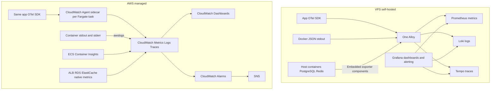

# Observability: VPS LGTM and independent AWS CloudWatch

**Status:** accepted stack, proposed configuration; updated 16 October 2026. Use the [budgets](01-current-state-audit-and-capacity.md), [SDK contract](02-app-12factor-and-redis-design.md) and [ingress boundaries](03-hybrid-infrastructure-vps-and-aws-iac.md). VPS uses self-hosted LGTM; AWS uses CloudWatch. Collection, queries, alerting and evidence export on AWS never require the VPS.

## Application implementation status

Lesson 10 implements the process-owned OTel SDK, structured log correlation,
sanitized HTTP/SQL/client spans, native Taskiq telemetry, observed in-memory stores,
Tantivy duration/pending-age measurements and generation/assistant stream outcomes.
See the [current instrument semantics](../backend/configuration.md#opentelemetry-export)
and [local Alloy verification](../../devops-course/lab/lesson10/README.md).
Lesson 11 verifies the [local LGTM pipeline](../../devops-course/lab/lesson11/README.md):
stored API/worker metrics, Docker API log parsing, HTTP/SQL/native Taskiq traces,
four embedded exporters, private provisioned Grafana datasources and backend outage
recovery. The course overlay owns this configuration until the VPS deployment gate.
Its smaller local limits are not the production sizing below. Production deployment,
interactive correlation, dashboards and alarms remain pending.

## Native worker signals

[Taskiq integration](../backend/modules/jobs.md#telemetry-and-operational-limits) reuses
one SDK per API/worker process, `pycil-api` / `pycil-worker` service identities and native
send/execute spans. Reuse its `tasks_sent`, `task_success`, `task_errors`,
`task_execution_time`, `task_wait_time` and `worker_active_tasks`; do not implement a
second set of job counters/spans. These count attempts, not unique logical jobs. Native
`retry_error` labels indicate retry eligibility, not proof a retry occurred.

Collect Redis stream lag/pending independently: no starts means no wait histogram
observations. Configure VPS Alloy Redis exporter `check_single_streams` for the canonical
stream configured by [the broker](../../apps/api/pycil/app/broker.py). Stream length
includes ACKed history and is not queue depth. AWS native ElastiCache metrics do not expose
arbitrary stream-group backlog; its supported collection path remains an explicit lesson-24
integration decision. No Redis exporter sidecar or application polling/export loop is added.
API readiness is not worker liveness/backlog. Correlate restarts, pending work and terminal
results with the [documented upstream limits](../backend/modules/jobs.md#telemetry-and-operational-limits).

## 1. Collection ownership and environment-local flow



### VPS: one Alloy with embedded exporters

Alloy owns exporter scraping and app metric conversion; Prometheus does not duplicate those targets. Enable these components explicitly within the same pinned Alloy process:

| Source | Embedded component | Access needed |
| --- | --- | --- |
| Host CPU/RAM/disk/network | [prometheus.exporter.unix](https://grafana.com/docs/alloy/latest/reference/components/prometheus/prometheus.exporter.unix/) | Host proc/sys/root paths, correctly configured to observe the host |
| Container resources | [prometheus.exporter.cadvisor](https://grafana.com/docs/alloy/latest/reference/components/prometheus/prometheus.exporter.cadvisor/) | Linux host/cgroup/runtime mounts and documented privileges |
| PostgreSQL | [prometheus.exporter.postgres](https://grafana.com/docs/alloy/latest/reference/components/prometheus/prometheus.exporter.postgres/) | Private connection with dedicated monitoring role |
| Redis coordination and optional cache | [prometheus.exporter.redis](https://grafana.com/docs/alloy/latest/reference/components/prometheus/prometheus.exporter.redis/) | Separate component instances, private authenticated connections |

No four standalone exporter containers and no custom exporter implementation are required. Embedded collectors still consume CPU/RAM: the consolidated Alloy budget includes them. cAdvisor's documented Docker setup uses privileged access and host mounts; isolation/socket access needs a concrete deployment review, not a blanket claim that every collector runs unprivileged. A read-only Docker socket mount does not restrict Docker API methods. Verify any allowlist proxy supplies all required discovery/stats calls; do not assume a logs-only proxy satisfies cAdvisor.

Scrape app/collector/backend health every 15 seconds, host/store metrics every 30 seconds and evaluate rules every 30 seconds. Prometheus self-scraping is allowed. Start with narrow collectors/labels and exclude container environment metadata. Docker logs use project-filtered discovery → loki.source.docker → JSON processing → loki.write through the reviewed elevated boundary; parse envelope/app JSON, preserve timestamps and trace IDs, label only env/service/version/level/role. Filtered discovery is not per-project Docker API authorization. Direct file tailing is an alternative only after positions/rotation/permissions are verified. Disable duplicate app log export.

VPS app OTLP uses internal Compose `http://alloy:4318`. Example routing fragment; production must add memory-limiter, batching and attribute filtering:

```alloy
otelcol.receiver.otlp "app" {
  http { endpoint = "0.0.0.0:4318" }
  output {
    traces  = [otelcol.exporter.otlp.tempo.input]
    metrics = [otelcol.exporter.prometheus.app.input]
  }
}
otelcol.exporter.otlp "tempo" {
  client {
    endpoint = "tempo:4317"
    tls { insecure = true }
  }
}
otelcol.exporter.prometheus "app" {
  forward_to = [prometheus.remote_write.hub.receiver]
}
prometheus.remote_write "hub" {
  endpoint {
    url = "http://prometheus:9090/api/v1/write"
    send_exemplars = true
  }
}
```

Plaintext remains on the host's internal network. External VPS k6 ingestion uses authenticated HTTPS at `telemetry.pycil.qninhdt.com`: exact POST paths `/api/v1/write`, `/loki/api/v1/push` and `/v1/traces` only when needed, never query/admin routes. Access service-token headers plus separate native Caddy basic_auth provide edge/origin authentication. Secrets do not appear in URLs/stdout. No equivalent AWS telemetry hostname is created.

### AWS: CloudWatch Agent plus native service paths

The application sends OTLP metrics/traces to the task-local CloudWatch Agent receiver, provisionally `http://127.0.0.1:4318` after verifying its config. The Agent exports to AWS through a scoped task role. ECS `awslogs` sends structured stdout/stderr directly to CloudWatch Logs; do not also export the same logs through the Agent. [AWS logs path](https://docs.aws.amazon.com/AmazonECS/latest/developerguide/using_awslogs.html).

Enable the supported ECS/Fargate Container Insights mode for task/container CPU, memory and ephemeral storage. ALB/RDS/ElastiCache supply their native managed metrics without YACE or postgres/redis exporter sidecars. Standard service metrics and Container Insights have separate enablement/coverage/cost; the Agent is not a universal scraper for every AWS resource. Validate needed RDS query/lock detail through supported Database Insights/pg_stat_statements tooling rather than assume native metrics equal every VPS exporter series. [ECS Container Insights](https://docs.aws.amazon.com/AmazonCloudWatch/latest/monitoring/deploy-container-insights-ECS.html), [RDS monitoring](https://docs.aws.amazon.com/AmazonRDS/latest/UserGuide/MonitoringOverview.html).

Use CloudWatch Dashboards, Logs Insights, traces/X-Ray integration, and CloudWatch Alarms → SNS. CloudWatch OTLP traces require Transaction Search enablement. Application Signals is an optional explicit feature choice, not silently implied by choosing the Agent. Pin supported Agent image/configuration and validate Python OTel compatibility before deployment. Do not add a second ADOT Collector, self-hosted LGTM or Amazon Managed Grafana by default. [CloudWatch OTel integration](https://docs.aws.amazon.com/AmazonCloudWatch/latest/monitoring/CloudWatch-OTLPGettingStarted.html).

### Shared signal contract and bounded export

Keep service name `pycil-api`, immutable service.version, deployment.environment.name (`vps` / `aws`; `local` for labs) and bounded instance identity. JSON logs retain valid trace_id/span_id. Map metrics explicitly per backend: do not assume a Prometheus histogram name/buckets, resource attributes, CloudWatch dimensions and exemplars all translate unchanged. Validate metric units/temporality/aggregation, latency percentiles, cardinality and trace/log navigation with real generated requests in each environment. Backend dashboards/query languages and alerts remain separately implemented.

Allowlist attributes; never turn baggage/user IDs/raw paths into metric dimensions. Trace IDs stay in JSON fields, not metric/Loki labels. Starting collector settings: finite queues/batches, two-second export timeout, memory limiter within its budget, and alerting on dropped/refused data and backlog age. VPS remote-write WAL is bounded by its spool quota; Agent retry/durability behavior must be verified, not assumed equivalent. Telemetry failure cannot block business readiness. Flush bounded queues before teardown and record unrecoverable gaps.

## 2. Storage configuration and retention

The following local storage contract applies to the **VPS only**. AWS storage is managed through CloudWatch retention and metering; no monitoring filesystem or EBS volume is provisioned.

| Backend | Explicit settings / starting policy | Capacity boundary |
| --- | --- | --- |
| Prometheus | `--web.enable-remote-write-receiver`, `--enable-feature=exemplar-storage`, retention time `15d`, retention size `6GB`; query timeout 15s and concurrency 4 | 8 GiB quota includes WAL/head/index; about 20k starting active-series budget |
| Loki 3.7.8 | Single binary; TSDB schema v13, filesystem object store, 24h index period; compactor retention enabled; `retention_period: 168h`; filesystem delete-request store | 6 GiB quota; ingestion starting 1 MiB/s with 2 MiB burst; at most two query workers |
| Tempo 3.1.0 | Monolithic single process, local trace storage; scoped retention override `overrides.defaults.compaction.block_retention: 168h`; explicit loopback/private receiver endpoints | 4 GiB quota; bounded live-store/query memory; no Kafka or old Tempo-2 compactor configuration |
| Grafana | Persistent SQLite metadata; provisioned dashboards/datasources/alerting; no anonymous org access | 0.5 GiB metadata/snapshot budget, off-host backup |
| Docker/journald | `json-file`: max-size 10m, max-file 3 for every container; bounded host journal | Logs are a finite local troubleshooting buffer, not a backup |

A Loki retention field alone does not delete filesystem chunks: the compactor, deletion store and schema/period must be valid. Reject arbitrarily old backfilled logs beyond the supported retention/ingest window; recovery/drill logs receive correct event time. Tempo 3 uses the current backend maintenance architecture; validate its monolithic/local-storage configuration using the pinned binary. Do not enable metrics-generator/service graphs by default when the app SDK already supplies RED metrics. [Loki retention](https://grafana.com/docs/loki/latest/operations/storage/retention/), [Tempo configuration](https://grafana.com/docs/tempo/latest/configuration/).

Time retention does not impose a hard byte ceiling on Loki/Tempo. Filesystem quotas, ingest caps, query limits, disk-runway alerts and test abort criteria are separate safeguards. If a quota is reached, telemetry may be refused; the DB must retain its reserved headroom. Prometheus size retention also leaves WAL/head consumption outside its retained-block target. Never delete active data files by hand during compaction.

### AWS retention and durable benchmark evidence

Set explicit CloudWatch Logs retention (initial proposal: seven days), trace sampling/feature retention and custom-metric dimension limits; verify the selected managed trace retention controls and billing instead of copying Tempo's seven-day YAML policy. Managed metric retention is governed by AWS, not the VPS Prometheus setting. Query scan volume and ingested logs/spans can dominate cost. Managed retention also does not mean unlimited, permanent or free historical evidence.

Before teardown/raw expiry archive k6 summaries, workload/release manifests, UTC windows, metric range results (CSV/JSON), CloudWatch dashboard definitions plus resolved chart data, sanitized representative traces/logs and scaling/deployment timelines to the protected S3 evidence prefix. Verify hashes/completeness before normal destruction. A dashboard definition alone saves queries, not results. AWS evidence does not require Grafana snapshots or the VPS; static rendered charts and exported data can be reviewed independently.

VPS runs may retain bounded Grafana snapshots **with populated panel data** alongside their series exports. [Grafana snapshot API](https://grafana.com/docs/grafana/latest/developer-resources/api-reference/http-api/api-legacy/snapshot/). Keep curated evidence under the existing initial 1-GiB envelope without automatic expiry; review growth instead of silently deleting agreed results. Remove workload telemetry resources only according to the declared export/retention policy, accounting for continuing managed storage charges.

## 3. Provisioning and three-way correlation

```text
infra/vps/observability/grafana/
  provisioning/datasources/lgtm.yaml
  provisioning/dashboards/providers.yaml
  provisioning/alerting/{rules,contact-points,policies}.yaml
  dashboards/{api-red,vps-use,postgres-deep-dive,redis,benchmark-comparison,public-api}.json
infra/vps/observability/prometheus/{recording-rules,health-rules}.yaml
```

The Grafana provisioning and correlation examples below apply to VPS. AWS dashboard/alarms configuration lives under `infra/aws/workload/` and uses IAM-authorized CloudWatch resources. Use fixed datasource UIDs `prometheus`, `loki`, `tempo`; dashboard UIDs are stable across envs. Dashboard provider uses `allowUiUpdates: false`, an explicit folder and read-only versioned files. Grafana provisioning expands only secret environment references in private runtime mounts; JSON dashboard bodies and contact-point secrets are separate concerns. Datasource URLs are private Docker DNS, not Internet endpoints. [Grafana provisioning](https://grafana.com/docs/grafana/latest/administration/provisioning/).

Datasource correlation fragment:

```yaml
apiVersion: 1
datasources:
  - name: Prometheus
    uid: prometheus
    type: prometheus
    access: proxy
    url: http://prometheus:9090
    jsonData:
      exemplarTraceIdDestinations:
        - name: trace_id
          datasourceUid: tempo
  - name: Loki
    uid: loki
    type: loki
    access: proxy
    url: http://loki:3100
    jsonData:
      derivedFields:
        - name: TraceID
          matcherRegex: '"trace_id"\s*:\s*"([a-f0-9]{32})"'
          datasourceUid: tempo
          url: '$${__value.raw}'
  - name: Tempo
    uid: tempo
    type: tempo
    access: proxy
    url: http://tempo:3200
    jsonData:
      tracesToLogsV2:
        datasourceUid: loki
        spanStartTimeShift: '-1m'
        spanEndTimeShift: '1m'
        filterByTraceID: true
        filterBySpanID: false
        tags:
          - key: service.name
            value: service_name
          - key: deployment.environment.name
            value: env
```

`$${...}` escapes Grafana's provisioning environment expansion, leaving the data-link variable intact. Validate exact generated LogQL with the pinned Grafana: the trace-to-logs filter must parse JSON `trace_id`, since it is not an indexed Loki label. Use a custom query if the default filter targets a different field format. Confirm Prometheus stores exemplars and converter forwards the SDK's sampled IDs; labels may otherwise be named `traceID`, requiring a deliberate remap. Do not declare correlation complete until a generated request goes from a latency exemplar to its Tempo span and then only its Loki logs in the correct env/time range. Unsampled requests have logs/metrics but no trace target.

## 4. Dashboard contracts and SLIs

Use `env` and `version` selectors on authenticated operational dashboards. Public dashboard sharing is out of scope.
The application currently emits these OTel instruments:

| Boundary | Instruments and units |
| --- | --- |
| HTTP | `http.server.duration` (ms, count supplies completed requests), `http.server.active_requests` |
| Database | `pycil.db.pool.acquire.duration`, `pycil.db.query.duration` (s); acquisition includes queueing, opening and validation |
| Process-local stores | `pycil.store.requests`, `pycil.store.evictions`, `pycil.store.entries`, `pycil.store.capacity`; bounded `store` / `backend` attributes |
| Search | `pycil.search.duration` (s), owner-only `pycil.search.pending_age` (s) |
| Operations | `pycil.operation.duration` (s); word generation, artifact generation, grading and assistant stream outcomes |
| Jobs | Native Taskiq instruments listed above |

See [measurement semantics](../backend/configuration.md#opentelemetry-export).
Alloy OTLP ingestion is locally verified. Resulting Prometheus names, unit conversion,
CloudWatch dimensions and backend queries still require validation. The PromQL below
illustrates the intended recording-rule interface; these `pycil_http_*` names are
not current SDK instruments or provisioned rules. Do not copy them into a live panel
before implementing and verifying that mapping. Assistant first-event timing, index
size/document count and owner-takeover counters are additional dashboard requirements,
not claims about instruments already present.

```promql
# RED rate, excluding probes.
sum by (env, version, http_route) (
  rate(pycil_http_requests_total{http_route!~"/livez|/readyz"}[5m])
)

# p95; substitute 0.50 and 0.99 for the other quantiles.
histogram_quantile(0.95,
  sum by (le, env, version, http_route) (
    rate(pycil_http_request_duration_seconds_bucket[5m])
  )
)
```

| Dashboard | Panels and interpretation |
| --- | --- |
| API RED | RPS by route/status, 5xx and timeout/error ratio, p50/p95/p99, in-flight, pool wait, request bytes; exclude probes from SLIs |
| VPS USE | CPU busy/steal/throttle, memory available/working set, swap activity, disk bytes/inodes/runway and I/O await/queue, network drops/errors |
| AWS Fargate USE | ECS desired/pending/running/healthy tasks, task/container CPU/memory/ephemeral storage, service scaling/deploy events and ALB targets/latency/5xx |
| PostgreSQL deep-dive | Active/idle/idle-in-transaction connections, pool demand, commits/rollbacks, buffers hit/read, locks/waiting sessions, query-id latency/calls, WAL archive lag, RDS credits/storage |
| Redis | Memory/maxmemory, evictions, rejected writes, command latency, cache hit/miss/fallback; coordination availability distinct from cache hit rate |
| Content/artifact memory caches | Hits/misses, entry count/capacity and LRU evictions by bounded cache name; TTL expiry and explicit invalidation are distinct from capacity eviction |
| Content generation | Word-job active/pending counts, oldest pending age, queue/run duration, overload rejection and terminal outcomes; artifact-generation duration/outcome at its actual execution boundary |
| Benchmark comparison | Offered/completed RPS, k6 latency/error/drop counts, app/DB CPU and pool wait, replica timeline, cache hit ratio; compare matched workload/time windows |
| Search | Query duration/errors, index document count/disk bytes, owner presence/takeover, pending revision/visibility lag, batch failures, publication wait/timeouts and rebuild cost; one writer per index, not per environment |

The selected application additions are content-generation jobs, content/artifact memory
caches and Tantivy search. Lesson 10 reuses native Taskiq job instruments and adds missing cache/search instruments; lesson 12
provisions their views and validates alert behavior through the existing OTel pipeline.
The table includes future collection requirements; the implemented subset is listed above.

- **Generation:** distinguish admitted work waiting for a slot from actively executing
  work. Measure queue wait and run time separately, count overload rejection before
  admission and record success/failure/timeout/interruption at the owning boundary.
  A deduplicated submission is not a new job. Artifact generation runs inside the
  preparation worker's async tasks; measure its duration/outcome without inventing a separate
  queue or queue-depth metric. Process death can prevent terminal emission: correlate
  restarts with stale job status rather than trusting completion counters alone.
- **Memory caches:** extend the existing in-memory backend in observability, with composition-supplied bounded names for
  content/artifact instances. Validate miss, hit, capacity eviction, expiration and
  invalidation; do not count every removal as LRU eviction. Entry capacity is not a
  byte budget. Reuse process/container memory monitoring and controlled profiling
  instead of walking cached object graphs on requests.
- **Tantivy:** measure query duration/outcome separately from synchronization and
  rebuild work. Track pending-change age/progress so a caught-up idle index remains
  healthy. Measure rebuild duration and index disk usage; reuse process/container
  CPU/RAM signals, which include Python and other application work. Collect index
  size off the request path at a bounded cadence. Validate new-content visibility
  and writer recovery using the [search contract](../backend/modules/vocabulary.md#search-and-projections).

Validate these instruments with controlled jobs, cache accesses and a search mutation;
HTTP 202/200 alone does not prove background completion or index publication. Use only
bounded job/cache kinds and outcomes as application dimensions, never word IDs, task
IDs, cache keys, revision IDs or search text. Existing metadata/export rules still apply
on VPS and AWS. Alert on sustained job backlog with stalled progress or elevated failure
and on the existing search-progress condition; calibrate job thresholds against measured
queue/run behavior. A cache miss or eviction alone is a dashboard observation, not a page.

Enable `pg_stat_statements` through preload and an explicit extension migration; use a role with monitoring privileges, never application owner/superuser credentials in Grafana. Enable necessary postgres_exporter collectors only after measuring query overhead. Query text is private; publish query IDs/aggregate statistics. Initial slow-query threshold 250 ms is a diagnostic threshold, not a universal SLO. Cumulative buffer-hit ratio is not the same as physical storage utilization; report deltas over the benchmark window. RDS exports contain privileged system limitations that must be tested.

Recording rules retain sum/count/histogram buckets, not an average of p95s. Do not average per-process percentile gauges to calculate fleet latency. k6 percentile gauges are per-run/load-generator evidence; fleet aggregation uses histograms. Traces supplement metrics rather than defining the denominator of error SLIs. SSE has a separate outcome metric so a failed stream returning initial HTTP 200 does not disappear from error analysis.

## 5. Public dashboard security

**Scope change (2026-10-17):** the user removed public dashboard sharing. Do not create a public dashboard hostname, anonymous access, share tokens or sharing-specific ingress routes. Existing course sharing drafts are historical evidence, not deployment requirements.

VPS administration uses `grafana.pycil.qninhdt.com`, behind Cloudflare Access. **Authentication decision (2026-10-17):** use a separate Clerk application named **Pycil Ops** as the OIDC identity provider through Grafana's native Generic OAuth support. Its operator user pool is independent of the product's Pycil application, even when using the same email address. MFA is deferred at both Grafana's identity-provider and Access policy layers. This is selected design, not a configured or tested VPS deployment. No self-hosted IdP or application authentication middleware is needed. Only explicitly authorized operators may access Grafana; a Pycil product account alone grants no monitoring access. AWS dashboards remain private through IAM/CloudWatch.

Register a dedicated Grafana OAuth client in Pycil Ops' production instance with callback `https://grafana.pycil.qninhdt.com/login/generic_oauth` and scopes `openid profile email`. The local lab uses Pycil Ops' development instance with a separate loopback client; keep product credentials, users and branding separate. Configure Grafana from Clerk's authorization/token/UserInfo endpoints and client credentials; store the client secret outside version control. Enable PKCE and ID-token signature validation with Clerk's published JWKS on the pinned Grafana version. Use an explicit operator allowlist/role mapping that rejects other identities, without default Viewer access or automatic admin assignment. Test the allowed operator and a non-allowlisted Ops identity before disabling routine Grafana password login; retain a documented local recovery procedure. Product-only users cannot authenticate to the separate Ops instance. Clerk SSO does not itself authenticate the separate Cloudflare Access gate; do not claim one login across both without validating its identity-provider configuration. [Clerk as an OIDC provider](https://clerk.com/docs/guides/configure/auth-strategies/oauth/single-sign-on), [Grafana Generic OAuth](https://grafana.com/docs/grafana/latest/setup-grafana/configure-access/configure-authentication/generic-oauth/).

Acceptance: an unauthenticated or unauthorized visitor cannot query operational dashboards, datasources, logs, traces or admin APIs. Direct-origin access must not bypass Access. Verify Grafana roles separately from identity-provider authentication. [Grafana authentication](https://grafana.com/docs/grafana/latest/setup-grafana/configure-access/configure-authentication/).

## 6. Alerting as code, FinOps and independent outage detection

Provision VPS Grafana-managed rules/contact points and AWS CloudWatch Alarms/SNS separately under Git. The table defines signal/response intent; implement each rule in its owning backend. Telegram bot/chat values or Discord webhook are secret environment references. Pick one destination during implementation; test notifications only once authorized for live configuration. Group by env/alertname, suppress duplicate instance alerts and include severity, condition, dashboard and runbook URL. Configure resolved notifications and NoData/Error states deliberately.

| Alert | Proposed trigger | Response |
| --- | --- | --- |
| API 5xx | Ratio >2% over 5m for 5m, with at least 50 eligible requests | Inspect RED → trace/log; rollback compatible image if release-related |
| API latency/pool | DB-only p95 >300 ms for 10m; pool wait >100 ms with elevated occupancy | Inspect pool budget, locks, slow query and CPU |
| VPS memory | `1 - node_memory_MemAvailable_bytes / node_memory_MemTotal_bytes > .85` for 5m | Stop test/admit less work; identify cgroup/process growth |
| Disk/inodes | Available <15% or inode free <15%; critical <10% or runway <6h | Stop load, repair archiving/retention, preserve DB/WAL |
| Container OOM/restart | Any OOM or unexpected restart | Treat sizing/admission as failed; do not mask with restart loops |
| Full backup late/failed | Last successful base >26h or latest attempt failed | Inspect uploader/credentials/archive coverage; run recovery procedure |
| WAL archiving | Increasing failures, pending bytes or oldest pending segment >5m while writes exist | Investigate S3/network/credentials; idle DB alone is not failure |
| Telemetry pipeline | Export drop/refusal, sustained backlog, missing exporter >5m | Record evidence gap and restore collector; app stays independent |
| Search progress | Pending committed changes without reconciliation progress >30s, repeated batch failure or publication timeout | Inspect index owner/cursor and DB capture; recover writer ownership or rebuild derived storage through the [search runbook contract](../backend/modules/vocabulary.md#search-and-projections); preserve history |
| AWS six-hour reminder | Session active and `time() - pycil_aws_session_started_timestamp_seconds > 21600` | Run `make aws-down`, confirm final cleanup |
| Inventory freshness | Last successful AWS inventory >10m while a session may exist | Do not mistake absent node/collector telemetry for destroyed infrastructure |
| Watchdog | Always-active heartbeat routed to an external dead-man receiver | Missing heartbeat indicates failed hub/notification path |

Backup utility writes atomic textfile gauges for last attempt/success, compressed bytes, duration and outcome; Alloy's Unix textfile collector reads them on the VPS. No custom exporter daemon is needed.

AWS lifecycle persists session start/expiry outside task-local storage. A bounded independent five-minute inventory job checks ECS tasks/services, restore EC2/EBS, ALB/RDS/Redis/NAT and required managed observability resources through scoped AWS reads, emits session-age/active/freshness metrics to CloudWatch and retains last-known state on API failure. Provision a six-hour age Alarm → SNS, plus inventory-staleness alarm; absent API-task telemetry is not proof that resources are gone. This is independent of the Agent/task count and VPS. Implementation must define its runner/IAM/cost within the existing lifecycle, not introduce a monitoring host.

The eight-hour EventBridge/CodeBuild cleanup in [03](03-hybrid-infrastructure-vps-and-aws-iac.md) is the spending safety mechanism, independent of notification delivery. Test notifications only to an authorized destination. Missing SNS/contact secrets or permissions fail preflight. Configure NoData/missing-data behavior separately for an intentionally inactive session and failed active-session inventory.

A GitHub scheduled probe can test public health/notification freshness every 15 minutes with its scheduling delays accepted for this MVP. A stricter uptime SLO needs an independently hosted monitor and agreed budget. Same-host VPS Grafana/blackbox cannot notify after losing the host; use an external heartbeat receiver. The AWS independence exercise blocks VPS access and proves requests, AWS queries/correlation, alarms, S3 archives and cleanup still work without disrupting unrelated VPS services.

### Why is this industry standard?

Unified collection, signal correlation, bounded cardinality, provisioned dashboards, private observability endpoints, explicit retention and external dead-man detection are standard SRE practices. VPS uses bundled Alloy exporters; AWS uses task-local collection and native managed metrics.

### Trade-offs

Sampling and storage caps lose some forensic detail. Operational dashboards remain private. Curated snapshots preserve interview charts but cannot replace unlimited raw historical exploration. VPS monitoring shares host failure; AWS has managed backend availability but task-local export can still lose data. CloudWatch charges must be bounded and evidence exported before workload teardown/raw expiry.

### Interview questions this design answers

- How do exemplars connect metrics to traces and logs?
- Why does high-cardinality labeling exhaust a small Prometheus/Loki installation?
- How do you collect VPS host/store signals and AWS task/service metrics without duplicate ingestion?
- Why is anonymous Grafana Viewer not a dashboard-only security boundary?
- How do you detect failure of the monitoring system itself?

Lesson 16 adds an [implemented backup view](../../devops-course/lab/lesson16/README.md#view-results):
WAL-G native StatsD, PostgreSQL archive/backlog SQL and atomic full-backup textfiles
flow through the existing Alloy/Prometheus/Loki stack. Four Grafana rules cover
full-backup failure/freshness and archive failure/backlog. The isolated lab proved
a firing archive-failure rule and catch-up after restoring S3 rights. Its receiver
is `empty`; notification delivery and an off-host failure watchdog remain unproven.
No application OTel SDK or custom exporter is added for backup.
