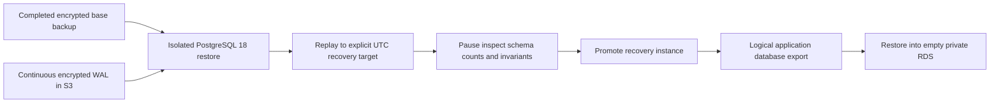

# DevSecOps delivery, backup and operational recovery

**Status:** implementation design only. Read the [overview](00-architecture-overview-and-standards.md), [resource budget](01-current-state-audit-and-capacity.md) and [infrastructure lifecycle](03-hybrid-infrastructure-vps-and-aws-iac.md) first. No deployment or backup configuration was changed during this audit.

## Worker release boundary

API, migration and [Taskiq worker](../backend/modules/jobs.md) use one immutable image.
Later delivery must migrate first, replace API and worker with compatible task/result
contracts, and budget their overlap separately. Drain workers through the native CLI;
Uvicorn drain affects only API requests. Rolling back code does not erase queued messages
or restore PostgreSQL. Test old/new payload/result compatibility before sharing a queue.
Keep safe acknowledged-stream retention separate from cache expiry; never flush the task
namespace or trim unfinished messages. Idle recovery remains a deferred upstream issue,
and result-save failure can still ACK; do not advertise guaranteed recovery from a green
API probe. This update specifies later delivery work, not a deployed worker service.

## 1. Existing delivery and registry decision

**GHCR is already used.** [deploy.yml](../../.github/workflows/deploy.yml) waits for the `Tests` workflow to succeed on `main`, checks out that workflow's tested `head_sha`, builds the API image, and pushes `ghcr.io/qninhdt/pycil-api:<12-character-tested-sha>`. It authenticates using `GITHUB_TOKEN`, reports the image digest, and prints an operator deployment hint. It does not currently SSH-deploy, federate into AWS, run SonarQube Cloud, or scan with Trivy. The API and explicit migration command use the same image. The [API Dockerfile](../../apps/api/Dockerfile) also pulls the pinned uv tool image from GHCR.

Keep GHCR for VPS delivery and ECR for ECS's execution-role-authenticated Fargate pull path. Build **once** for `linux/amd64`, scan that artifact, and publish identical image content to both registries. Resolve and compare platform manifest digests; preserve the identical OCI index if provenance/SBOM attestations introduce one. Reject a promotion that changes the deployable manifest. Store registry references, digests, commit/release, SBOM and scan results in a reviewed release manifest. No environment-specific rebuild.

Package visibility and a successful publish were not verified. The [latest recorded Deploy run](https://github.com/qninhdt/pycil/actions/runs/32523443811) was `skipped`; the package-version read returned HTTP 403 because the CLI token lacks `read:packages`. Source proves the configured publication path, not that a particular registry artifact currently exists. Do not change visibility as part of automation. Public images can be pulled anonymously; a private package needs authorized `read:packages`. Within GitHub Actions use the repository's scoped, expiring `GITHUB_TOKEN`; a manual private-package pull outside Actions requires GitHub's documented PAT authentication. Avoid leaving a PAT in ordinary Docker configuration. [GHCR authentication and digest pulls](https://docs.github.com/en/packages/working-with-a-github-packages-registry/working-with-the-container-registry).

## 2. Pipeline stages and trust boundaries

```mermaid
flowchart LR
  PR[Pull request] --> Lint[Lint types frontend and API checks]
  Lint --> Tests[Unit and real PostgreSQL Redis integration tests]
  Tests --> Sonar[SonarQube Cloud quality gate]
  Sonar --> Build[Build one locked API artifact]
  Build --> Scan[Trivy image config secrets and SBOM]
  Scan --> Publish[Trusted main or release promotion to GHCR and ECR]
  Publish --> Gate[Protected deployment environment]
  Gate --> Backup[Verified recovery point and migration compatibility]
  Backup --> Migrate[One finite migration task]
  Migrate --> Deploy[VPS Compose blue-green or ECS rolling deployment]
  Deploy --> Probe[Readiness and business smoke checks]
  Probe --> Good[Retain previous digest and publish release evidence]
  Probe --> Bad[Rollback application routing or image digest]
```



| Stage | Required result | Failure behavior |
| --- | --- | --- |
| Lint/test | Reuse [test.yml](../../.github/workflows/test.yml); retain real Testcontainers PostgreSQL/Redis tests and frontend checks | No build promotion or deployment |
| SonarQube Cloud | Coverage XML from API tests; frontend coverage when available; quality gate waits and passes; exclusions reviewed | Block promotion; never install a SonarQube server on VPS/AWS |
| Build | Locked dependencies, non-root runtime, source revision label, no secrets in layers | Build on CI runner, not VPS |
| Trivy | Image HIGH/CRITICAL vulnerability gate; config and secret scan; CycloneDX/SPDX SBOM | Do not silently ignore unfixed findings; documented, expiring risk acceptance is an explicit release decision |
| Publish | Tested SHA and scan report refer to the same artifact; exact GHCR/ECR manifest verification | No mutable deploy tags; ECR tag immutability |
| Migration | One successful exit; bounded locks/time; schema compatible with active and previous API | Keep active deployment; collect sanitized migration logs |
| Deploy | Healthy candidate, minimum healthy capacity, finite rollout timeout, authenticated smoke | Roll back the application; database recovery is a separate incident decision |

Proposed action pins: retain `actions/checkout@v7.0.1`, `docker/setup-buildx-action@v4.4.1`, `docker/login-action@v4.6.0`, and `docker/build-push-action@v7.4.0`; add `SonarSource/sonarqube-scan-action@v8.3.0`, `aquasecurity/trivy-action@0.36.0` with Trivy `v0.75.0`, and `aws-actions/configure-aws-credentials@v6.3.0`. Resolve these reviewed releases to full commit SHAs during implementation, documenting the corresponding version. No floating action reference or fabricated SHA is acceptable. Runner labels are OS selections rather than action versions; use `ubuntu-24.04` to make the runner generation explicit.

The following is a **trusted-job fragment**, not a complete workflow. Existing test commands remain owned by `test.yml`; publication and deployment jobs must explicitly depend on successful tests, quality gate and scan.

```yaml
permissions:
  contents: read
concurrency:
  group: pycil-delivery-${{ github.ref }}
  cancel-in-progress: false
jobs:
  aws-delivery:
    environment: aws-demo
    runs-on: ubuntu-24.04
    permissions:
      contents: read
      id-token: write
    steps:
      - uses: actions/checkout@v7.0.1
        with:
          ref: ${{ inputs.tested_sha }}
          persist-credentials: false
      - uses: aws-actions/configure-aws-credentials@v6.3.0
        with:
          role-to-assume: ${{ vars.AWS_DEPLOY_ROLE_ARN }}
          aws-region: ap-southeast-1
          role-session-name: pycil-${{ github.run_id }}
      # Validate the reviewed release manifest, then execute the bounded lifecycle.
```

Give `packages:write` only to the trusted GHCR publish job, `packages:read` only where needed, and `id-token:write` only to AWS jobs. Pull-request jobs get no deployment secrets or AWS write role. Keep the current tested-SHA checkout invariant. A privileged `workflow_run` must additionally verify the originating repository, trusted branch, workflow identity and result; never execute an arbitrary PR artifact or untrusted checkout with deployment privileges. Serialize deployment per environment, and serialize migrations at the DB boundary too; separate workflow concurrency alone cannot stop an operator racing another client. [GitHub workflow-run security](https://docs.github.com/en/actions/reference/workflows-and-actions/events-that-trigger-workflows#workflow_run).

## 3. AWS OIDC, runtime secrets and VPS delivery credentials

IAM trust policy **fragment** for the AWS demo deployment role; substitute the real account/OIDC provider ARN in implementation, without committing an account credential:

```json
{
  "Effect": "Allow",
  "Principal": {"Federated": "<github-oidc-provider-arn>"},
  "Action": "sts:AssumeRoleWithWebIdentity",
  "Condition": {
    "StringEquals": {
      "token.actions.githubusercontent.com:aud": "sts.amazonaws.com",
      "token.actions.githubusercontent.com:sub": "repo:qninhdt/pycil:environment:aws-demo"
    }
  }
}
```

Configure GitHub environment deployment branch/tag restrictions and required reviewers as the release policy. Environment-scoped OIDC `sub` does not itself encode `main`; the GitHub environment restriction supplies that additional gate. A separate foundation-admin role handles rare foundation changes; the workload role cannot delete backup/state buckets, OIDC identity or foundation IAM roles. Grant `iam:PassRole` only for exact ECS execution/task roles with `ecs-tasks.amazonaws.com` and the finite restore role with the EC2 service principal. Scope ECS service/task updates, telemetry permissions and restore-only SSM/EC2 operations to this workload. Read/list permissions that require wildcard resources must be isolated from scoped write permissions. Do not authenticate routine operations as AWS account root. [AWS OIDC for GitHub Actions](https://docs.github.com/en/actions/how-tos/secure-your-work/security-harden-deployments/oidc-in-aws).

| Credential / setting | Storage and reader | Rotation / control |
| --- | --- | --- |
| AWS CI identity | GitHub OIDC → short-lived STS session | No AWS access-key/secret-key GitHub secrets |
| Fargate API credentials | SSM SecureString by default for static credentials; Secrets Manager when managed rotation is required; exact references injected by ECS at startup | Execution-role reads; rotate source then deploy new tasks; no credentials in task-definition literals |
| Terraform secret handling | IaC owns IAM/path contracts; secret values loaded through a secure bootstrap process outside ordinary Terraform state | `sensitive=true` only hides display; it does not remove secrets from state |
| VPS application/DB secrets | Service-scoped root-owned files outside Git; API uses Compose `env_file`, while file-aware services use read-only secret mounts where supported | File mode 0600; recreate API containers after rotation; no environment dumps or broad Docker inspect exposure |
| AWS telemetry | Scoped ECS task role used by CloudWatch Agent; exact config/secret reads assigned to execution or task role as appropriate | No static keys, no separate monitoring host; task-wide role boundary, IAM-authorized CloudWatch access |
| VPS SSH deploy identity | Dedicated operator/deploy key in protected GitHub environment; pinned host key | Restricted sudo to reviewed deployment commands; no unrestricted root automation |
| Private GHCR CI pull on VPS | Short-lived job `GITHUB_TOKEN` with package read, passed through stdin to a temporary Docker auth directory on tmpfs | Remove the auth directory at job end; retain previous images locally for rollback |
| Sonar / Cloudflare / notification tokens | Protected GitHub secret or scoped SSM/VPS file | Narrow project/zone/ingestion scope; never log header/token values |
| WAL-G AWS identity | IAM Roles Anywhere certificate and signing helper | Short-lived role sessions; separately rotate/revoke the certificate |

VPS secret retrieval from SSM, if used, must be through its temporary Roles Anywhere identity. GitHub OIDC is not a replacement for host-to-AWS authentication. ECS execution role authorizes image/startup-secret/awslogs operations; task role authorizes runtime AWS calls. These are distinct from the finite restore host instance profile. Do not claim separate IAM roles per API/Agent container inside one task.

## 4. Pre-deploy migration, rollout and rollback

Use the same digest with `python -m pycil.app.migrate`; provide `DB_URL` through secrets, never a CLI URL printed in logs. `--reference <validated-artifact-path>` is for initial import or an explicitly reviewed reference update, not every rolling deploy. The current [migration module](../../apps/api/pycil/app/migrate.py) runs Alembic, native checkpoint setup and optional reference import separately; native checkpoint setup needs its documented autocommit behavior. See [application design](02-app-12factor-and-redis-design.md).

**VPS:** acquire a deployment `flock`; verify manifest, free memory/disk and recent recoverability; pull candidate while old API serves; run a bounded one-off migration; start the inactive color; require five consecutive successful `/readyz` checks plus neutral word/auth smoke checks; validate Caddy config; reload Caddy to route new traffic; observe RED metrics for five minutes; drain old connections, then stop old API. Caddy rollback restores the previous upstream and reloads. Keep both digests independent, existing DB volumes untouched, and migration/backup/test jobs out of the two-API memory peak. The current `scripts/deploy.sh` stops API before migration: it needs this redesign before anyone claims zero downtime.

**AWS:** register a reviewed task definition with the tested ECR digest, one API process plus CloudWatch Agent, private networking, exact secret references and bounded resources. Run one finite ECS migration task against RDS and require its container exit zero before updating the service. For reference import, a bounded initialization task must download/verify the artifact into its local writable mount first. Do not run migrations in every API task.

Use ECS rolling deployment, `minimumHealthyPercent=100`, `maximumPercent=200`, deployment circuit breaker/rollback, a finite rollout deadline and real business smoke. Three desired tasks can overlap with six API processes, so budget up to 48 application DB connections plus ten maintenance reserve. Temporarily suspend scaling and verify the selected RDS maximum. ECS task-definition revision/config/digest is the release identity; there are no AWS Compose colors, Caddy reloads, application launch templates or host deploy locks. [ECS rollout](https://docs.aws.amazon.com/AmazonECS/latest/developerguide/deployment-type-ecs.html).

ALB uses an IP target group at API HTTP 8000, readiness `/readyz`, interval 15 seconds, timeout five, thresholds two and deregistration delay 90 seconds. API `stopTimeout=120` bounds the 75-second Uvicorn drain and cleanup; calibrate ECS health-check grace against image pull/RDS/index build. Initial activation has no previous completed deployment: hold DNS and clean up incomplete workload. A failed update rolls back to the previous compatible task-definition/digest; successful startup alone is insufficient without business checks.

Every AWS task has an independent Tantivy index. Until the [accepted search design](../../search_and_content_revisions.md) passes its implementation checks, freeze dictionary-changing requests and quiesce jobs throughout **every replacement overlap**, even at desired count one. Validate candidate indexes against the fixed dataset; rebuild/verify the surviving task before restoring writes. Once synchronization passes, bootstrap/catch-up/freshness tests gate mutable rolling continuity. VPS compatible slots share one lifetime writer/poller. The first transition to revision-driven indexing pauses content writes and must not overlap old direct-index writers with the new ownership model; rollback preserves revision history and business data.

Observe both readiness and a real business operation: a healthy DB socket alone does not prove a compatible response schema. If post-deploy 5xx exceed 2% for two minutes with sufficient traffic, or a contract smoke fails, revert routing/image digest to the last compatible digest. Archive rollout logs and the failure report before teardown.

Application rollback does **not** undo a successful schema change. Use expand/contract: add nullable columns/new tables; deploy readers/writers compatible with both versions; backfill in bounded jobs; remove old contracts in a later release after the rollback window. Never automatically downgrade Alembic or overwrite live data. Backups are a disaster-recovery path, not a normal deploy rollback. Ordinary requests can drain; current 180/600-second streams/jobs can outlast the chosen budget and must finish, defer deployment, or surface an honest interruption according to the contract in document 02.

Vercel: retain separate frontend deployments/API base URLs for VPS and AWS; verify Clerk origin/CORS settings for each. Deploy a backward-compatible backend first, then frontend; only afterward contract the API. `NEXT_PUBLIC_*` values are build-time and public. Keep the previous Vercel deployment available; AWS shutdown should remove its demo route or show a planned offline state. Vercel project behavior remains an implementation verification gate.

## 5. WAL-G producer design

PostgreSQL **18.6** and WAL-G **3.0.9** are the physical compatibility set. Build a reviewed, scanned custom PostgreSQL image with the official Debian/glibc PostgreSQL base and a verified WAL-G binary/source artifact. Do not copy a glibc WAL-G binary into the current Alpine image without proving compatibility. Validate CPU architecture, PostgreSQL backup protocol, binary dependencies and chosen encryption support in CI. Deploy that custom image by real digest.

Mount the PostgreSQL 18 volume at `/var/lib/postgresql`; validate the actual image's `PGDATA` (expected `/var/lib/postgresql/18/docker`). Do not reuse the old-major assumption `/var/lib/postgresql/data`. Archive commands run inside the PostgreSQL container, so WAL-G and its short-lived credential mechanism must be available there. A daily one-off backup service uses the same image, read-only access to data files, a replication/backup connection, and the 384 MiB / 0.40 CPU utility allowance. WAL archiving itself is inside PostgreSQL's 1,792 MiB / 2 CPU budget.

Configuration **fragment**; key files and AWS certificate/private key are service-specific secrets:

```ini
# PostgreSQL configuration; archive_mode changes require a planned restart.
wal_level = replica
archive_mode = on
archive_timeout = 60s
archive_command = 'wal-g wal-push %p'
```

```text
WALG_S3_PREFIX=s3://<backup-bucket>/postgres/<cluster-system-id>/pg18
PGHOST=postgres
PGPORT=5432
PGDATABASE=postgres
PGUSER=walg_backup
PGPASSFILE=/run/secrets/walg-pgpass
AWS_REGION=ap-southeast-1
AWS_PROFILE=pycil-walg-producer
AWS_SDK_LOAD_CONFIG=1
WALG_COMPRESSION_METHOD=zstd
WALG_DELTA_MAX_STEPS=0
WALG_UPLOAD_CONCURRENCY=2
WALG_PGP_KEY_PATH=/run/secrets/walg-encryption-public-key
```

Use client-side OpenPGP encryption with WAL-G's native key-file setting: the producer has the public encryption key; recovery has the matching private key and passphrase, stored off-host. Also require S3 SSE-S3, HTTPS-only bucket policy, block public access and least-privilege prefix access. No paid KMS key is necessary for this budget. Record a non-secret key fingerprint per backup generation; retain old recovery keys while any corresponding backup exists. Do not rely on deprecated external GPG environment names. [WAL-G native compression and encryption](https://github.com/wal-g/wal-g/blob/v3.0.9/docs/README.md).

The backup database role gets only the WAL-G PostgreSQL-18 backup/introspection function privileges required by the chosen release, validated through a real backup/fetch smoke test; it is separate from API and monitoring roles. `PGPASSFILE` is mode 0600 and readable by the actual utility UID. Backup utility scratch space and credentials are private mounts; do not put the password in `PGPASSWORD` in a committed Compose file. The backup connection counts against the ten reserved admin/maintenance slots.

The AWS signing helper **1.8.5** supplies `credential_process` in a read-only AWS profile. IAM Roles Anywhere trust anchor/certificate role is limited to this prefix. The producer can upload and perform only the required listing/read checks; it cannot prune. A distinct maintenance identity deletes obsolete chains; a recovery identity reads and decrypts. Verify WAL-G's Go SDK credential-process support and automatic refresh during a restore longer than one credential session. Temporary credentials are not replaced by a hardcoded host access key. [Roles Anywhere credential helper](https://docs.aws.amazon.com/rolesanywhere/latest/userguide/credential-helper.html).

Run a daily full base backup at 02:30 UTC using a systemd timer, `Persistent=true`, bounded retry and a finite runtime, outside deploy/test windows. Check backup sentinel completion, record size/time/identity and publish the backup gauges in [document 04](04-observability-lgtm-and-public-dashboard.md). A successful `archive_command` means upload succeeded durably; never append `|| true`. A failed archive retries and accumulates local WAL; `max_wal_size` is not a cap on unarchived WAL.

Proposed utility commands, executed only after implementation approval:

```sh
# Services/secrets/PGDATA are supplied by the production manifest, not this example.
docker compose -f infra/vps/compose.production.yaml run --rm backup \
  wal-g backup-push /var/lib/postgresql/18/docker
docker compose -f infra/vps/compose.production.yaml run --rm backup wal-g backup-list --json
```

`archive_timeout=60s` causes a switch when there has been WAL activity; it is not a guaranteed RPO. One full 16 MiB segment per minute is **22.5 GiB/day before compression**. Archive rate, compression ratio, latency, uploads and retained base size determine cost. Measure last successful archive time **when WAL is being generated**; an idle server need not upload a segment every minute. Proposed RPO ≤5 minutes and RTO ≤60 minutes are targets until a drill demonstrates them.

## 6. Retention and S3 lifecycle without breaking PITR

Separate state, backup, temporary exports and durable benchmark evidence into prefixes/buckets with different lifecycle contracts. Keep at least **14 completed daily full backups** initially, with a conservative advertised **seven-day PITR window**, provided the complete WAL chain exists. Compute the earliest recoverable timestamp from actual backups/WAL; a count of backups is not a proof of a particular window.

WAL-G owns chain-aware pruning of the active PostgreSQL prefix. Preview `wal-g delete retain FULL 14 --use-sentinel-time` without confirmation, compare the intended oldest retained backup and recovery window, then use `--confirm` under the separate prune identity. Retain by sentinel time and isolate PostgreSQL major/system-ID generations; timeline/file-name ordering after a migration can otherwise retain the wrong generation. Run pruning only after a new full backup is complete and a recovery check has passed. [WAL-G PostgreSQL deletion and timeline cautions](https://github.com/wal-g/wal-g/blob/v3.0.9/docs/PostgreSQL.md).

| S3 prefix / object class | Lifecycle design | Reason |
| --- | --- | --- |
| Current PostgreSQL base/WAL chain | No independent age-based expiration or Glacier transition; WAL-G prunes coherently | Expiring a needed WAL segment makes a retained base unrecoverable |
| Completed retired cluster generation | Delete after 30 days only after an explicit generation-retired tag and recovery-window review | Never tag the active generation for automatic expiry |
| Logical export/staging | Expire after seven days; incomplete multipart uploads abort after seven days | Contains sensitive data; not the durable backup authority |
| State | Versioning; expire noncurrent versions after 30 days; never current state | Recovery from state mistakes; restrict state readers |
| Backup noncurrent versions, if versioning enabled | Expire after one day following controlled prune | Otherwise delete markers hide storage charges rather than remove data |
| Curated benchmark evidence | Keep within explicit 1 GiB envelope; no automatic deletion | Preserve interview charts after local or managed raw telemetry retention |

Short retention rarely benefits from Standard-IA/Glacier because minimum storage durations, retrieval charges and object sizes add costs. Start with S3 Standard; optimize only against measured data. The conditional foundation envelope in document 03 is approximately $0.90/month at its stated assumptions; actual backup growth can exceed it. An AWS Budget alert is delayed notification, not a hard spending cap. If data no longer fits, revise budget/retention with an accepted RPO; do not silently sacrifice recovery to claim $1.

## 7. Physical PITR and restore drill



1. Declare incident scope and exact target UTC time before the unwanted transaction. Preserve the original cluster/volumes and writes if forensic investigation requires them. Select a **named** complete base backup before that target, its PostgreSQL version, system identifier, timeline, encryption key fingerprint and complete WAL coverage.
2. Use independent isolated compute, or an approved maintenance window with measured VPS headroom. A physical drill must not double the 16 GiB DB allocation on the production disk by accident. Recovery has no public DB port, no application traffic, and explicit memory/CPU/storage limits.
3. Fetch the base into an empty, correctly owned PGDATA using `wal-g backup-fetch <PGDATA> <backup-name>`. Supply the recovery private encryption key, not the producer's public key. Restore required configuration explicitly; do not inherit production networking/archiving or credentials blindly from backup contents.
4. Set `restore_command='wal-g wal-fetch %f %p'`, `recovery_target_time='<ISO-8601 UTC target>'`, `recovery_target_inclusive=false`, `recovery_target_action='pause'`, and the reviewed recovery timeline; create `recovery.signal`. Disable archive production on the drill and start the matching PostgreSQL image. Monitor WAL fetch/decrypt/replay errors.
5. At the paused target, inspect expected rows, application schema/Alembic head, native checkpoint tables, foreign keys and the specifically reversed event. Record recovered timestamp and measured data-loss interval. Promote only after verification. A wrong target, missing WAL or unreadable key fails the drill; it does not qualify as a backup success.
6. Test the API against recovered data with providers disabled through operational isolation/credentials, rebuild Tantivy from DB, and verify readiness and representative reads. Do not introduce a business-logic flag or mocks for this exercise. Preserve a signed drill report, elapsed RTO, backup/WAL sizes and any gaps.
7. For a real disaster, switch the application DB route only under the incident change procedure, restart connection-owning processes, verify business operations, and retain the original data until recovery is accepted. Delete only disposable drill resources after the report and stop their processes cleanly.

## 8. Cross-environment restore into RDS during `aws-up`

The source is a named completed VPS PostgreSQL backup plus its verified WAL chain **already stored in S3**. Initialization artifacts and off-host recovery keys must be accessible through scoped AWS identities without SSH, secret retrieval or any live connection to the VPS. The VPS can be offline during `aws-up`; no ongoing synchronization or reverse replication is configured. After import, AWS owns its application data and monitoring independently.

**RDS cannot directly consume a WAL-G physical cluster directory.** The supported bridge is an isolated PostgreSQL physical recovery followed by a logical dump/import. [RDS PostgreSQL import](https://docs.aws.amazon.com/AmazonRDS/latest/UserGuide/PostgreSQL.Procedural.Importing.html).

Run finite restore containers on **one temporary private EC2 restore host**, separate from application tasks: starting shape **2 vCPU / 8 GiB**, encrypted gp3 root 16 GiB plus work disk 40 GiB, larger only if measured base/WAL/dump peaks require it. The host has no public IP or inbound listeners, uses SSM and a scoped instance profile for S3/artifacts/recovery-secret reads, and reaches only private RDS plus required egress. PostgreSQL recovery container hard limit is 2,816 MiB / 1.25 cores; WAL-G/dump/import utility 768 MiB / 0.60 cores; leave remaining memory/CPU for host/agents and measured overhead. Enforce a 60-minute operation timeout, archive the sanitized report, remove logical exports, stop containers and terminate the host with all owned EBS. The independent expiry inventory must include this host even after partial failure. This is a finite physical-recovery utility, not an application or monitoring EC2 choice. Normal API and one-off migration work uses ECS/Fargate; physical restore retains the existing isolated EC2 work-disk procedure.

Procedure:

1. Workload IaC creates empty RDS and coordination Redis; ECS application desired count remains zero, Service Auto Scaling suspended. Select the newest **complete base plus verified WAL replay point**, not an unchecked `backup-fetch` of the newest base alone.
2. Restore/replay the physical source cluster on temporary PostgreSQL 18. Stop replay at a recorded consistent target. Reinitialize the search index later from restored DB; do not copy live Tantivy files from VPS.
3. Dump the application database with PostgreSQL 18 tools: custom format, `--no-owner --no-acl`. Include the actual `public` application and native checkpoint tables; inventory extensions, schemas and dependencies first. Do not dump/restore cluster superuser roles, tablespaces or system databases into RDS.
4. Provision compatible RDS extension/owner/runtime/monitor roles separately. Use TLS `verify-full` with the AWS RDS CA bundle and hostname. Restore into an empty application database with `pg_restore --no-owner --no-acl --exit-on-error`; use a bounded `--jobs=2` only if memory/connection budgets permit. No `--clean` against an existing live environment.
5. Run `ANALYZE`, compare reference/application table counts, validate constraints/schema/checkpoints, then run the selected image's one-off migration to head. A failed SQL statement aborts activation; do not ignore permission errors.
6. Default demo mode sanitizes private account/profile/conversation data and uses isolated, dedicated test identities. For an authorized exact-data benchmark, keep production data private, remove public user-facing demo routes, and restrict access. Restored production identifiers are not automatically valid Clerk test identities. Record the sanitization/dataset hash in the benchmark manifest.
7. Launch one application Fargate task, build/verify search, run read/auth smoke tests, and enable Cloudflare routing only afterward. Delete logical export and temporary restore containers, host and all owned EBS after verification; keep the recovery report, not user data, in permanent evidence.

Logical import can take longer than provisioning ECS tasks and ALB. `make aws-up` means ready after restore and validation, not instantly. RDS startup, private networking and WAL replay must be included in the measured RTO. AWS demo changes never flow back into production.

## 9. Makefile and independent cleanup contract

Proposed root `Makefile` delegates to a small set of reviewed shell scripts. Keep AWS lifecycle state in Terraform and the release manifest; do not build a separate deployment framework. All mutations produce a timestamped, sanitized audit log and return nonzero on failure. Secrets are read from protected files/SSM; Make variables carry references, not secret values.

| Command | Contract / owning script | Preconditions and rollback |
| --- | --- | --- |
| `make vps-deploy RELEASE=v1.0.0` | `scripts/deploy.sh`: migrate then blue-green, readiness/business gate | Reviewed digest/backup; per-host lock; rollback previous Caddy upstream |
| `make aws-up RELEASE=v1.0.0 TTL_HOURS=8` | `scripts/aws-up.sh`: apply ECS/Fargate/managed CloudWatch workload, restore from S3, migrate, validate AWS-local telemetry, activate DNS | No live VPS dependency; foundation/keys/artifacts ready, full cost checked; on error preserve report then clean partial workload |
| `make aws-down` | `scripts/aws-down.sh`: verify S3 evidence export before workload telemetry removal, withdraw DNS, destroy workload, inventory residuals | Retry idempotently; no foundation destroy; reconcile ECS tasks/services, managed telemetry storage and finite restore EC2/EBS as well as stores/network |
| `make k6-vps TEST=load RELEASE=v1.0.0` | `scripts/run-k6.sh`: independent runner, fixture/token validation and telemetry export | No automatic stress against production; require explicit target/run contract |
| `make k6-aws TEST=spike RELEASE=v1.0.0` | Same k6 wrapper and scripts | Healthy AWS environment, remaining TTL, task/process/count/cost ceilings |
| `make backup-now` | `scripts/backup.sh`: bounded full backup, completion/chain metadata | No concurrent deploy/stress/rebuild; never prune first |
| `make restore-drill TARGET_TIME=<utc>` | `scripts/restore-drill.sh`: isolated physical PITR plus invariants/report | Named backup/key/space verified; preserve source; destroy only own disposable resources |

An independent **8-hour safety teardown** runs even if the VPS/GitHub job is unavailable: foundation holds a CodeBuild project with a pinned Terraform/tool image, scoped workload cleanup role and fixed, normally disabled EventBridge Scheduler universal `codebuild:StartBuild` target. Before apply, `aws-up` updates its absolute expiry/state and allowlisted artifact/version/workload input under the operational ownership described in document 03. The project consumes a reviewed IaC archive from S3, checks that the current session ID matches the scheduled ID, acquires the same Terraform state lock, withdraws DNS using the scoped Cloudflare secret, destroys layer 2 and reports residual inventory. Pass only allowlisted run identifiers; do not accept arbitrary shell/code overrides. Foundation itself is protected from deletion by this role. Cleanup disables the fixed schedule; normal `aws-down` also disables it after residual verification. CodeBuild logs/artifacts have finite retention. CodeBuild has no idle hourly compute bill, but cleanup execution and artifact storage must be counted. [Scheduler universal targets](https://docs.aws.amazon.com/scheduler/latest/UserGuide/managing-targets-universal.html).

The six-hour alert runs in AWS monitoring and is a human reminder, not the deletion mechanism. Normal teardown verifies evidence export before removing workload log groups/dashboards and other declared telemetry resources. Emergency expiry attempts a bounded export, records gaps and proceeds to remove hourly resources at its deadline even if monitoring fails. A failed cleanup alerts and retries with a deadline; no cloud control plane can promise unconditional zero cost. FinOps evidence includes NAT gateways, EIPs, ALB, ECS tasks/services/Service Auto Scaling, finite restore EC2/EBS, RDS instances/snapshots, ElastiCache, managed telemetry resources and interface endpoints, not just ECS desired count. `terraform destroy` can leave resources after an error; success requires a residual check. Cleanup IAM must include these exact owned ECS/telemetry/restore resources without permitting unrelated resource deletion.

## 10. Operational runbook contents and incident steps

Future `RUNBOOK.md` links to configuration owners and these procedures rather than copying manifests. Every incident entry records impact, evidence queries, safe mitigation, verification and escalation. Suggested initial entries:

| Incident | Diagnose | Safe mitigation and acceptance |
| --- | --- | --- |
| DB/pool saturation | Pool wait, `pg_stat_activity`, `pg_locks`, long transactions, CPU/I/O and `pg_stat_statements` | Reduce arrival rate/job admission; cancel only identified runaway statements; tune verified plans/indexes; never scale replicas blindly or terminate all sessions |
| Disk ≥85% / archive failure | `df`, quotas, growth rate, WAL archive counters and backup error; distinguish logs, TSDB, WAL and images | Stop stress; restore archive destination/credentials; remove only expired logs/evidence through owner policy; never delete `pg_wal` or active Docker volumes |
| Optional Redis cache down | Cache timeout/fallback counters, cache-only exporter, DB headroom | Read from DB, reduce load if DB saturates; restart/fix cache only under change control; correctness remains unchanged |
| Coordination Redis down | Readiness, lease renewals, failed task status and pending jobs | Fail affected operations safely, restore coordination; no lock bypass; confirm no duplicate paid operations |
| Bad application release | Deployment revision, readiness, business smoke, RED version comparison | Switch previous compatible image/routing; preserve migration state; separately assess data repair |
| WAL-G backup stale | Full sentinel age, archive delay with activity, S3/credential/key errors | Restore archiving, take verified full backup; perform isolated drill; update last-success only after actual completion |
| AWS >6h / cleanup failed | Run-created timestamp, fresh residual inventory, scheduler/CodeBuild job and Terraform lock | Preserve evidence, run bounded `aws-down`; reconcile paid leftovers and credits; do not force-unlock a live Terraform operation |
| Whole VPS unreachable | External watchdog, provider console, network/SSH reachability | Recover host or provision replacement, restore PostgreSQL and hub configuration; monitoring co-failure needs off-host notification |

### Why is this industry standard?

This is gated CI, build-once artifact promotion, short-lived federation, protected delivery, expand/contract migration, readiness-gated blue-green rollback, PostgreSQL physical PITR and supported logical RDS import. A restore drill proves recoverability; a successful upload alone does not.

### Trade-offs

Two registries add digest/retention checks but reuse GHCR and ECS execution-role image pulls. Public-key backup encryption reduces producer key exposure but makes off-host key custody essential. Physical-to-logical restoration costs temporary compute and extends startup. Single-host blue-green doubles API memory temporarily and cannot protect against total host failure.

### Interview questions this design answers

- Why should a migration be a one-off task rather than an application entrypoint?
- Why is application rollback different from database rollback?
- How do OIDC trust conditions and permissions prevent a fork from deploying?
- What makes a WAL-G backup recoverable to a point in time, and why can it not be mounted into RDS?
- Why can an AWS Budget alert not enforce a hard spending limit?
