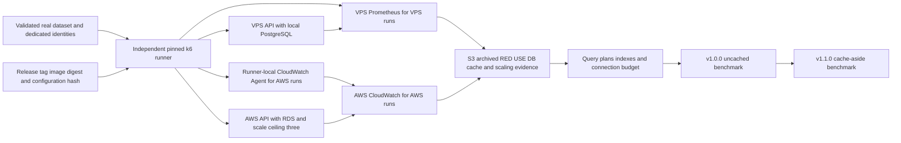

# k6 performance testing, release comparisons and implementation roadmap

**Status:** test design, not measured performance. The [capacity model](01-current-state-audit-and-capacity.md) contains assumptions, not achieved RPS. Use the [application contract](02-app-12factor-and-redis-design.md), [AWS lifecycle](03-hybrid-infrastructure-vps-and-aws-iac.md) and [telemetry contract](04-observability-lgtm-and-public-dashboard.md) together.

## 1. What is being measured



The primary cohort measures **real DB-backed reads**, not `/livez` throughput, paid model generation, or Tantivy search speed. Initially use 60% neutral `GET /v1/words/{word_id}`, 20% authenticated `GET /v1/me`, and 20% authenticated `GET /v1/study/progress?node_id=<owned-node>`. These owners are verified in [vocabulary routes](../../apps/api/pycil/vocabulary/api.py), [account routes](../../apps/api/pycil/account/api.py) and [study routes](../../apps/api/pycil/study/api.py). Each timed iteration makes exactly one business request, so its arrival rate equals offered business RPS.

Run additional cohorts separately, with their own names/results:

| Cohort | Existing operation / data requirement | Interpretation |
| --- | --- | --- |
| Search | `GET /v1/words:search?query=...`; representative exact/prefix/reference queries | Tantivy/filesystem performance; do not attribute this to DB cache wins |
| Hierarchy | `GET /v1/nodes/{node_id}/senses`; real authorized/public decks, bounded page size | Scope/ownership/projection cost; keep tree depth/size fixed |
| Study reads | Progress, activity, review schedule; dedicated real users and owned decks | DB/actor cost, different cacheability from neutral dictionary content |
| Study writes | `POST /v1/study:submitResults`; real existing question artifacts and valid ReviewBatch | Transactions/locks/idempotency; separate write rate and dataset reset |
| Provider/stream | Word generation, preparation that creates artifacts, grading and assistant | Paid provider latency/token cost/admission; small explicitly budgeted exercise only |

Reference import alone creates reference content, not necessarily generated application `word_ids`. Provision and validate real application words/decks/question artifacts **before** exporting the fixture. Reuse accepted product flows or validated real-data import, not fabricated IDs, mocked providers or new business-logic test flags. Keep paid generation/preparation outside stress/spike loops.

The fixture manifest contains: dataset/version/hash, valid generated word IDs, deck IDs with known scope/cardinality, dedicated test identities and their owned nodes, request distribution, hot/cold selection and a separate private token file. Do not commit tokens, user data, private fixtures or exported production rows. A release-specific OpenAPI document validates request schemas; exact study write bodies come from [ReviewBatch](../../apps/api/pycil/study/schemas.py), not guessed fields.

## 2. Independent runner and test preflight

Run k6 on a separate Linux workstation or disposable runner, initially **2 vCPU / 4 GiB**, with exact k6 **2.3.0** binary/image and a finite 1.5 CPU / 2 GiB container limit. Keep output under a bounded 2 GiB working directory and rotate local logs. Calibrate the generator: CPU below 70%, no swapping, adequate network, no dropped iterations at the target rate. Increase only the runner's resources when generator saturation invalidates a test; record the change. Never run k6 on this VPS, inside an application Fargate task, or as an unbounded cloud process. For AWS live metric export, budget a finite runner-local CloudWatch Agent separately, starting at 384 MiB / 0.25 CPU; stop it with the run and include its overhead in generator calibration.

Preflight is mandatory:

1. Confirm target hostname, image digest/tag, DB schema, selected release configuration, dataset hash and telemetry health. Record the UTC test interval and a bounded `run_id`; prohibit deploy/backup/rebuild during the run.
2. Validate representative responses against OpenAPI and ownership before timing. Check every word/node exists and authenticated reads return the expected account/scope. Do not count 401/404 fixture mistakes as system capacity failures.
3. Provision test accounts before timing, avoiding Clerk user provisioning/network requests in measured iterations. The current verifier requires real RS256 `iss/sub/exp` and configured `aud`, if present; it must remain unchanged.
4. Tokens must outlive the full scenario plus a five-minute margin. Clerk's native JWT templates support configurable lifetime; a pre-issued test token must have the same validated issuer/audience and dedicated test identity. Use only an approved test-identity policy, keep lifetime bounded (initially one hour), and destroy the private file after the run. Default session tokens are short-lived, so a pasted default token is inadequate for a 20-minute test. If the identity policy requires refresh, implement Clerk's documented session refresh in the k6 authentication helper, label those requests `workload=auth-control`, and exclude them from DB business SLIs while recording their generator overhead. Never disable signature/expiry validation. [Clerk JWT templates](https://clerk.com/docs/guides/sessions/jwt-templates).
5. Verify free disk/RAM, DB connections, telemetry ingestion, credit/TTL allowance, cancellation path and maintenance window. Start with smoke; approve higher arrival rates from actual lower-rate evidence. On live VPS, stress/spike requires a specific maintenance run with a recoverable dataset and operator monitoring.

### Cloudflare path control

For a normal edge-path run, use the requested API host, bypass CDN caching for API responses, and apply an expiring WAF exception scoped to **runner IP + exact hostname + test window**. Skip only the specific managed/rate challenges that obstruct the test; preserve application auth, origin restrictions and unrelated protection. Some bot/rate features are not skippable on every plan: verify actual entitlement rather than promise a global bypass. Record Cloudflare 403/429 separately from origin failures. [Cloudflare Skip rules](https://developers.cloudflare.com/waf/custom-rules/skip/).

For an origin-path run, temporarily allow only the runner's fixed IP to ALB/Caddy 443, preserve the intended hostname/SNI with a k6 `hosts` mapping or runner resolver, and use a publicly trusted certificate or explicitly trusted origin CA. A Cloudflare Origin CA certificate is not normally browser/system trusted. Do not set `insecureSkipTLSVerify` or expose database/monitoring ports. Revoke the temporary IP allowance after the run. Report `path=edge` versus `path=origin`; never compare one release through WAF with another directly.

## 3. Shared workload contract

Proposed files, created in the later implementation phase:

```text
tests/performance/k6/
  workload.js
  01-smoke-test.js
  02-load-test.js
  03-stress-test.js
  04-spike-test.js
  fixtures/README.md
scripts/run-k6.sh
```

The following shared module is a concrete **design example** for the read cohort. Its private fixture JSON has `word_ids`, `users` (each with `token`, `expires_at`, `node_id`) and `dataset_hash`, all exported from actual validated data. The wrapper verifies JWT claims/expiry, fixture schema and permissions before starting; this example does not implement token issuance or full response-schema validation. No sample tokens or fabricated fixture records are supplied.

```javascript
// tests/performance/k6/workload.js
import http from 'k6/http';
import exec from 'k6/execution';
import { check } from 'k6';
import { SharedArray } from 'k6/data';

const fixture = new SharedArray('real benchmark fixture', () => [
  JSON.parse(open(__ENV.FIXTURE_FILE)),
])[0];
const base = (__ENV.API_BASE_URL || '').replace(/\/$/, '');
if (!/^https:\/\//.test(base) || !['vps-docker', 'aws-fargate'].includes(__ENV.ENV)) {
  throw new Error('A validated HTTPS target and supported ENV are required');
}
if (!__ENV.VERSION || !__ENV.RUN_ID || !fixture.word_ids?.length || !fixture.users?.length) {
  throw new Error('Release, run ID and non-empty real fixtures are required');
}

export const shared = {
  tags: {
    env: __ENV.ENV, version: __ENV.VERSION, run_id: __ENV.RUN_ID,
    dataset: fixture.dataset_hash, workload: 'db-read', path: __ENV.TEST_PATH || 'edge',
  },
  systemTags: ['status', 'method', 'name', 'scenario', 'expected_response', 'error_code'],
  summaryTrendStats: ['avg', 'med', 'p(95)', 'p(99)', 'max'],
  thresholds: {
    http_req_failed: [
      'rate<0.01',
      { threshold: 'rate<0.05', abortOnFail: true, delayAbortEval: '1m' },
    ],
    http_req_duration: ['p(95)<300', 'p(99)<800'],
    checks: ['rate>0.99'],
  },
};

export function businessRead() {
  // A deterministic ten-request cycle preserves the 60/20/20 mix.
  const sequence = exec.scenario.iterationInTest;
  const user = fixture.users[(exec.vu.idInTest - 1) % fixture.users.length];
  if (Date.parse(user.expires_at) <= Date.now() + 60000) {
    exec.test.abort('Token expiry would invalidate this benchmark');
  }
  const slot = sequence % 10;
  const word = fixture.word_ids[Math.floor(sequence / 10) % fixture.word_ids.length];
  const path = slot < 6 ? `/v1/words/${word}`
    : slot < 8 ? '/v1/me'
    : `/v1/study/progress?node_id=${encodeURIComponent(user.node_id)}`;
  const name = slot < 6 ? '/v1/words/:id'
    : slot < 8 ? '/v1/me' : '/v1/study/progress';
  const response = http.get(base + path, {
    timeout: '5s', redirects: 0,
    headers: slot < 6 ? {} : { Authorization: `Bearer ${user.token}` },
    tags: { name },
  });
  check(response, { 'business HTTP 200': (r) => r.status === 200 });
}

export function handleSummary(data) {
  // The wrapper creates an empty bounded output directory before execution.
  return { 'summary.json': JSON.stringify(data, null, 2) };
}
```

Use stable route names; remove the default raw `url` system tag so IDs/query strings do not multiply time series or disclose private identifiers. Never label metrics with bearer tokens, user IDs, request IDs or trace IDs. `run_id`/dataset/release create bounded experiment cardinality; raw series expire under retention. This deterministic cyclic word selection is the first uniform dataset; use a fixed, versioned sequence of real hot/cold IDs for the cache-effect cohort, identical across releases. Identity verification still runs in every measured authenticated request.

Thresholds evaluate aggregates over elapsed test time; `delayAbortEval=1m` delays evaluation, it does **not** mean a rolling one-minute error window. The wrapper/operator also observes the 30-second resource/latency windows below. k6 failure gives a nonzero exit; do not treat a failed stress threshold as a successful SLO result. [k6 thresholds](https://grafana.com/docs/k6/latest/using-k6/thresholds/).

## 4. Four scenario designs

Arrival-rate executors offer load independently of server response time, avoiding the misleading falling request rate of a fixed-VU closed loop when the server slows down. Allocate enough VUs and record `dropped_iterations`; offered iterations are not completed RPS. No `sleep()` is needed in these paced one-request iterations. [k6 arrival-rate executor](https://grafana.com/docs/k6/latest/using-k6/scenarios/executors/ramping-arrival-rate/).

### `01-smoke-test.js`

```javascript
import { shared } from './workload.js';
export { businessRead as default, handleSummary } from './workload.js';
export const options = {
  ...shared,
  scenarios: { smoke: {
    executor: 'constant-arrival-rate', rate: 1, timeUnit: '1s', duration: '2m',
    preAllocatedVUs: 2, maxVUs: 5, gracefulStop: '10s',
  } },
  thresholds: {
    ...shared.thresholds, http_req_failed: ['rate==0'], checks: ['rate==1'],
    dropped_iterations: ['count==0'],
  },
};
```

Require healthy telemetry, expected data, zero authentication/contract errors and zero dropped iterations. Smoke establishes correctness, not capacity.

### `02-load-test.js`

```javascript
import { shared } from './workload.js';
export { businessRead as default, handleSummary } from './workload.js';
export const options = {
  ...shared,
  scenarios: { load: {
    executor: 'ramping-arrival-rate', startRate: 10, timeUnit: '1s',
    preAllocatedVUs: 50, maxVUs: 150, gracefulStop: '10s',
    stages: [
      { target: 10, duration: '2m' },
      { target: 50, duration: '1m' },
      { target: 50, duration: '10m' },
      { target: 75, duration: '1m' },
      { target: 75, duration: '5m' },
      { target: 10, duration: '1m' },
      { target: 10, duration: '2m' },
    ],
  } },
  thresholds: { ...shared.thresholds, dropped_iterations: ['count==0'] },
};
```

The first target is 50 RPS and the provisional peak 75 RPS. Judge **each plateau**, not only the whole-test summary, against p95 <300 ms, p99 <800 ms and errors <1%. Warm-up/recovery periods must not hide a peak failure. Conduct a later two-hour 50-RPS soak only after the short run succeeds and token refresh/disk growth are proven.

### `03-stress-test.js`

```javascript
import { shared } from './workload.js';
export { businessRead as default, handleSummary } from './workload.js';
const stages = [25, 50, 75, 100, 150].flatMap((target) => [
  { target, duration: '30s' }, { target, duration: '5m' },
]);
export const options = {
  ...shared,
  scenarios: { stress: {
    executor: 'ramping-arrival-rate', startRate: 10, timeUnit: '1s',
    preAllocatedVUs: 100, maxVUs: 300, gracefulStop: '10s',
    stages: [...stages, { target: 10, duration: '30s' }, { target: 10, duration: '3m' }],
  } },
};
```

Do not assume 150 RPS is safe or sufficient to find the limit. Stop at the first sustained failure/resource trigger; raising the ceiling is a separate measured experiment. Define breaking point as the first plateau with origin error ≥1%, p95 ≥300 ms for two consecutive one-minute windows, persistently increasing queue/pool wait, or dropped iterations after runner saturation has been excluded. Report the last passing plateau and the failure cause; do not advertise the peak offered rate as capacity. The cumulative 5% error abort is an additional safety brake, not the primary breaking-point definition.

### `04-spike-test.js`

```javascript
import { shared } from './workload.js';
export { businessRead as default, handleSummary } from './workload.js';
export const options = {
  ...shared,
  scenarios: { spike: {
    executor: 'ramping-arrival-rate', startRate: 10, timeUnit: '1s',
    preAllocatedVUs: 150, maxVUs: 300, gracefulStop: '10s',
    stages: [
      { target: 10, duration: '2m' },
      { target: 100, duration: '1s' },
      { target: 100, duration: '8m' },
      { target: 10, duration: '1s' },
      { target: 10, duration: '6m' },
    ],
  } },
};
```

On VPS, inspect queue recovery, timeouts, pool checkout and OOM risk. On AWS, record the ECS task-CPU alarm, desired/pending/running task count, image pull/local index rebuild/catch-up duration, ALB healthy targets and p95 recovery. ECS CPU-target autoscaling triggers only if task CPU crosses its target; a DB-bound spike may not scale API at all. Eight minutes is a starting hold, not a scale-out guarantee. Preserve the 1–3 steady task limit and budget up to six tasks during a separate 100%/200% rollout; do not deploy during a benchmark. Recovery returns to the original healthy state, not merely a completed test process.

**Safety aborts for all heavy tests:** memory available <15% for 30 seconds, cgroup memory >90%, disk <10 GiB or projected time-to-full <6 hours, archive backlog threatening the WAL reserve, origin errors >5%, persistent provider calls in a DB-only cohort, or expired AWS session/credits allowance. Stop load first and preserve telemetry; do not restart healthy services just to erase evidence. A kernel/container OOM, swap storm or disk exhaustion fails acceptance.

## 5. Environment-local live output and evidence preservation

### VPS: protected Prometheus remote write

Prometheus remote-write receiver is enabled **internally**; k6 reaches only the authenticated HTTPS ingestion route. Configure these in the runner's protected environment, without printing secret values:

```text
K6_PROMETHEUS_RW_SERVER_URL=https://telemetry.pycil.qninhdt.com/api/v1/write
K6_PROMETHEUS_RW_PUSH_INTERVAL=5s
K6_PROMETHEUS_RW_TREND_STATS=med,p(95),p(99),avg,count,sum
K6_PROMETHEUS_RW_STALE_MARKERS=true
K6_PROMETHEUS_RW_HTTP_HEADERS=<service-auth-and-origin-auth-headers-from-secrets>
```

Run contract, from a dedicated output directory on the independent runner:

```sh
k6 run --out experimental-prometheus-rw \
  --env API_BASE_URL=https://api.pycil.qninhdt.com \
  --env ENV=vps-docker --env VERSION=v1.0.0 \
  --env RUN_ID=<bounded-run-id> --env FIXTURE_FILE=<private-fixture-path> \
  <absolute-project-path>/tests/performance/k6/02-load-test.js
```

The wrapper supplies actual values and rejects missing placeholders. This remote-write path applies to VPS runs only. AWS uses the CloudWatch path below, with the same selected script/data distribution; never export an AWS run to VPS monitoring. `experimental-prometheus-rw` is the official requested output name and remains experimental in the current docs; pin k6 and validate its output contract before upgrades. The default trend-stat mode exposes per-series percentile gauges; do not average p95 gauges across independent runners. A single initial generator avoids that ambiguity; native histograms are a later explicitly validated aggregation choice. Static `env/version/run_id` tags must be present in actual received series. [k6 Prometheus output and headers](https://grafana.com/docs/k6/latest/results-output/real-time/prometheus-remote-write/).

### AWS: OpenTelemetry to CloudWatch

Run a bounded CloudWatch Agent on the independent runner, with a loopback-only OTLP metrics receiver and scoped temporary AWS credentials for the session. k6 uses its built-in `--out opentelemetry`; the Agent exports to that environment's CloudWatch namespace. This is a finite runner process, not an AWS monitoring host, public task collector or additional application sidecar. Track and stop it when the run ends; never expose collector ports or reuse broad deployment credentials.

Runner configuration starts with:

```text
K6_OTEL_EXPORTER_PROTOCOL=http/protobuf
K6_OTEL_HTTP_EXPORTER_ENDPOINT=127.0.0.1:4318
K6_OTEL_HTTP_EXPORTER_INSECURE=true
K6_OTEL_HTTP_EXPORTER_URL_PATH=/v1/metrics
K6_OTEL_SERVICE_NAME=pycil-k6
K6_OTEL_METRIC_PREFIX=k6_
```

HTTP without TLS is limited to runner loopback; AWS export uses verified TLS. The wrapper starts the pinned Agent with private configuration and runs:

```sh
k6 run --out opentelemetry \
  --env API_BASE_URL=https://aws-api.pycil.qninhdt.com \
  --env ENV=aws-fargate --env VERSION=v1.0.0 \
  --env RUN_ID=<bounded-run-id> --env FIXTURE_FILE=<private-fixture-path> \
  <absolute-project-path>/tests/performance/k6/02-load-test.js
```

Validate actual received attributes/dimensions, units, counter temporality, trend histograms, latency percentiles and rate calculations before a benchmark. k6's current OTel rate representation uses a counter with `condition=zero|nonzero`; do not copy old occurred/total queries. Limit exported dimensions and account for their CloudWatch charges. A successful collector export alone does not prove that backend percentile queries represent the original samples. Archive the authoritative k6 summary and bounded detailed output alongside CloudWatch chart data. [k6 OTel output](https://grafana.com/docs/k6/latest/results-output/real-time/opentelemetry/).

### Shared interpretation and archive

k6 measures client-end HTTP duration; app OTel measures server work. DNS/TLS/connection timing is available separately. Do not attribute edge/network changes to SQL optimization. The test client's aggregate summary cannot reconstruct an entire server trace. VPS Prometheus exemplars and AWS's separately validated CloudWatch trace/log navigation follow document 04; do not assume identical correlation controls.

Before raw expiry or workload teardown save: test exit code/summary, script/manifest hashes, UTC window, client/server RED data, pool/SQL/task/container/RDS/cache signals, scaling timeline and bill estimate. VPS exports populated Grafana snapshots plus CSV/JSON series; AWS exports CloudWatch dashboard definitions plus resolved chart data, metric results and representative sanitized traces/logs. Store verified archives and a private evidence catalog in the bounded S3 prefix. Share only reviewed aggregate charts. VPS finite retention and AWS managed retention differ; an archive preserves the comparison, not arbitrary queries over expired raw telemetry.

## 6. Release-based baseline and Redis comparison

The actual code already caches actor/content/artifacts. Calling the present branch “raw PostgreSQL” would be inaccurate. Prepare releases through direct, reviewable code changes at the relevant cache callers, using existing optional parameters/contracts; do not introduce a cache-toggle framework.

| Release / experiment | Code contract | Benchmark meaning |
| --- | --- | --- |
| Raw characterization, before the baseline tag | Instrumented selected DB reads bypass optional actor/content cache; required Redis leases/status remain | Identify real SQL/pool bottleneck before optimization; archive SHA/digest and query plans |
| `v1.0.0` — Baseline Raw DB | Same uncached cohort after measured DB/index/pool improvements; no new data-read cache | Publish a tuned PostgreSQL baseline with pre-tuning evidence, schema/config and plans |
| `v1.1.0` — Redis Cache-Aside | New isolated cache, identical optimized DB/query/schema foundation | Attribute incremental read benefit to Redis rather than simultaneous SQL changes |

If an already published `v1.0.0` is immutable, never move it; publish DB changes as `v1.0.1` and declare **that** exact release as the tuned comparator. Existing factory `version="1.0.0"` is API metadata, not evidence that a Git release tag exists. `service.version` comes from the actual release manifest.

For each environment:

1. Restore the same recorded dataset/backup replay point; provision equivalent test identities, word distribution, tree size and request mix. Keep PostgreSQL configuration, API limits, OTel sampling, retention, runner/location, network path and script identical.
2. Record cold-start separately. For steady-state comparison warm PostgreSQL buffers/Tantivy/JWKS in the same way for both releases; then populate the v1.1.0 Redis hot set through real reads. “Cold cache” means only the isolated cache keyspace is cold, not that production coordination was flushed.
3. Run smoke → load → approved stress/spike, and at least three repeat load runs with the same setup and run-length. Report median results and min/max variation; do not claim statistical significance from three samples. A VPS-vs-AWS comparison is descriptive because API CPU and managed storage differ; cache improvement is assessed within each environment.
4. Compare at fixed offered RPS first: completed RPS, p50/p95/p99, error %, SQL calls/request, pool wait, DB CPU/locks/I/O, API CPU/throttling/RSS, cache hit/miss/fallback and cost per successful 1,000 requests. Then compare the highest **passing** sustained plateau.
5. Cache failure exercise: stop/isolate only optional cache under a reviewed run; confirm correct DB responses and bounded cache timeout, observe DB capacity/fallback rate and recovery. Do not infer fail-open for mandatory leases. Cache hit ratio alone does not prove correctness or lower latency.
6. For AWS autoscaling, compare a fixed single task separately from the identical 1–3 ECS task-CPU policy. Until the [search acceptance gate](../../search_and_content_revisions.md#10-implementation-owners-and-acceptance) passes, use fixed vocabulary/reference data and quiesce generation jobs; verify the surviving index before restoring writes. Even with verified sync, keep benchmark data/write policy identical across releases. Record task/process count: one baseline task versus three cached tasks does not isolate cache value.

PostgreSQL tuning procedure: enable `pg_stat_statements` with bounded statistics; correlate slow trace spans with statement identity; inspect `EXPLAIN (ANALYZE, BUFFERS)` on an isolated equivalent dataset, especially recursive scopes and nested projections. Existing [word indexes](../../apps/api/pycil/vocabulary/models.py) already cover match-key prefix, aliases and sense ordering; do not duplicate them blindly. Add only plan-proven indexes through reviewed migrations; `CREATE INDEX CONCURRENTLY` requires its separate transaction handling. Bound queries/transactions, eliminate measured repeated reads, and enforce the combined SQLAlchemy/checkpoint pool budget. Introduce PgBouncer only if measurements show connection churn/fanout is the bottleneck and session/prepared-statement semantics are proven compatible; three small application tasks do not automatically justify another service.

`v1.1.0` uses the cache-aside/fail-open design in document 02: bounded keys/TTL/payload, real PostgreSQL fallback, commit-then-invalidate, and separate coordination storage. A timeout must cancel/complete the cache operation without leaking tasks. Reject stale authorization, cross-user values and corrupted cached DTOs in correctness tests before benchmarking.

## 7. Implementation roadmap and acceptance gates

This task publishes the design. The following ordered work begins only in the implementation phase; remote mutation has not been performed.

| Order | Work and owners | Acceptance evidence / rollback |
| --- | --- | --- |
| 1 — Resolve activation prerequisites | Nested Cloudflare edge certificate/plan; operator SSH/rescue access; AWS non-root role/credits; quota-capable VPS storage; dependency compatibility | TLS/exposure/IAM checks, filesystem quota proof, verified BOM; no public activation until passed |
| 2 — Application readiness | Files in document 02: canonical probes, bounded pools/admission, SDK/logging, shutdown, multi-stage image; preserve migration separation | Real DB/Redis outage tests, live remains 200, ready fails 503 for required deps, cache-only outage stays ready, SIGTERM drain test and non-root image smoke |
| 3 — VPS production and backup | Compose/Caddy/firewall/Fail2ban/resource limits; WAL-G/temporary credentials/encryption | Effective limits/port scan, ordinary blue-green request continuity, backup complete and isolated PITR drill; previous digest/rules/data preserved |
| 4 — VPS LGTM and safe sharing | One Alloy with embedded exporters, finite storage, correlation, provisioned dashboards/alerts/public routes | Prometheus exemplar → Tempo span → matching Loki log; no raw/private public APIs; notification and external watchdog receipt; 24-hour memory/disk soak |
| 5 — DevSecOps CI/CD | Extend current GHCR publish workflow; Sonar/Trivy, build-once ECR, OIDC, finite migration and rollback | Bad test/scan prevents promotion, wrong OIDC subject denied, digest equality, migration/candidate failure keeps active API, rollback exercise |
| 6 — Raw characterization and DB tuning | Independent k6 smoke/load; selected optional cache bypass; SQL plans/indexes/pool | Initial measured limits/bottleneck, before/after DB plans, stable dataset; publish tuned `v1.0.0` and evidence |
| 7 — AWS foundation/workload and search sync | Two state roots, private ECS/Fargate/ALB/RDS/Redis, per-task search, Agent/awslogs/Container Insights/CloudWatch; finite restore EC2, CodeBuild expiry; accepted content-revision/index-owner changes | ECS desired zero until validated restore; VPS single-writer takeover and independent AWS index replay/bootstrap/delete/history tests pass before mutable overlap; AWS requests/queries/alarms/archive/cleanup work without VPS; verified S3 evidence and empty paid residual inventory |
| 8 — AWS baseline/scaling | Same k6 suite, fixed-task and ECS Service Auto Scaling runs; CloudWatch live output | Scale timeline and constraints, RDS credit/connection data, six-hour alert and independent TTL cleanup drill, retained results after destroy |
| 9 — Redis release | Isolated cache-aside changes and fail-open; release `v1.1.0` | Correctness/invalidation/outage tests; matched three-run comparison on VPS and AWS; benefits/limits/cost documented |
| 10 — Recovery/operations review | Runbook incidents, recurring restore drill, dependency upgrades and retention checks | Measured RPO/RTO, backup/key recovery, no secret-bearing artifacts, drift/residual checks and maintained evidence catalog |

Before search synchronization acceptance, ECS scale-out/replacement tests require a verified fixed dataset and quiesced vocabulary-changing requests/jobs. The accepted update strategy is [one index owner consuming content revisions](../../search_and_content_revisions.md); passing its integration checks gates mutable multi-task operation, not merely choosing it in documentation. Do not run production stress before recovery/admission/telemetry are verified. Do not start Redis optimization before raw/DB-tuning evidence exists. Monitoring noise or a failed remote export invalidates an experiment rather than justifying claims without data.

### Why is this industry standard?

Open-model load generation, workload-specific SLIs, independent generators, immutable release comparisons, controlled datasets and measured query-plan tuning are conventional performance engineering. The design distinguishes offered/completed rate, generator saturation, shared DB constraints and autoscaling delay.

### Trade-offs

Synthetic workload ratios are hypotheses until production traffic informs them. Authentication/private fixtures require operational care; bypassing auth would change the measured system. VPS monitoring overhead, AWS Agent/export limits and small RDS can constrain results themselves. Three repeats provide useful variation, not rigorous confidence intervals. A cache can improve reads while leaving transactions, coordination and paid provider limits unchanged.

### Interview questions this design answers

- Why can fixed-VU testing conceal an overloaded server's real latency problem?
- How do you distinguish a load-generator limit from an application limit?
- How do you compare a cache release fairly without also changing SQL or replica count?
- Why might ECS task-CPU autoscaling not react to a DB-bound spike, and how do you prove it?
- What evidence makes a reported breaking point and retained benchmark credible?
