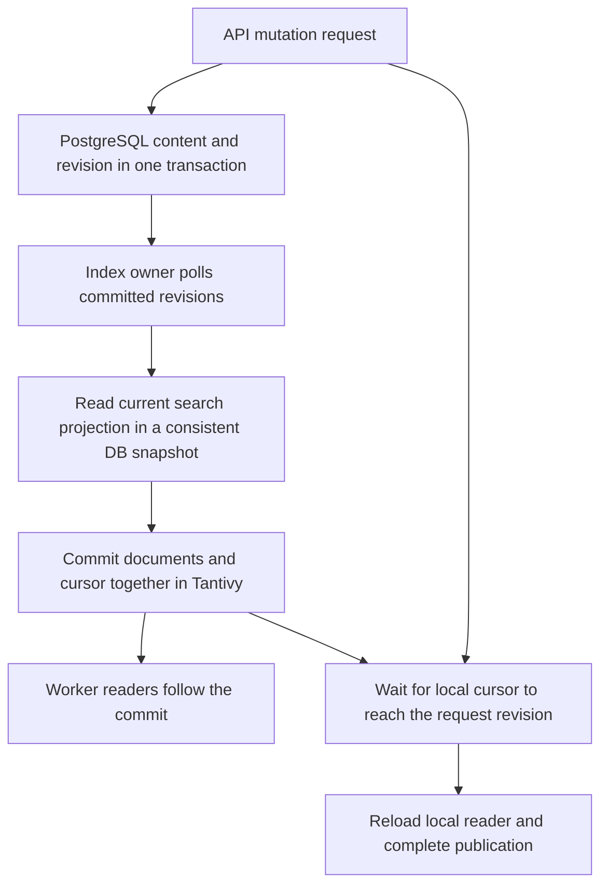

# Search and content revisions

**Decision:** accepted architecture, 15 October 2026. This document specifies application changes; it does not describe deployed behavior. The [DevOps overview](docs/devops-architecture/00-architecture-overview-and-standards.md) owns the infrastructure stack.

## 1. Outcome and boundaries

Keep PostgreSQL authoritative for content and history, and Tantivy as a rebuildable search projection. Support incremental additions, edits and deletions without rebuilding the entire dictionary for each word. Use the same application lifecycle on VPS and AWS, with one writer per index and multiple readers where appropriate.

Use existing PostgreSQL and local Tantivy storage. Do not introduce a search service, indexer container, Redis broker, EFS, custom Uvicorn supervisor or permanent cloud compute. An API worker runs one background task that either owns the writer and synchronizes, or waits to acquire ownership.

Content history covers the three entity types below. Model IDs, LLM provenance, per-table revision columns, automatic rollback and general event sourcing are outside this decision.

## 2. Supported content objects

| `entity_type` | Identity | Revision content |
| --- | --- | --- |
| `word` | `Word.id` | Word fields and its owned aliases, senses, definitions/examples including themed content, forms, patterns, collocations, reference links and outgoing word/sense relations |
| `question_artifact` | `QuestionArtifact.id` | Artifact type, structured payload, sense/theme links and ordering |
| `theme` | `Theme.id` | Key, name, voice and diction |

Vocabulary child rows belong to the `word` revision rather than becoming separate revision entity types. Preserve their IDs in the serialized content, with a deterministic representation and ordering. Related words/themes are referenced by ID, not recursively copied. Include semantic content, not cache state, generation retries, transient job status or credentials. Exclude derived hashes/internal bookkeeping when they carry no content meaning. Serialize artifact payloads as JSON values rather than escaped JSON strings.

Lock the affected content owner before computing its before/after representation. Concurrent writes to different children of the same word must not publish incompatible patches. A theme descriptor edit does not automatically regenerate existing themed content; preserve the current product behavior.

Cascade changes are real content changes: deleting a theme also records word patches for removed themed definitions/examples and tombstones for deleted artifacts. Deleting a word records its tombstone and those of removed artifacts. Capture affected objects before SQL cascade removes them and write all revisions in the same transaction.

Reference words/senses are currently immutable imported source data. They are not another revision entity type. A reviewed reference-artifact replacement uses the maintenance/rebuild procedure in section 9. User/library data, learning progress, assistant conversations and translations are outside this content-history scope.

## 3. One PostgreSQL revision table

```text
content_revisions
  id           bigint primary key
  entity_type  text
  entity_id    bigint
  op           jsonb
  created_at   timestamptz
```

`op` is a JSON Patch array, even when it contains only one operation. There is no separate `operation` or `diff` column. Validate the allowed entity types, positive entity IDs and patch-array structure. Index `(entity_type, entity_id, id)` for history; the primary key supports incremental scanning. Do not attach a cascading foreign key from history to the current entity: history must survive deletion.

Use Python `jsonpatch` for ordinary updates and historical replay. No full before/after pair is stored on every revision.

| Change | Stored `op` |
| --- | --- |
| Create or initial baseline | `[{"op":"add","path":"","value":{"lemma":"hello"}}]` — actual value contains the complete serialized entity |
| Edit a field | `[{"op":"replace","path":"/lemma","value":"hello"}]` |
| Remove a field | `[{"op":"remove","path":"/description"}]` |
| Delete the entity | `[{"op":"replace","path":"","value":null}]` |

Root `null` is the entity tombstone; nullable fields inside a live object remain ordinary content. Python `jsonpatch` rejects removal of the whole document, so entity deletion uses root replacement with `null`. Create and delete patches are explicit; ordinary updates come from comparing the locked before/after content. Do not append an empty patch for an unchanged object.

For existing content, create one baseline per entity in a bounded, reviewed migration/backfill while content mutations are paused. Enable the new mutation contract before resuming writes. This baseline describes the adoption-time state; it cannot recover earlier history. Do not have every API startup independently backfill revisions.

Historical content is reconstructed from the baseline through the requested entity revision. Current business tables remain the normal read authority. Revision IDs identify versions without adding a version column to every business table.

Keep the baseline and complete patch chain while historical reconstruction is required. The old seven-day search-log pruning proposal does not apply to this table. Measure history growth; no arbitrary pruning or snapshot-compaction subsystem is selected here.

## 4. Transaction and ordering contract

Every supported mutation writes its content revisions in the **same PostgreSQL transaction** as its business changes. A rollback publishes neither. Capture canonical-word reuse/reference-link branches as well as new generation, themed enrichment, artifact insertion/merge, edits and deletions. LLM calls and enrichment run outside the short publication transaction.

An incremental `id > cursor` scan requires committed revisions to appear in increasing ID order. Ordinary identity/BIGSERIAL allocation alone does not provide this: transaction A can allocate 10, transaction B commit 11, and A commit 10 after a poller advances to 11.

Use the existing PostgreSQL transaction-lock helper with one fixed content-revision publication key:

1. Acquire entity locks in a consistent order and complete business changes and before/after serialization.
2. Acquire the shared transaction-scoped publication lock immediately before inserting revisions.
3. Allocate revision IDs only after obtaining that lock; use a sequence with `CACHE 1`. Insert the affected revisions and commit promptly, retaining the lock through commit.
4. Acquire no further conflicting entity locks or perform provider work after taking the publication lock.

All revision-producing paths, including the one-time baseline, follow this rule. Rollback gaps are valid; consumers need ordered committed records, not gapless integers. `created_at` is for display, never the synchronization cursor. Concurrency tests must delay publishers and prove no committed lower ID is missed. Measure publication-lock wait before accepting the write-rate envelope.

## 5. One writer per index

| Environment | Local storage | Writer and polling | Readers |
| --- | --- | --- | --- |
| VPS, one API worker | One host-local directory | That worker owns the writer | One reader |
| VPS, four workers or overlapping compatible slots | Same host-local directory mounted into all workers | One worker owns the writer and polls; the others wait for ownership | One reader per worker |
| AWS Fargate | Independent ephemeral directory per task; one API worker/task | Each task owns its own writer and polls the same environment's revision table | One reader/task |

The ownership boundary is **the index directory**, not the server, deployment environment or PostgreSQL database. Independent AWS indexes must each receive every relevant revision. Do not claim a record globally or delete it after one index applies it.

Each worker starts one background ownership/synchronization task in the existing application resource lifecycle. The first worker able to open Tantivy's `IndexWriter` keeps that writer for its ownership lifetime. It alone builds and updates that directory. Standby workers serve from their readers and retry writer acquisition at a bounded interval, initially two seconds with jitter; they do not poll the revision table.

Use Tantivy's existing writer lock, not an additional leader file or a worker ID. Uvicorn does not expose a stable application worker slot `0`. Writer commits do not relinquish ownership. The current per-update `wait_merging_threads()` consumes/releases the writer; move writer teardown to ownership shutdown rather than calling it after every batch.

Readers use the existing OnCommit reload policy. Explicitly reload before checking a publication receipt. A fresh searcher observes the new commit; an already-running query may complete against its previous snapshot.

## 6. One update path



Replace request-side direct writes with a request to **wait for publication through the index owner's path**. Preserve the existing success condition for word generation: committed content is searchable in the responding worker before publication succeeds. A worker that owns the index still uses this same path; it does not run a second direct-update route.

After DB commit, retain the revision ID that must be visible. Wait asynchronously with a bounded deadline for the local index cursor to reach it, then reload the local reader. Waiting holds no DB transaction/connection. A timeout reports delayed/failed search publication without implying the already committed content was rolled back. Preserve canonical-word retry/reuse behavior; retries must not buy generation again or invent a duplicate revision when content is unchanged.

A content mutation that does not affect search does not need a search-publication receipt. Search publication in the responding task does not guarantee immediate visibility on every other AWS task.

### Incremental batch processing

The index owner polls approximately every two seconds, initially with a maximum of 100 revision records per batch. These are tuning values, not latency guarantees.

1. Open a short repeatable-read snapshot on the primary PostgreSQL. Read the next bounded batch after the index cursor.
2. Identify affected word IDs and old/new reference links from the revision chain and current data. Coalesce repeated changes to one word within the batch.
3. Load the current search projection in the same DB snapshot. Reuse the existing document builder; do not replay historical JSON Patch directly into Tantivy.
4. Delete affected word identities, add currently eligible DONE-word documents, remove consumed reference hits and restore old/unlinked reference hits only when no DONE word consumes them.
5. Replace an internal cursor metadata document and commit it **together with the document updates**, then reload. The cursor advances only through the successfully processed batch.

When the snapshot contains later committed changes to an affected word, publishing its current state is acceptable; later batches may replace it again. Never move the cursor past unprocessed records. Artifact/theme revisions advance scanning progress but do not themselves create search documents. A word revision that only changes definitions/examples may leave its search projection unchanged.

The cursor belongs to the index, not process memory or a separate cursor file. Reuse the existing metadata-document pattern and keep internal documents out of business search results. Commit visibility gives either the prior documents/cursor or the new documents/cursor. Failed batches retain the previous committed checkpoint; replacement operations are safe to replay. Do not claim universal exactly-once execution.

## 7. Startup, takeover and shutdown

**Existing compatible VPS index:** the owner reads its committed cursor and catches up to a recorded DB high-water mark. Standby readers wait for valid initialization/catch-up before readiness. The old count/max-ID fingerprint is insufficient for deciding that a mutable index is current.

**Fresh directory/Fargate replacement:** the owner builds from a consistent PostgreSQL snapshot and records that snapshot's revision high-water mark in the same initial commit. Replay later revisions committed during the build to a subsequently captured high-water mark before readiness. Keep polling afterward. Build from current content, not the entire historical patch chain.

**Owner process crash:** on the tested local disk-backed binding, process death releases writer ownership. A standby worker acquires the writer, reloads the committed cursor and resumes; it does not rebuild a valid index merely because ownership changed. No process ID or stable Uvicorn slot is required.

**Indexer task failure without process death:** retain ownership while retrying bounded transient DB failures with backoff. For fatal indexing/corruption errors, close/drop the writer and fail the worker or remove search readiness; do not silently leave a dead background task holding the writer. A hung process may still hold the lock until terminated; monitor progress rather than relying only on Uvicorn's process heartbeat.

**Shutdown:** stop accepting mutation work through the existing drain policy, cancel/join generation work, then stop/join the index task and close the writer before closing DB resources. Join native work on cancellation using the existing `_native` pattern. Existing readers can keep serving the last committed snapshot during short takeover; sustained reconciliation failure must be visible in readiness and monitoring.

On AWS with one worker/task, ECS replaces a failed task; Uvicorn has no separate child supervisor in single-worker mode. The replacement builds its own index from RDS. No existing task-local disk is assumed to survive.

## 8. Consistency and observability

Normal cross-task search is eventually consistent, with a provisional five-second normal-load visibility target. Polling interval plus queue/build/DB time determines actual lag; provider generation latency is separate. A local publication receipt does not provide arbitrary-replica read-after-write consistency.

Keep liveness separate from readiness. Readiness requires initialized compatible search and no sustained reconciliation failure; use a provisional 30-second pending-change/progress threshold, calibrated against real traffic. Compare the committed DB revision head with the local index cursor: an idle dictionary whose cursor equals the head is not stale because its last commit is old. This lets standby VPS readers assess shared progress without another background revision poller or heartbeat file. Successful empty polls count as reconciliation success for the owner; no index commit is needed just to refresh an idle heartbeat.

Measure index-owner presence, last successful reconciliation, pending revision/visibility lag, batch errors/duration, ownership takeover, publication wait/timeouts and rebuild duration/CPU/RAM/disk. Use the existing OTel pipeline: VPS Alloy/LGTM, AWS CloudWatch Agent/CloudWatch. Do not label metrics with word IDs, revision IDs or unbounded histories.

## 9. Maintenance, capacity and rollout

Reference-artifact replacement, schema-version changes and DB restore require reviewed index invalidation. Pause content changes, stop/restart index-owning workers and remove/rebuild only derived index directories in the affected environment. After restoring an older DB, never reuse a later local cursor. AWS task replacement naturally supplies fresh directories; VPS restore explicitly invalidates them. No dataset-epoch table or shared-file snapshot distribution is selected.

Reference-only measurements used 103,426 reference words / 157,309 documents: about 17 MiB completed files, 34 MiB sampled rebuild file-size peak and 160 MiB peak Python-process RSS including imports (roughly 70 MiB imported baseline). These exclude generated vocabulary, full API load and disk blocks of unlinked/mapped files; they are not worst-case bounds. VPS shares disk files but each API worker still consumes reader/application memory. AWS pays rebuild and storage per task. Use the [resource budgets](docs/devops-architecture/01-current-state-audit-and-capacity.md) and [Fargate envelope](docs/devops-architecture/03-hybrid-infrastructure-vps-and-aws-iac.md#aws-application-task), then measure real load.

Roll out the additive revision schema and baseline with content writes paused; deploy only compatible revision-producing writers before resuming mutable traffic. Do not mix an old application that writes no revisions or writes Tantivy directly with the new owner model. Until synchronization acceptance passes, AWS overlap/scaling labs use a fixed dataset and quiesced generation jobs. Rollback pauses writes, returns to a compatible verified release and rebuilds as needed; preserve history and committed business data.

## 10. Implementation owners and acceptance

| Owner | Required change |
| --- | --- |
| [Vocabulary models](apps/api/pycil/vocabulary/models.py) and API migrations | Shared revision storage/migration and deterministic word serialization; no per-table version columns |
| [Generation pipeline](apps/api/pycil/vocabulary/generation/pipeline.py) and themed-content publication | Capture revisions in all publication/reuse/link branches; replace direct writes with bounded publication waiting |
| [Artifact storage](apps/api/pycil/study/artifacts/storage.py) | Capture inserts, singleton merges/updates and deletions atomically |
| [Theme service](apps/api/pycil/themes/service.py) | Capture descriptors and cascade-affected content in the same transaction |
| [SearchIndex](apps/api/pycil/vocabulary/search.py) | Lifetime writer ownership, polling, consistent projections, reference restoration, atomic cursor, bootstrap/takeover and reader publication receipts |
| [Application resources](apps/api/pycil/app/resources.py) and readiness | One ownership task/worker, finite cleanup, progress health and shared OTel signals |
| Existing vocabulary/study/theme/lifespan tests | Real PostgreSQL transactions and temporary Tantivy directories; no fake synchronization backend |

Acceptance must cover:

- Four VPS processes sharing a directory: one active poller/writer, all readers see additions/edits/deletions, and no fourfold revision application.
- Two independent directories: each applies all relevant changes; one disconnected replica catches up without a full rebuild.
- Request publication and polling use one write path; canonical retries, local visibility and bounded timeout preserve committed content.
- Entity patches reconstruct create/edit/delete history, including themed enrichment and cascade effects; rolled-back transactions produce no history.
- Delayed concurrent commits cannot be skipped; consistent projections do not mix incompatible reads.
- Crash before/after commit, forced owner death and cancelled native work preserve cursor/document consistency and allow takeover.
- Writes during bootstrap, schema/reference replacement and older-DB restore recover safely; artifact/theme-only changes do not create search documents.
- Measure polling/lock/pool cost, startup/takeover, publication wait, visibility targets and rebuild/storage peaks under the declared resource envelope.

The native local checks already demonstrated writer exclusion, commit-coupled metadata and writer reacquisition after SIGKILL. They do not establish PostgreSQL ordering, complete application integration or production latency.

## References

- [JSON Patch RFC 6902](https://www.rfc-editor.org/info/rfc6902/) and [Python jsonpatch](https://python-json-patch.readthedocs.io/en/latest/tutorial.html).
- [Tantivy writer API](https://docs.rs/tantivy/latest/tantivy/index/struct.Index.html) and [Python commit/reload API](https://tantivy-py.readthedocs.io/en/latest/api/tantivy/tantivy.html).
- [PostgreSQL sequence semantics](https://www.postgresql.org/docs/current/functions-sequence.html) and [transaction advisory locks](https://www.postgresql.org/docs/current/explicit-locking.html#ADVISORY-LOCKS).
- [Transactional outbox principle](https://docs.aws.amazon.com/prescriptive-guidance/latest/cloud-design-patterns/transactional-outbox.html): durable change capture belongs in the business transaction; consumers must tolerate retries.
